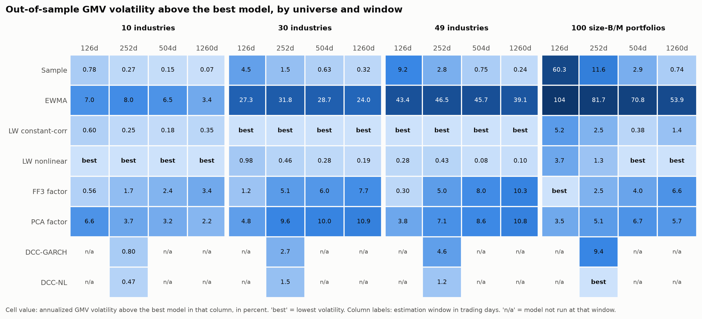
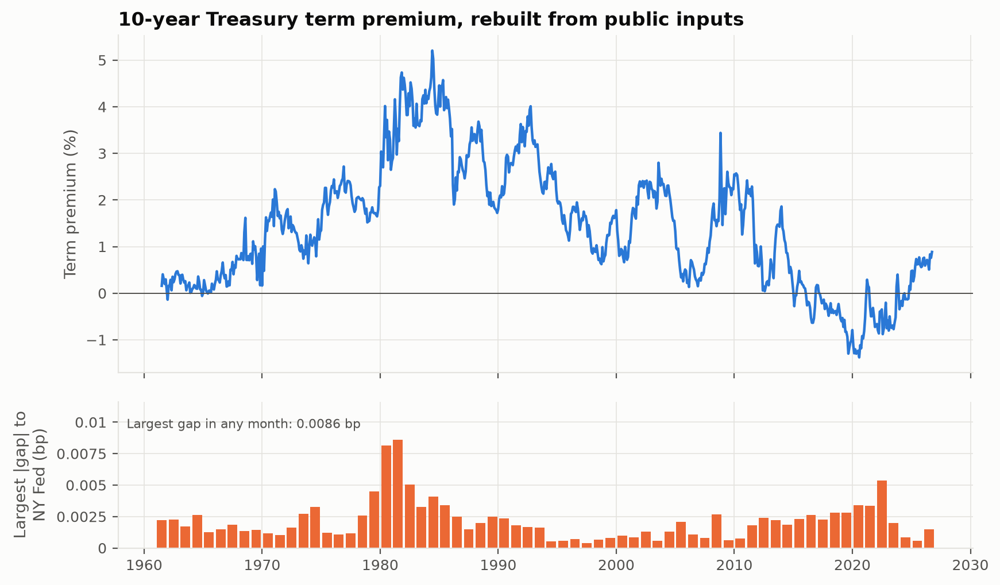
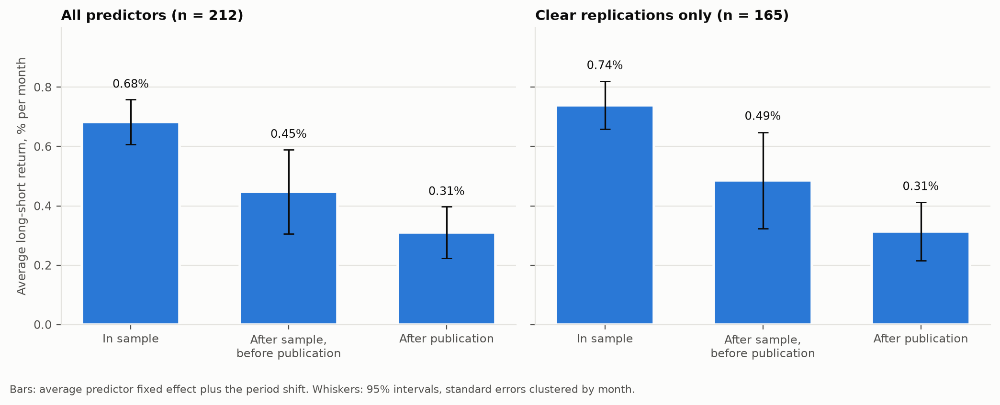
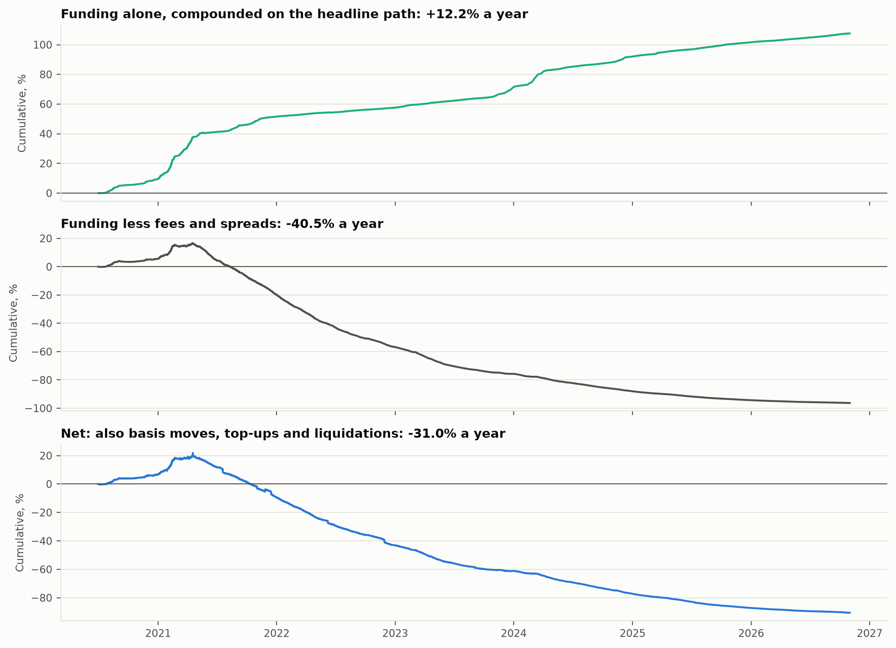
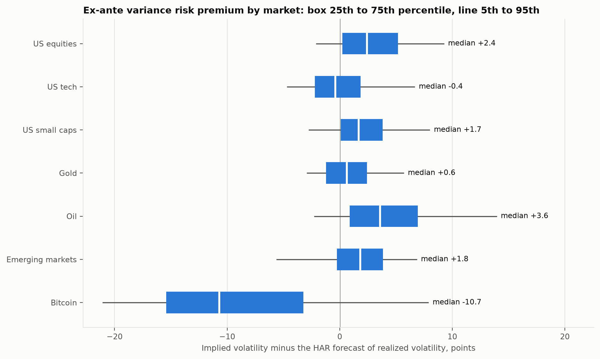
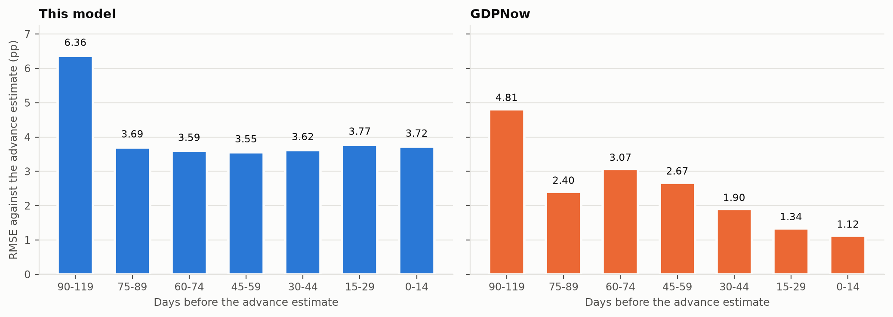

# Quantitative research projects

Empirical finance and econometrics projects by Ian Wachira. Each folder is a standalone project with its own code, tests, CI, results and paper. Every number in a project README is rendered from that project's `results.json`, built from the public source data, and CI fails if the two disagree or if the results came from synthetic test data.

## Projects

| Project | Question | CI |
| --- | --- | --- |
| [Covariance horse race](covariance-horse-race) | Which covariance forecast gives the lowest out-of-sample risk on a century of daily US portfolio returns, and which models are statistically tied? | [](https://github.com/TJT-Pro/Quantitative-research-projects/actions/workflows/covariance-horse-race.yml) |
| [The term premium, rebuilt](acm-term-premium) | Can the NY Fed's ACM Treasury term premium be reproduced exactly from public data, how different was it in real time, and does it predict bond returns? | [](https://github.com/TJT-Pro/Quantitative-research-projects/actions/workflows/acm-term-premium.yml) |
| [The factor zoo on trial](factor-zoo-trial) | How much of a published equity anomaly's return survives publication, how many survive multiple-testing corrections, and do they replicate outside the US? | [](https://github.com/TJT-Pro/Quantitative-research-projects/actions/workflows/factor-zoo-trial.yml) |
| [What funding carry actually pays](perp-funding-carry) | What does the long-spot, short-perpetual funding trade on Binance earn after fees, spreads, basis moves and liquidations, and can funding be forecast? | [](https://github.com/TJT-Pro/Quantitative-research-projects/actions/workflows/perp-funding-carry.yml) |
| [The variance risk premium across seven markets](cross-asset-vrp) | How large is the gap between implied and realized variance across equity, commodity, emerging-market and bitcoin options, does it predict returns, and does sizing a short volatility position by it pay once crashes are included? | [](https://github.com/TJT-Pro/Quantitative-research-projects/actions/workflows/cross-asset-vrp.yml) |
| [A real-time GDP nowcast against GDPNow](realtime-nowcast) | Can a dynamic factor model that sees only the data as they were first published match the Atlanta Fed's GDPNow, and do Treasury yields react to its news? | [](https://github.com/TJT-Pro/Quantitative-research-projects/actions/workflows/realtime-nowcast.yml) |

### [Covariance horse race](covariance-horse-race)

Estimators from the sample covariance through Ledoit-Wolf shrinkage, factor models and DCC-GARCH forecast next-month risk for minimum-variance portfolios on Kenneth French daily data. Models are separated with the Model Confidence Set and checked against a simulation where the true covariance is known. Read the [results](covariance-horse-race#readme) or the [paper (PDF)](covariance-horse-race/paper/_output/paper/paper.pdf).

[](covariance-horse-race#readme)

### [The term premium, rebuilt](acm-term-premium)

The Adrian-Crump-Moench model is rebuilt from the Federal Reserve Board's Gurkaynak-Sack-Wright yield curve and checked against every series the NY Fed publishes. It is then re-estimated month by month as a user would have seen it at the time, tested as an out-of-sample predictor of bond excess returns against the Cochrane-Piazzesi factor, and used to split long-yield moves on policy-rate change days into expected short rates and term premium. Read the [results](acm-term-premium#readme) or the [paper (PDF)](acm-term-premium/paper/_output/paper/paper.pdf).

[](acm-term-premium#readme)

### [The factor zoo on trial](factor-zoo-trial)

Every published US predictor in Open Source Asset Pricing is put through the McLean-Pontiff decay regression, six multiple-testing procedures including a whole-month bootstrap, and the Jensen-Kelly-Pedersen empirical Bayes model on Global Factor Data in every country. The US posterior is then scored as a forecast of each other country's alphas, and every procedure is checked in a simulation with known truth. Read the [results](factor-zoo-trial#readme) or the [paper (PDF)](factor-zoo-trial/paper/_output/paper/paper.pdf).

[](factor-zoo-trial#readme)

### [What funding carry actually pays](perp-funding-carry)

Every USDT perpetual on Binance with a spot pair, including contracts since delisted, is rebuilt from Binance Vision. Funding prints are first reproduced from the 1-minute premium index, then the trade is simulated bar by bar with isolated margin checked against mark-price highs, trading costs measured from order-book quotes, and three margin paths. Funding forecasts are scored walk-forward against persistence, a cross-sectional carry portfolio is compared with BTC and ETH alone, and venue failure is priced as a scenario across Binance, Bybit and OKX. Read the [results](perp-funding-carry#readme) or the [paper (PDF)](perp-funding-carry/paper/_output/paper/paper.pdf).

[](perp-funding-carry#readme)

### [The variance risk premium across seven markets](cross-asset-vrp)

Implied variance from Cboe's volatility indices and Deribit's DVOL is set against the variance that followed over 30 calendar days, each matched to the instrument its options are written on, with realized variance forecast by a HAR model on range estimators checked against Heston paths and bitcoin minute data. The premium is tested as a predictor of returns, sold in constant-maturity VIX futures under three sizing rules, and replicated as a bitcoin variance swap from Deribit's full trade history. Read the [results](cross-asset-vrp#readme) or the [paper (PDF)](cross-asset-vrp/paper/_output/paper/paper.pdf).

[](cross-asset-vrp#readme)

### [A real-time GDP nowcast against GDPNow](realtime-nowcast)

A Python port of the New York Fed's staff nowcasting model, which reproduces their own estimates on their example vintage, is re-estimated month by month on the data exactly as ALFRED recorded them on each day, with Lenza-Primiceri scaling for the pandemic months. Its nowcasts are scored against GDPNow on the days GDPNow published, every revision is split into the news from each release, and that news is tested against the same-day move in Treasury yields. Read the [results](realtime-nowcast#readme) or the [paper (PDF)](realtime-nowcast/paper/_output/paper/paper.pdf).

[](realtime-nowcast#readme)

## Running a project

Each project uses [uv](https://docs.astral.sh/uv/). From the repository root, one command at a time, with the project's folder and command name:

| Project | Folder | Command |
| --- | --- | --- |
| Covariance horse race | `covariance-horse-race` | `chr` |
| The term premium, rebuilt | `acm-term-premium` | `acm` |
| The factor zoo on trial | `factor-zoo-trial` | `fzt` |
| What funding carry actually pays | `perp-funding-carry` | `pfc` |
| The variance risk premium across seven markets | `cross-asset-vrp` | `vrp` |
| A real-time GDP nowcast against GDPNow | `realtime-nowcast` | `rtn` |

```
cd acm-term-premium
uv sync
uv run acm results
uv run acm check
uv run acm check-provenance
```

The project README lists what each command does.

## License

MIT. See [LICENSE](LICENSE).
