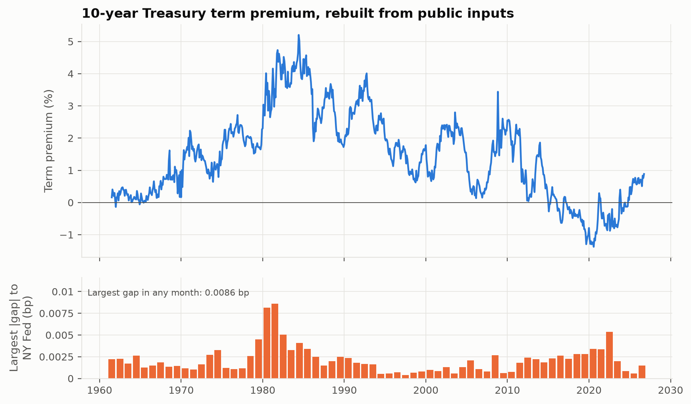
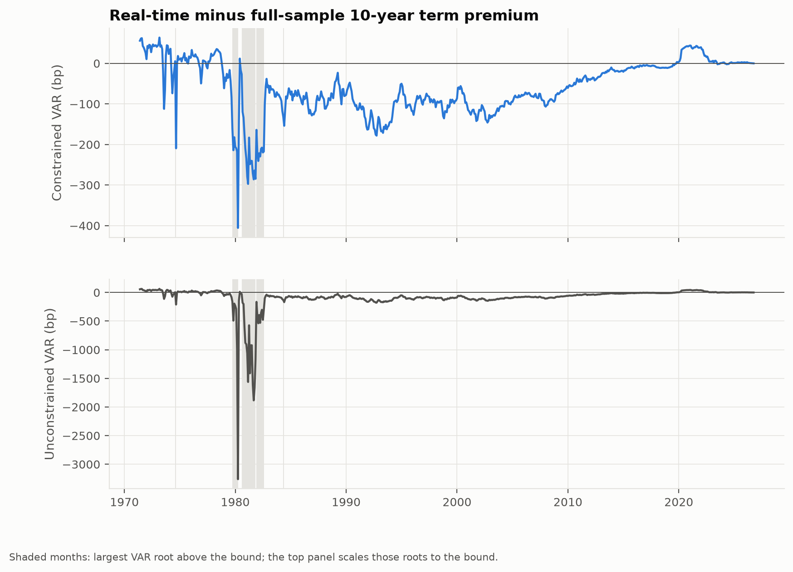
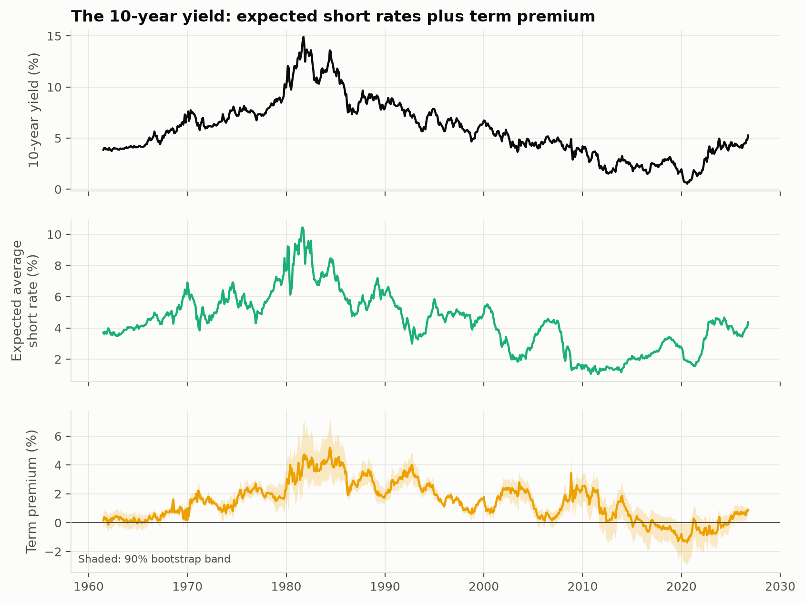
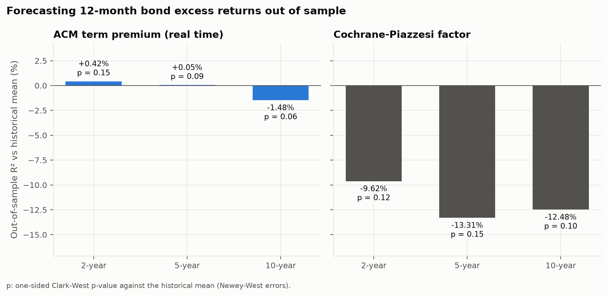
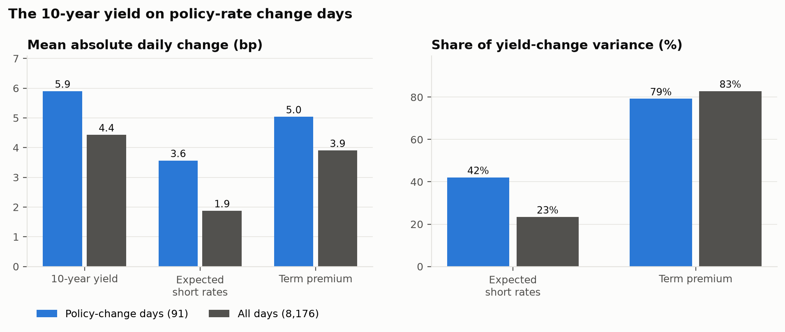

# The term premium, rebuilt and stress-tested

Can the NY Fed's Adrian-Crump-Moench Treasury term premium be rebuilt exactly from public data, how different did it look to someone estimating it at the time, and does it predict bond returns?

| | |
| --- | --- |
| Replication | Every published series, every maturity from 1 to 10 years, all 784 months from 1961 to 2026: largest gap **0.0087 bp** |
| Textbook equations instead | 10-year term premium off by 6.3 bp |
| Estimated in real time | 10-year term premium 69 bp from the published history on average, up to 406 bp (1980-03) |
| Forecasting 12-month bond returns | Real-time term premium: out-of-sample R² -1.48% to 0.42%, none significant at 5%. Cochrane-Piazzesi: -13.3% to -9.6% |
| Policy-rate change days | Term premium carries 79% of the 10-year yield's variance (91 days) |
| Latest 10-year term premium | 0.88% on 2026-09-30 (90% band 0.58% to 1.18%) |
| Data | Federal Reserve Board, NY Fed and FRED files, every download SHA-256 hashed in [`data/manifest.json`](data/manifest.json) |



*Top: 10-year term premium from this code, end of month, 1961 to 2026. Bottom: the largest absolute gap to the NY Fed's published series in each year. RMSE 0.0018 bp, largest 0.0086 bp. On the daily series (16,305 days) the largest gap is 0.0094 bp.*

## Question, data, method

The term premium is the extra yield investors demand for holding a long bond instead of rolling short ones. It cannot be observed, so it has to be estimated, and the NY Fed's ACM series has become the reference estimate.

Inputs are the Gurkaynak-Sack-Wright daily Svensson curve from the Federal Reserve Board and, to repair the curve's unreliable short end before 1982, the effective fed funds rate. The model is ACM (2013): 5 principal components of yields, a VAR for their dynamics, a regression of one-month bond excess returns on the VAR innovations and lagged factors, prices of risk from that regression's cross-section, and affine pricing recursions run once with those prices of risk and once without. The term premium is the difference.

## What it takes to match the published series

The textbook estimator gets the fitted yields right but not the term premium. Matching the published numbers needs two conventions that the paper does not spell out, found by testing candidate definitions against the published series:

1. The VAR intercept is folded into the innovations, so the pricing recursions run with a zero drift. Only the drift minus the price of risk enters fitted yields, so they are unchanged; the risk-neutral leg moves.
2. The recursion starts at the one-month bond with no convexity term, and the factor covariance uses T - 1 degrees of freedom.

With the textbook equations instead, the 10-year term premium is 6.30 bp lower on average, with a largest gap of 6.30 bp. Using the raw GSW one-month yield instead of the fed funds repair moves it by 12.0 bp on average and up to 29 bp. Every run estimates both conventions and both short-rate treatments.

| Decade | RMSE (bp) | Max abs (bp) |
| --- | ---: | ---: |
| 1960s | 0.0012 | 0.0026 |
| 1970s | 0.0016 | 0.0045 |
| 1980s | 0.0032 | 0.0086 |
| 1990s | 0.0010 | 0.0023 |
| 2000s | 0.0008 | 0.0027 |
| 2010s | 0.0018 | 0.0028 |
| 2020s | 0.0020 | 0.0054 |

*10-year term premium against the NY Fed by decade. The full table for every series and maturity is in [`reports/tables/validation.md`](reports/tables/validation.md).*

## What a user could have known at the time

The published series is re-estimated on the full sample every month, so its history is rewritten as data arrive. Here the model is re-estimated on an expanding window ending at each month from 1971, factors included, and only that month's estimate is kept.



*Real-time minus full-sample 10-year term premium. Correlation between the two series: 0.88.*

| Decade | Mean abs revision (bp) |
| --- | ---: |
| 1970s | 36.3 |
| 1980s | 115.4 |
| 1990s | 108.7 |
| 2000s | 95.0 |
| 2010s | 20.5 |
| 2020s | 14.4 |

In 31 windows ending between 1974-08 and 1984-05, the estimated VAR had a root at or above the bound of 0.995 (largest 1.0193). Near or past a unit root, 10-year expectations barely mean-revert, and the unconstrained real-time term premium misses the published one by up to 3,261 bp. Those windows are re-estimated with every root above the bound pulled down to it, a half-life of about 11.5 years. The full-sample model is never constrained, so the replication above is unaffected.

## The decomposition, with its uncertainty



*Fitted 10-year yield, expected average short rate and term premium, with a 90% band from a 500-draw moving-block bootstrap (24-month blocks) of the whole estimator. Median band width: 122 bp.*

## Does the term premium predict bond returns?

Every month from 1982 to 2025, 12-month excess returns on 2-year, 5-year and 10-year bonds are forecast with the real-time term premium of the same maturity, with the Cochrane-Piazzesi (2005) forward-rate factor, and with the historical mean. Each forecast uses only returns realized by its date.



| Bond | Predictor | Months | OOS R2 (%) | Clark-West | p-value |
| --- | --- | --- | ---: | ---: | ---: |
| 2-year | ACM term premium (real time) | 522 | 0.42 | 1.03 | 0.152 |
| 2-year | Cochrane-Piazzesi factor | 522 | -9.62 | 1.20 | 0.115 |
| 5-year | ACM term premium (real time) | 522 | 0.05 | 1.34 | 0.090 |
| 5-year | Cochrane-Piazzesi factor | 522 | -13.31 | 1.03 | 0.151 |
| 10-year | ACM term premium (real time) | 522 | -1.48 | 1.59 | 0.056 |
| 10-year | Cochrane-Piazzesi factor | 522 | -12.48 | 1.26 | 0.104 |

*Out-of-sample R² is relative to the historical mean (Campbell and Thompson, 2008). Clark-West (2007) statistics use Newey-West errors with 12 lags because the 12-month returns overlap.*

## Policy-rate change days

On the 91 days from 1994 to 2026 when the federal funds target or the top of its range changed (52 increases, 39 cuts), the daily 10-year yield is decomposed with the model a user had at the end of the previous month.



*Policy-change days against all 8,176 trading days of the same period. Adding twice the covariance of the two components (-18% on change days, -3% on all days) to the two shares gives 103% and 103%; the model's fitting error accounts for the difference from 100%.*

| | Change days | All days |
| --- | ---: | ---: |
| Mean absolute change in the yield | 5.9 bp | 4.4 bp |
| ... in expected short rates | 3.6 bp | 1.9 bp |
| ... in the term premium | 5.0 bp | 3.9 bp |
| Share of yield-change variance from expected short rates | 42% | 23% |
| Share of yield-change variance from the term premium | 79% | 83% |

## Limitations, and what was built around them

- **The GSW curve's short end is an extrapolation before 1982.** The one-month yield is repaired from the fed funds rate, as in the published series, and the raw-curve alternative is run every time with its effect reported above.
- **Small real-time samples can produce a VAR with no mean reversion.** Those windows are constrained to a stated bound, counted and shown, with the unconstrained path plotted in its own panel.
- **The bootstrap holds the factor definition fixed.** The ACM estimator is invariant to invertible affine changes of the factors, so this loses nothing for yields and term premia; 24-month blocks keep the joint dynamics together.
- **Policy days before 1994 are excluded.** Until then decisions were not announced, so the change day was not an information event.
- **The sources revise history.** Every download is hashed in [`data/manifest.json`](data/manifest.json). `uv run acm fetch` revalidates each file with a conditional GET and lists any file whose content changed in `data/changed.txt`; `uv run acm results` then rebuilds every number on this page from the revised data.

## Reproduce

Requires [uv](https://docs.astral.sh/uv/) and, for the PDF, [Quarto](https://quarto.org). Run from this folder, one line at a time; the same commands work in PowerShell, cmd, bash and zsh:

```
uv sync
uv run acm results
uv run acm check
uv run acm check-provenance
```

`acm results` downloads and verifies the sources, builds the curves, runs every estimate and rebuilds the figures, this README and the paper. `acm check` runs lint, strict type checking, the tests and the README drift check. `acm check-provenance` fails if the results came from the synthetic CI fixture. `uv run acm --help` lists each stage.
The estimation behind this page took 21 seconds (Python 3.12.10, 12 CPUs).

## Layout

| Path | Contents |
| --- | --- |
| [`configs/research.yaml`](configs/research.yaml) | Every research choice with its reason |
| [`src/acm_term_premium/data`](src/acm_term_premium/data) | Resumable downloads with a SHA-256 manifest; parsers; the Svensson curve; the short-end repair |
| [`src/acm_term_premium/models/acm.py`](src/acm_term_premium/models/acm.py) | The estimator, both conventions, the stationarity bound and the bootstrap |
| [`src/acm_term_premium/evaluation`](src/acm_term_premium/evaluation) | Real-time estimates, out-of-sample forecasts, policy days |
| [`reports/`](reports) | Figures, tables and `results.json` |
| [`paper/`](paper) | Full write-up |

## References

- Adrian, T., Crump, R. K. and Moench, E. (2013). Pricing the term structure with linear regressions. *Journal of Financial Economics* 110(1), 110-138.
- Campbell, J. Y. and Thompson, S. B. (2008). Predicting excess stock returns out of sample. *Review of Financial Studies* 21(4), 1509-1531.
- Clark, T. E. and West, K. D. (2007). Approximately normal tests for equal predictive accuracy in nested models. *Journal of Econometrics* 138(1), 291-311.
- Cochrane, J. H. and Piazzesi, M. (2005). Bond risk premia. *American Economic Review* 95(1), 138-160.
- Gurkaynak, R. S., Sack, B. and Wright, J. H. (2007). The U.S. Treasury yield curve: 1961 to the present. *Journal of Monetary Economics* 54(8), 2291-2304.

Data: Board of Governors of the Federal Reserve System (GSW curve, H.15); Federal Reserve Bank of New York (ACM term premia, used only as the validation target); Federal Reserve Bank of St. Louis (FRED). This project is not affiliated with any of them.

<sub>Generated 2026-11-04T07:46:52+00:00 from configuration `cb7fadbe4c9882e8`.</sub>
