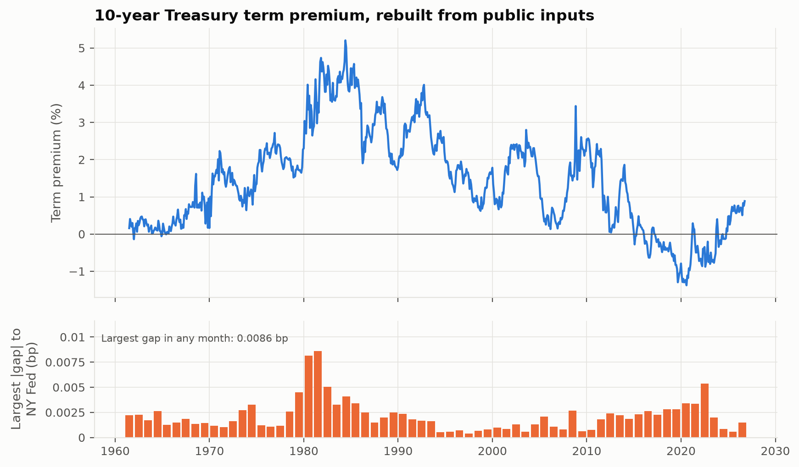
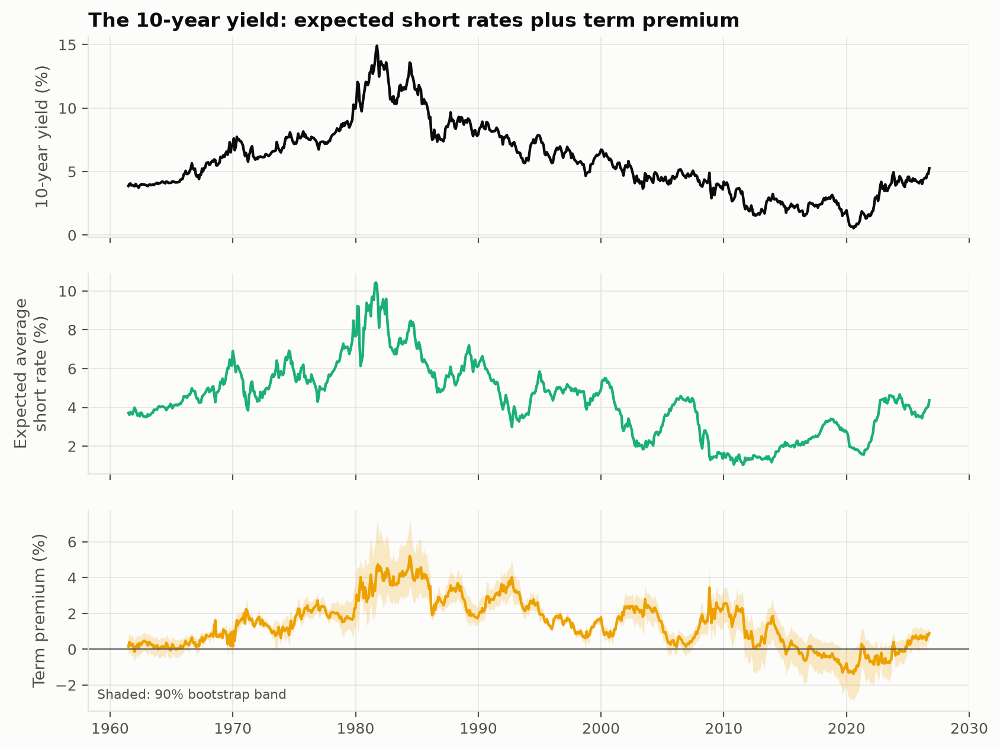
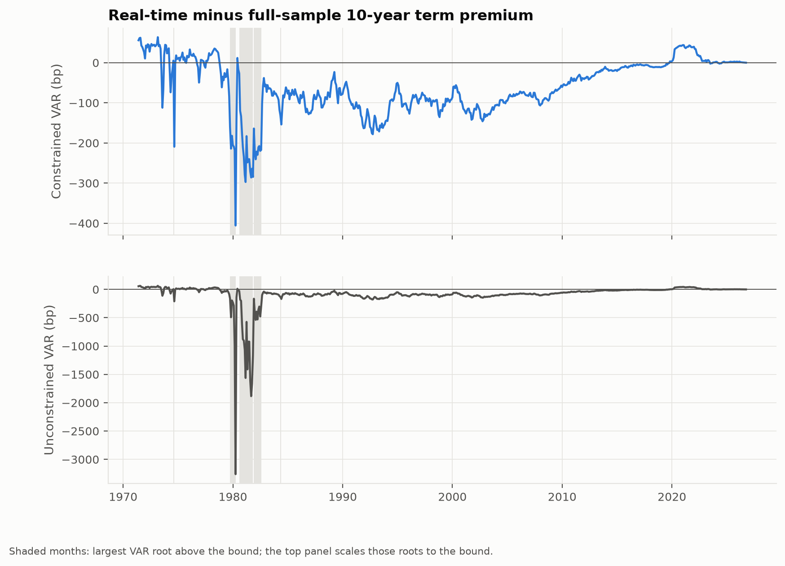
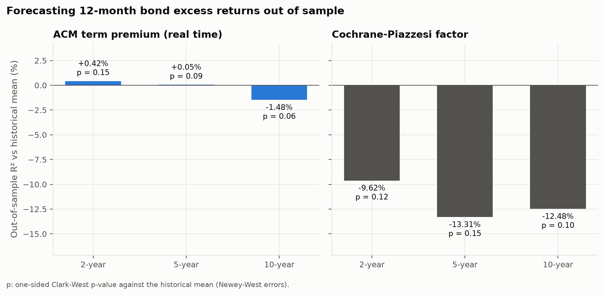
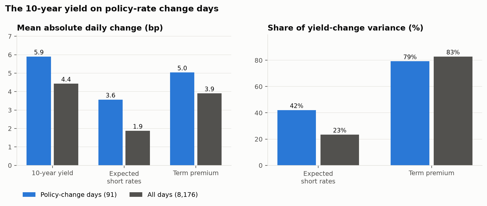

# Introduction

A long Treasury yield is the average short rate investors expect over the bond's life plus a term premium that compensates them for bearing duration risk. Neither component is observed. The decomposition published by the Federal Reserve Bank of New York, based on Adrian, Crump and Moench (2013), has become the reference estimate in policy and markets. This note asks three questions: can the published series be reproduced exactly from public inputs, how different was the estimate for someone computing it at the time, and does it contain information about future bond returns that a forecaster could have used?

# Data

The inputs are the daily Svensson curve parameters of Gurkaynak, Sack and Wright (2007), published by the Federal Reserve Board, evaluated at maturities of one to 120 months on the last trading day of each complete month. The curve is fitted to coupon securities, so its one-month point is an extrapolation; before 1982 it is replaced by its fitted value from a regression on the effective federal funds rate estimated from 1982 onward ($R^2$ = 0.977, 247 months replaced). The New York Fed workbook is used only as the validation target. Policy-rate change days come from the daily federal funds target and, after it was replaced, the upper end of the target range.

# Model

With $K = 5$ pricing factors $X_t$, the first principal components of demeaned yields scaled to unit variance, the factor dynamics are a VAR(1), $X_{t+1} = \mu + \Phi X_t + v_{t+1}$, with innovation covariance $\Sigma$. One-month log excess returns on bonds of maturities 6, 12, 24, 36, 48, 60, 72, 84, 96, 108, 120 months are regressed jointly on a constant, the innovations and the lagged factors,

$$ rx_{t+1}^{(n-1)} = a_n + \beta_n' v_{t+1} + c_n' X_t + e_{t+1}^{(n)}, $$

and the prices of risk follow from the cross-section of the coefficients,

$$ \lambda_1 = (\beta\beta')^{-1}\beta c, \qquad \lambda_0 = (\beta\beta')^{-1}\beta\left(a + \tfrac{1}{2}\left(B^{*}\operatorname{vec}(\Sigma) + \sigma^2 \iota\right)\right). $$

Log zero prices are affine, $p_t^{(n)} = A_n + B_n' X_t$, with

$$ A_n = A_{n-1} + B_{n-1}'(\mu - \lambda_0) + \tfrac{1}{2}\left(B_{n-1}'\Sigma B_{n-1} + \sigma^2\right) - \delta_0, \qquad B_n' = B_{n-1}'(\Phi - \lambda_1) - \delta_1', $$

where $\delta_0 + \delta_1' X_t$ is the one-month rate. Setting $\lambda_0 = \lambda_1 = 0$ gives risk-neutral yields; the term premium is the fitted yield minus the risk-neutral yield.

# Replication

Fitting this model as written reproduces the published fitted yields but not the published term premium. Two conventions close the gap. First, the VAR intercept is folded into the innovations, $v_{t+1} = X_{t+1} - \Phi X_t$, so the recursions run with $\mu = 0$; because only $\mu - \lambda_0$ enters fitted yields they are unchanged, while risk-neutral yields move. Second, the recursion starts at the one-month bond, $A_1 = -\delta_0$ and $B_1 = -\delta_1$, without a convexity term, and $\Sigma$ uses $T-1$ degrees of freedom. With both, every published series is matched to within 0.0087 basis points across 784 months; the textbook version is 6.30 basis points lower on average at 10 years. The daily published series is matched to 0.0094 basis points by pricing daily factors with the monthly estimates.

{#fig-rep}

| Decade | RMSE (bp) | Max abs (bp) |
| --- | ---: | ---: |
| 1960s | 0.0012 | 0.0026 |
| 1970s | 0.0016 | 0.0045 |
| 1980s | 0.0032 | 0.0086 |
| 1990s | 0.0010 | 0.0023 |
| 2000s | 0.0008 | 0.0027 |
| 2010s | 0.0018 | 0.0028 |
| 2020s | 0.0020 | 0.0054 |

: Replication error of the 10-year term premium by decade. {#tbl-dec}

{#fig-dec}

# Real-time estimates

The model is re-estimated on expanding windows ending at each month from 1971, with the factors re-extracted in each window, and only the end-of-window estimate is kept. The real-time and full-sample 10-year term premia have correlation 0.88; their mean absolute difference is 68.7 basis points.
In 31 windows ending between 1974-08 and 1984-05 the largest root of $\hat\Phi$ exceeds 0.995 (up to 1.0193). Without mean reversion, expectations over 10 years are not anchored and the unconstrained real-time term premium differs from the full-sample one by up to 3,261 basis points. In those windows each offending eigenvalue is scaled to the bound, keeping its eigenvector, and the remaining steps are re-estimated given the constrained $\Phi$.

{#fig-rev}

| Decade | Mean abs revision (bp) |
| --- | ---: |
| 1970s | 36.3 |
| 1980s | 115.4 |
| 1990s | 108.7 |
| 2000s | 95.0 |
| 2010s | 20.5 |
| 2020s | 14.4 |

: Mean absolute revision by decade. {#tbl-rev}

# Out-of-sample return forecasts

12-month log excess returns on 2-year, 5-year and 10-year bonds are forecast each month from 1982 to 2025 using only returns realized by the forecast date. The ACM forecaster regresses returns on the real-time term premium of the same maturity; the Cochrane-Piazzesi forecaster first regresses the average excess return on bonds of 2, 3, 4, 5 years on forward rates and then uses the fitted factor. Both are compared with the historical mean using the out-of-sample $R^2$ of Campbell and Thompson (2008) and the Clark and West (2007) statistic with Newey-West errors (12 lags).

| Bond | Predictor | Months | OOS R2 (%) | Clark-West | p-value |
| --- | --- | --- | ---: | ---: | ---: |
| 2-year | ACM term premium (real time) | 522 | 0.42 | 1.03 | 0.152 |
| 2-year | Cochrane-Piazzesi factor | 522 | -9.62 | 1.20 | 0.115 |
| 5-year | ACM term premium (real time) | 522 | 0.05 | 1.34 | 0.090 |
| 5-year | Cochrane-Piazzesi factor | 522 | -13.31 | 1.03 | 0.151 |
| 10-year | ACM term premium (real time) | 522 | -1.48 | 1.59 | 0.056 |
| 10-year | Cochrane-Piazzesi factor | 522 | -12.48 | 1.26 | 0.104 |

: Out-of-sample forecast evaluation on a common sample. {#tbl-fc}

{#fig-fc}

# Policy-rate change days

On 91 days between 1994 and 2026 when the policy rate changed, the daily 10-year yield change is split into expectations and term premium using the model estimated through the previous month end. The term premium accounts for 79% of the variance of yield changes on those days, against 83% on all 8,176 trading days of the period; expected short rates account for 42% against 23%. The mean absolute change in expected short rates is 1.9 times its all-day level (3.6 bp against 1.9 bp), yet the term premium remains the larger source of variance on change days.

{#fig-pol}

# Limitations

Uncertainty bands hold the factor definition fixed; the estimator's invariance to invertible affine factor transformations makes this innocuous for yields and term premia. Policy days before 1994 are excluded because decisions were not announced. The source files are revised by their publishers; every download is hashed, `acm fetch` flags any file whose content changed, and `acm results` rebuilds every number from the revised data.

# References

- Adrian, T., Crump, R. K. and Moench, E. (2013). Pricing the term structure with linear regressions. *Journal of Financial Economics* 110(1), 110-138.
- Campbell, J. Y. and Thompson, S. B. (2008). Predicting excess stock returns out of sample. *Review of Financial Studies* 21(4), 1509-1531.
- Clark, T. E. and West, K. D. (2007). Approximately normal tests for equal predictive accuracy in nested models. *Journal of Econometrics* 138(1), 291-311.
- Cochrane, J. H. and Piazzesi, M. (2005). Bond risk premia. *American Economic Review* 95(1), 138-160.
- Gurkaynak, R. S., Sack, B. and Wright, J. H. (2007). The U.S. Treasury yield curve: 1961 to the present. *Journal of Monetary Economics* 54(8), 2291-2304.
