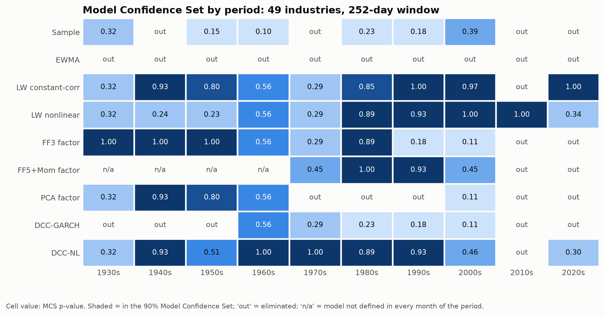
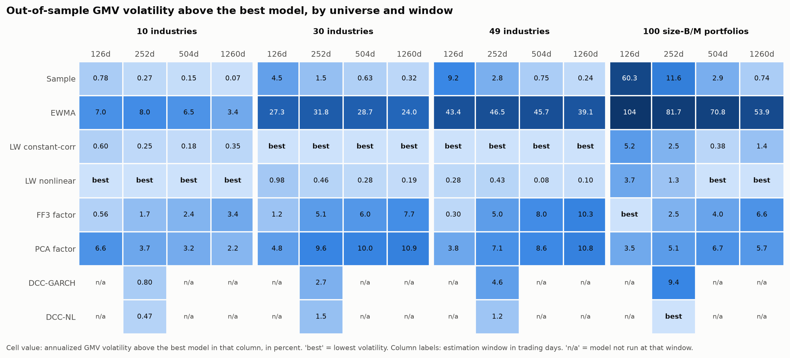
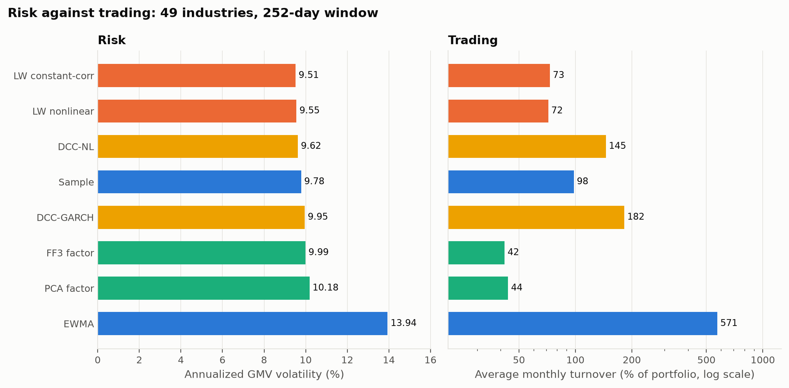
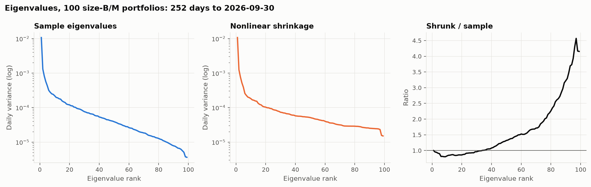
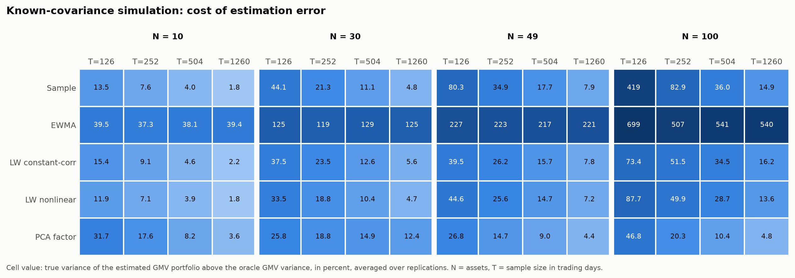

# Which covariance forecast survives a century?

Which of 9 covariance estimators, from the sample covariance to dynamic conditional correlation, forecasts risk best? Each one builds a minimum-variance portfolio every month on 1930 to 2026 daily returns, held for the next month. Lowest realized risk wins.

| | |
| --- | --- |
| Winner | **LW constant-corr**, 9.51% annualized GMV volatility |
| Sample covariance | 9.78%; the winner cuts risk 2.8% below it |
| Worst | EWMA, 13.94% |
| Statistically tied for best | 3 of 8: DCC-NL, LW constant-corr and LW nonlinear (90% Model Confidence Set) |
| Test bed | 49 industries, 1152 monthly rebalances, 252-day window, the 8 models defined in every month |
| Data | Kenneth R. French Data Library, every file SHA-256 hashed in [`data/manifest.json`](data/manifest.json) |



*MCS p-values by decade for 49 industries, loss = realized variance of the unconstrained global minimum variance portfolio. A shaded cell means the model cannot be statistically separated from the best model in that period at the 90% level.*

| Model | GMV vol (%) | Long-only vol (%) | Turnover (%/month) | QLIKE |
| --- | ---: | ---: | ---: | ---: |
| LW constant-corr | 9.51 | 11.10 | 73.0 | -401.287 |
| LW nonlinear | 9.55 | 11.16 | 71.6 | -402.124 |
| DCC-NL | 9.62 | 11.23 | 145.4 | -402.500 |
| Sample | 9.78 | 11.14 | 98.1 | -397.592 |
| DCC-GARCH | 9.95 | 11.27 | 182.1 | -397.790 |
| FF3 factor | 9.99 | 11.15 | 41.9 | -401.925 |
| PCA factor | 10.18 | 11.19 | 43.7 | -400.832 |
| EWMA | 13.94 | 12.00 | 571.4 | -158.985 |

*Full-sample results for 49 industries, 252-day window, common sample of 1152 months. Volatility is the annualized standard deviation of daily out-of-sample returns. QLIKE is averaged over months against the realized covariance; lower is better.*

## Question, data, method

Every risk model and every mean-variance optimizer depends on a covariance forecast, and the textbook choice, the sample covariance, is known to be badly conditioned once the number of assets is a meaningful fraction of the sample size. This project asks which of 9 estimators delivers the lowest realized risk out of sample, how that answer changes with the ratio of assets to observations, and which models cannot be told apart once sampling noise is accounted for.

The data are daily value-weighted returns on 10 industries, 30 industries, 49 industries and 100 size-B/M portfolios from the Kenneth R. French Data Library, plus the Fama-French factors. At the end of every month each model is fitted on a trailing window, a global minimum variance portfolio is formed, and its return is recorded over the next month. Models are compared on realized portfolio variance, QLIKE and Frobenius loss against realized covariance, and turnover, and separated statistically with the Model Confidence Set of Hansen, Lunde and Nason (2011).

## The estimators

| Model | What it does |
| --- | --- |
| Sample | Unbiased sample covariance of the window |
| EWMA | Exponentially weighted covariance with the RiskMetrics daily decay |
| LW constant-corr | Ledoit and Wolf (2004), shrinkage toward a constant-correlation target with the estimated optimal intensity |
| LW nonlinear | Ledoit and Wolf (2020), sample eigenvectors with each eigenvalue replaced by its estimated oracle value |
| FF3 factor | Time-series regression on the Fama-French three factors, diagonal residual covariance |
| FF5+Mom factor | Time-series regression on the five Fama-French factors and momentum, diagonal residual covariance |
| PCA factor | Principal components plus diagonal remainder, number of factors chosen in each window by Bai and Ng (2002) IC_p2 |
| DCC-GARCH | GARCH(1,1) variances and scalar DCC correlations estimated by composite likelihood (Engle, Shephard and Sheppard, 2008) |
| DCC-NL | DCC with the correlation target estimated by nonlinear shrinkage (Engle, Ledoit and Wolf, 2019) |

Every estimator is implemented from scratch in [`src/covariance_horse_race/models`](src/covariance_horse_race/models) behind one `fit` / `forecast` interface, and each has a test with a known answer: recovery of GARCH and DCC parameters from simulated data, recovery of the number of factors, the closed-form behaviour of shrinkage on a constant-correlation truth, and positive definiteness on randomized inputs.

## What the evidence shows



*Each column is one universe and estimation window; each cell is the out-of-sample GMV volatility above the best model in that column, in percent. Darker means further behind.*

*Not every model runs at every window: DCC-GARCH and DCC-NL run only on the 252-day window, because the conditional-versus-unconditional question needs only the primary window and these are the slowest estimators. Annualized volatility levels for every cell are in [`reports/tables/sweep_vol.md`](reports/tables/sweep_vol.md).*

Left out of a comparison because they are not defined in every month of it:

| Model | Window | Universes | Reason |
| --- | ---: | --- | --- |
| FF5+Mom factor | 126d | 10 industries, 30 industries, 49 industries and 100 size-B/M portfolios | factor data not yet available: defined in 753 of 1152 months, first on 1963-12-31 |
| FF5+Mom factor | 252d | 10 industries, 30 industries, 49 industries and 100 size-B/M portfolios | factor data not yet available: defined in 747 of 1152 months, first on 1964-06-30 |
| FF5+Mom factor | 504d | 10 industries, 30 industries, 49 industries and 100 size-B/M portfolios | factor data not yet available: defined in 735 of 1152 months, first on 1965-06-30 |
| FF5+Mom factor | 1260d | 10 industries, 30 industries, 49 industries and 100 size-B/M portfolios | factor data not yet available: defined in 698 of 1152 months, first on 1968-07-30 |



*Lower risk is only worth having if it does not come from trading far more. Left: realized GMV volatility per model. Right: average monthly turnover, log scale. Models sorted by volatility, lowest at the top.*



*Why shrinkage helps: on the last 252 days of 99 portfolios ending 2026-09-30, the sample covariance has a condition number of 2,958; nonlinear shrinkage brings it to 712 by pulling the extreme eigenvalues toward the bulk.*

## A check with a known answer

Real data cannot say which forecast was right, only which one did better. The simulation study removes that ambiguity: returns are drawn from multivariate Student-t (5.0 degrees of freedom) with a fixed parametric covariance, so the true risk of every estimated portfolio is known exactly and can be compared with the portfolio built from the true covariance.



*Models in the simulation: Sample, EWMA, LW constant-corr, LW nonlinear and PCA factor. True GMV variance above the oracle portfolio, in percent, averaged over 200 replications per cell. Standard errors are in [`reports/results.json`](reports/results.json) and the full table in [`reports/tables/simulation_excess_variance.md`](reports/tables/simulation_excess_variance.md).*

## Limitations, and what was built around them

- **Industry portfolios are diversified**, so estimation noise is smaller than in a single-stock universe and the gaps between models understate what a stock-level desk would see. The sweep therefore runs up to 100 size-B/M portfolios, where the 126-day window gives 0.78 assets per observation, the regime in which the sample covariance is closest to singular.
- **Real data never reveal the true covariance.** The simulation above is the control: the same estimators and the same GMV evaluation where the truth is known.
- **Some models are undefined in some cells.** The sample covariance is singular when assets reach the window length, and the extended factor data begin on 1963-07-01. Rather than patch these cases, each comparison uses only months where every included model is defined, and every exclusion is listed with its reason.
- **Weights are held fixed through each month**, as in Ledoit and Wolf (2017), so realized variance measures forecast quality rather than drift. Turnover is measured against the drifted weights a monthly rebalancer would actually trade from.
- **Transaction costs are not charged.** Turnover is reported next to risk so the trade-off is visible; the portfolios are a lens on forecast quality, not a strategy.
- **The library revises history.** It moved from CRSP's legacy files to the CIZ format in January 2025. Every download is hashed in [`data/manifest.json`](data/manifest.json). `uv run chr fetch` revalidates each file with a conditional GET and lists any file whose content changed in `data/changed.txt`; `uv run chr results` then rebuilds every number on this page from the revised data.

## Reproduce

Requires [uv](https://docs.astral.sh/uv/) and, for the PDF, [Quarto](https://quarto.org). The same commands work in PowerShell, cmd, bash and zsh; run them one at a time from this folder.

```
uv sync
uv run chr results
uv run chr check
uv run chr check-provenance
```

`chr results` downloads and verifies the data, runs every stage and rebuilds the figures, this README and the paper. `chr check` runs lint, strict type checking, the test suite and the README drift check. `chr check-provenance` fails if the results came from the synthetic CI fixture. `uv run chr --help` lists every stage.

The backtest behind this page took 30.6 minutes on 4 worker processes (12 CPUs, Python 3.12.10).

## Layout

| Path | Contents |
| --- | --- |
| [`configs/research.yaml`](configs/research.yaml) | Every research choice with its reason; validated on load |
| [`src/covariance_horse_race/data`](src/covariance_horse_race/data) | Download with SHA-256 manifest, archive safety checks, parser for the library format |
| [`src/covariance_horse_race/models`](src/covariance_horse_race/models) | The 9 estimators |
| [`src/covariance_horse_race/evaluation`](src/covariance_horse_race/evaluation) | Point-in-time backtest, GMV solvers, losses, Model Confidence Set, simulation |
| [`reports/`](reports) | Figures (PNG and SVG), tables (CSV and Markdown) and `results.json` |
| [`paper/`](paper) | Write-up with full method and references |

## References

- Bai, J. and Ng, S. (2002). Determining the number of factors in approximate factor models. *Econometrica* 70(1).
- Engle, R. (2002). Dynamic conditional correlation. *Journal of Business and Economic Statistics* 20(3).
- Engle, R., Ledoit, O. and Wolf, M. (2019). Large dynamic covariance matrices. *Journal of Business and Economic Statistics* 37(2).
- Engle, R., Shephard, N. and Sheppard, K. (2008). Fitting vast dimensional time-varying covariance models. Working paper, Oxford.
- Hansen, P. R., Lunde, A. and Nason, J. M. (2011). The model confidence set. *Econometrica* 79(2).
- Laurent, S., Rombouts, J. and Violante, F. (2013). On loss functions and ranking forecasting performances of multivariate volatility models. *Journal of Econometrics* 173(1).
- Ledoit, O. and Wolf, M. (2004). Honey, I shrunk the sample covariance matrix. *Journal of Portfolio Management* 30(4).
- Ledoit, O. and Wolf, M. (2017). Nonlinear shrinkage of the covariance matrix for portfolio selection: Markowitz meets Goldilocks. *Review of Financial Studies* 30(12).
- Ledoit, O. and Wolf, M. (2020). Analytical nonlinear shrinkage of large-dimensional covariance matrices. *Annals of Statistics* 48(5).
- Politis, D. and Romano, J. (1994). The stationary bootstrap. *Journal of the American Statistical Association* 89(428).

<sub>Generated 2026-11-03T16:18:29+00:00 from configuration `31244ed6a28e4a5e`.</sub>
