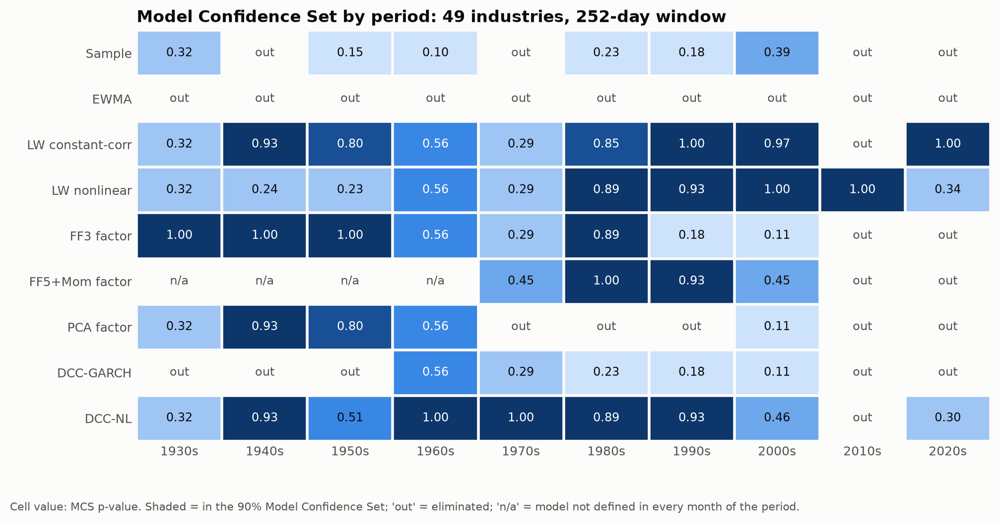
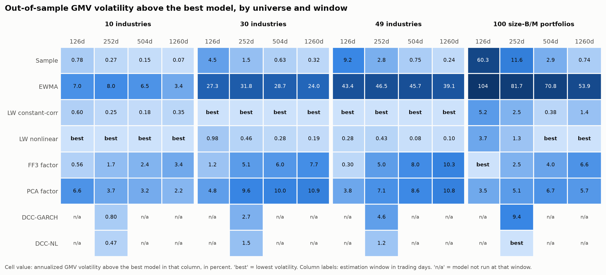
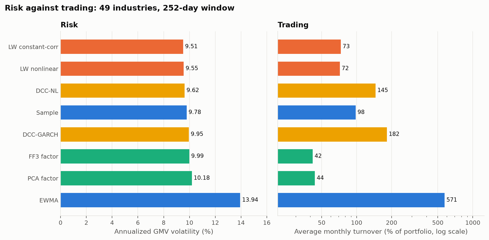
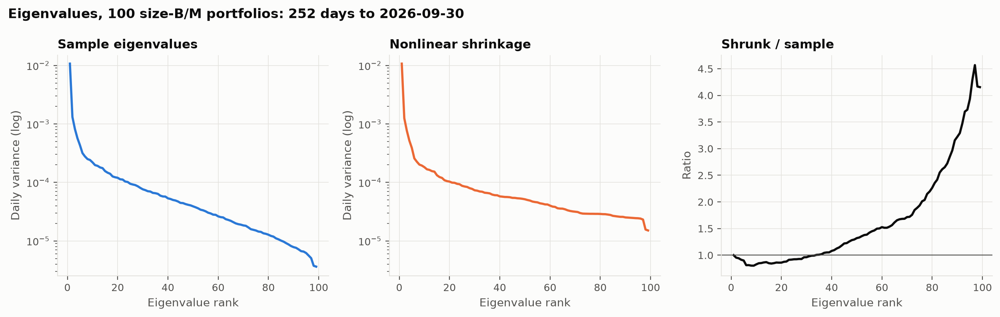
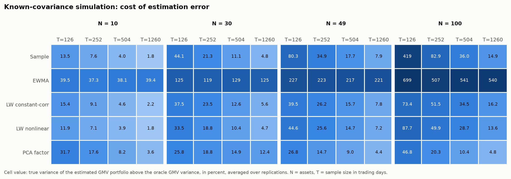

# Introduction

The covariance matrix is the input every risk model and every mean-variance optimizer shares. Its textbook estimator, the sample covariance, is unbiased entry by entry but its eigenvalues are systematically too dispersed: large ones are overestimated and small ones underestimated, and the error grows with the ratio of assets $N$ to observations $T$. A minimum variance optimizer inverts the matrix, so it loads precisely on the directions whose variance is most underestimated. The literature offers several remedies: shrinkage toward a structured target, factor structure, and conditional models that track changing volatility and correlation.

This study asks a narrow, testable question. Holding the portfolio construction fixed at the global minimum variance (GMV) portfolio, which uses no expected returns, which estimator produces the lowest realized risk out of sample, how does the ranking change with $N/T$, and which estimators cannot be distinguished statistically?

# Data

Returns are daily value-weighted portfolio returns from the Kenneth R. French Data Library: 10 industries, 30 industries, 49 industries and 100 size-B/M portfolios. Factor returns for the observable factor models come from the Fama-French three-factor file and, from 1963-07-01, the five-factor and momentum files. Every file is downloaded over HTTPS, its SHA-256 recorded in a manifest, and parsed structurally rather than by line position. Portfolios with no constituents carry the library's missing-value sentinel; an asset enters an estimation window only if it has a return on every day of that window.

| File | First day | Last day | Days | Series | Missing share | All series from | Retrieved |
| --- | --- | --- | --- | --- | ---: | --- | --- |
| ff3 | 1926-07-01 | 2026-09-30 | 26338 | 4 | 0.000 | 1926-07-01 | 2026-11-03 |
| ff5 | 1963-07-01 | 2026-09-30 | 15918 | 6 | 0.000 | 1963-07-01 | 2026-11-03 |
| ind10 | 1926-07-01 | 2026-09-30 | 26338 | 10 | 0.000 | 1926-07-01 | 2026-11-03 |
| ind30 | 1926-07-01 | 2026-09-30 | 26338 | 30 | 0.000 | 1926-07-01 | 2026-11-03 |
| ind49 | 1926-07-01 | 2026-09-30 | 26338 | 49 | 0.052 | 1969-07-01 | 2026-11-03 |
| me_bm100 | 1926-07-01 | 2026-09-30 | 26338 | 100 | 0.013 | 1945-07-02 | 2026-11-03 |
| mom | 1926-11-03 | 2026-09-30 | 26237 | 1 | 0.000 | 1926-11-03 | 2026-11-03 |

: Data coverage as parsed. {#tbl-coverage}

# Method

## Evaluation design

At the last trading day of each month $t$, every model is fitted on the trailing window of $T$ trading days, with $T$ set to 126, 252, 504 and 1260 and forecasts the average daily covariance $H_t$ over the next month. The GMV weights

$$ w_t = \frac{H_t^{-1}\mathbf{1}}{\mathbf{1}^{\top} H_t^{-1}\mathbf{1}} $$

are held fixed through the month, and the long-only variant solves $\min_w w^{\top} H_t w$ subject to $w \ge 0$, $\mathbf{1}^{\top} w = 1$ by accelerated projected gradient. Membership of the estimation window is decided from the window alone, never from the holding period, and the test suite verifies that perturbing returns after a rebalance date leaves that date's weights unchanged.

## Losses

The economic loss is the realized variance of the GMV portfolio. Two statistical losses compare $H_t$ with the realized covariance proxy $\Sigma_t = D^{-1}\sum_d r_d r_d^{\top}$ over the $D$ days of the month: the squared Frobenius distance and the multivariate QLIKE,

$$ L(\Sigma_t, H_t) = \log\lvert H_t\rvert + \operatorname{tr}(H_t^{-1}\Sigma_t). $$

Both rank forecasts consistently when the proxy is conditionally unbiased but noisy (Laurent, Rombouts and Violante, 2013), which matters because $\Sigma_t$ is singular whenever $N > D$.

## Estimators

**Linear shrinkage** (Ledoit and Wolf, 2004) forms $\delta F + (1-\delta) S$ with $F$ the constant-correlation target and $\delta$ the estimated optimal intensity.

**Nonlinear shrinkage** (Ledoit and Wolf, 2020) keeps the sample eigenvectors $u_i$ and replaces each sample eigenvalue $\lambda_i$ by

$$ \tilde d_i = \frac{\lambda_i}{\left(\pi \tfrac{p}{n} \lambda_i \tilde f(\lambda_i)\right)^2 + \left(1 - \tfrac{p}{n} - \pi \tfrac{p}{n}\lambda_i \mathcal{H}_{\tilde f}(\lambda_i)\right)^2}, $$

where $\tilde f$ is an Epanechnikov kernel estimate of the limiting spectral density and $\mathcal{H}_{\tilde f}$ its Hilbert transform, with a separate formula for the null space when $p > n$.

**Factor models** set $H = B \Sigma_f B^{\top} + D$ with $D$ diagonal, using either observable Fama-French factors or principal components, the number of components chosen inside each window by the Bai and Ng (2002) criterion $IC_{p2}$.

**DCC** fits a variance-targeted GARCH(1,1) to each asset and the scalar correlation recursion

$$ Q_t = (1-a-b)\,C + a\, z_{t-1} z_{t-1}^{\top} + b\, Q_{t-1}, \qquad R_t = \operatorname{diag}(Q_t)^{-1/2} Q_t \operatorname{diag}(Q_t)^{-1/2}, $$

estimated by the composite likelihood over contiguous pairs (Engle, Shephard and Sheppard, 2008). DCC-NL replaces the target $C$ by its nonlinear-shrinkage estimate (Engle, Ledoit and Wolf, 2019). Multi-step forecasts use exact GARCH mean reversion and the Engle-Sheppard approximation for correlations.

## Model Confidence Set

Statistical separation uses the Model Confidence Set (Hansen, Lunde and Nason, 2011) with the $T_{\max}$ statistic, elimination of the model with the largest standardized excess loss, and the stationary bootstrap with mean block length 6.0 months and 2000 replications. The set at level $\alpha = 0.1$ contains every model whose MCS p-value is at least $\alpha$. A comparison only includes models defined in every month of its sample; exclusions are reported, not imputed.

# Results

| Model | GMV vol (%) | Long-only vol (%) | Turnover (%/month) | QLIKE |
| --- | ---: | ---: | ---: | ---: |
| LW constant-corr | 9.51 | 11.10 | 73.0 | -401.287 |
| LW nonlinear | 9.55 | 11.16 | 71.6 | -402.124 |
| DCC-NL | 9.62 | 11.23 | 145.4 | -402.500 |
| Sample | 9.78 | 11.14 | 98.1 | -397.592 |
| DCC-GARCH | 9.95 | 11.27 | 182.1 | -397.790 |
| FF3 factor | 9.99 | 11.15 | 41.9 | -401.925 |
| PCA factor | 10.18 | 11.19 | 43.7 | -400.832 |
| EWMA | 13.94 | 12.00 | 571.4 | -158.985 |

: Full-sample out-of-sample performance, 49 industries, 252-day window, 1152 months. {#tbl-headline}

{#fig-mcs}

Over the full sample for 10 industries, the 90% set under the GMV variance loss contains DCC-GARCH, DCC-NL, FF3 factor, LW constant-corr, LW nonlinear and Sample.
Over the full sample for 30 industries, the 90% set under the GMV variance loss contains DCC-NL, LW constant-corr and LW nonlinear.
Over the full sample for 49 industries, the 90% set under the GMV variance loss contains DCC-NL, LW constant-corr and LW nonlinear.
Over the full sample for 100 size-B/M portfolios, the 90% set under the GMV variance loss contains DCC-NL, FF3 factor, LW constant-corr and LW nonlinear.

{#fig-sweep}

Annualized volatility levels for every universe, window and model are in `reports/tables/sweep_vol.md` in the repository.

{#fig-turnover}

{#fig-spectrum}

On the last 252-day window ending 2026-09-30, nonlinear shrinkage reduces the condition number from 2,958 to 712.

# Simulation with a known covariance

Real data cannot reveal which forecast was correct. Returns are therefore also drawn from a multivariate Student-t distribution with 5.0 degrees of freedom and a fixed parametric covariance $\Sigma$, for $N$ equal to 10, 30, 49 and 100 and $T$ equal to 126, 252, 504 and 1260, with 200 replications per cell. For an estimate $H$ with GMV weights $w_H$, the true risk $w_H^{\top} \Sigma \, w_H$ is compared with that of the oracle weights built from $\Sigma$ itself, $w_\Sigma^{\top} \Sigma \, w_\Sigma$.

{#fig-sim}

The same values are in `reports/tables/simulation_excess_variance.md`, and their standard errors in `reports/results.json`.

# Limitations

Portfolio returns are smoother than single-stock returns, so the gaps between estimators understate what a stock-level universe would show; the largest universe, 100 size-B/M portfolios, reaches 0.78 assets per observation. Transaction costs are not charged: turnover is reported beside risk instead. Weights are held fixed within each month so that realized variance isolates forecast quality. The library revised its history when it moved to CRSP's CIZ files in January 2025; every download is hashed, `chr fetch` flags any file whose content changed, and `chr results` rebuilds every number from the revised data.

# Reproducibility

All code, configuration and tests are in the repository. `uv run chr results` downloads the data, verifies it, runs every stage and regenerates this document and the README from the same `results.json`.

# References

- Bai, J. and Ng, S. (2002). Determining the number of factors in approximate factor models. *Econometrica* 70(1), 191-221.
- Engle, R. (2002). Dynamic conditional correlation. *Journal of Business and Economic Statistics* 20(3), 339-350.
- Engle, R., Ledoit, O. and Wolf, M. (2019). Large dynamic covariance matrices. *Journal of Business and Economic Statistics* 37(2), 363-375.
- Engle, R., Shephard, N. and Sheppard, K. (2008). Fitting vast dimensional time-varying covariance models. Working paper, University of Oxford.
- Engle, R. and Sheppard, K. (2001). Theoretical and empirical properties of dynamic conditional correlation multivariate GARCH. NBER Working Paper 8554.
- Hansen, P. R., Lunde, A. and Nason, J. M. (2011). The model confidence set. *Econometrica* 79(2), 453-497.
- Laurent, S., Rombouts, J. and Violante, F. (2013). On loss functions and ranking forecasting performances of multivariate volatility models. *Journal of Econometrics* 173(1), 1-10.
- Ledoit, O. and Wolf, M. (2004). Honey, I shrunk the sample covariance matrix. *Journal of Portfolio Management* 30(4), 110-119.
- Ledoit, O. and Wolf, M. (2017). Nonlinear shrinkage of the covariance matrix for portfolio selection: Markowitz meets Goldilocks. *Review of Financial Studies* 30(12), 4349-4388.
- Ledoit, O. and Wolf, M. (2020). Analytical nonlinear shrinkage of large-dimensional covariance matrices. *Annals of Statistics* 48(5), 3043-3065.
- Politis, D. and Romano, J. (1994). The stationary bootstrap. *Journal of the American Statistical Association* 89(428), 1303-1313.
