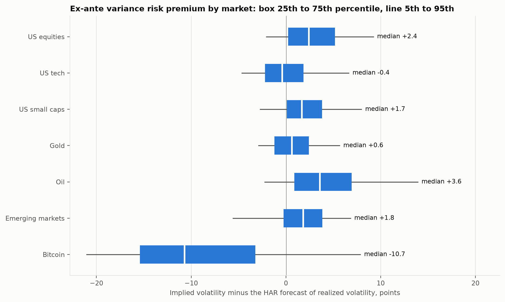
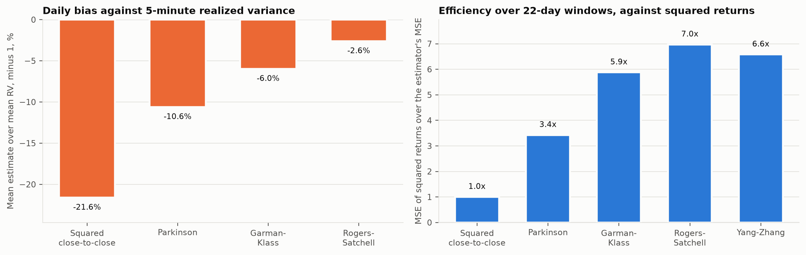
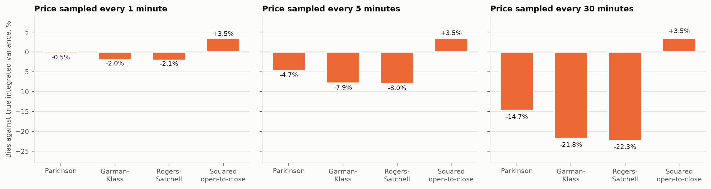
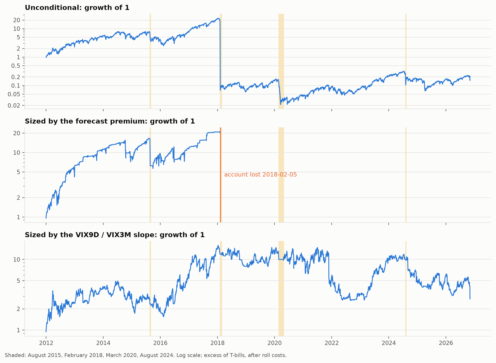
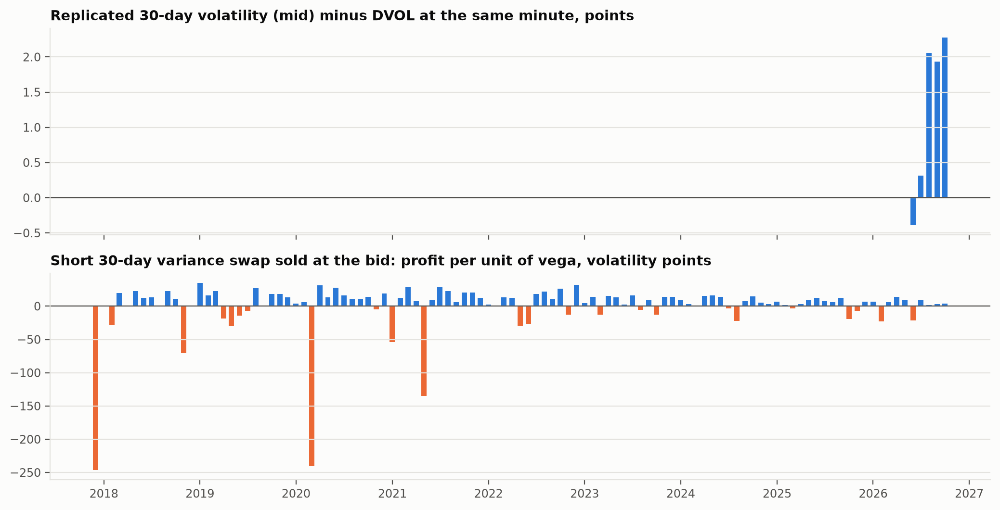
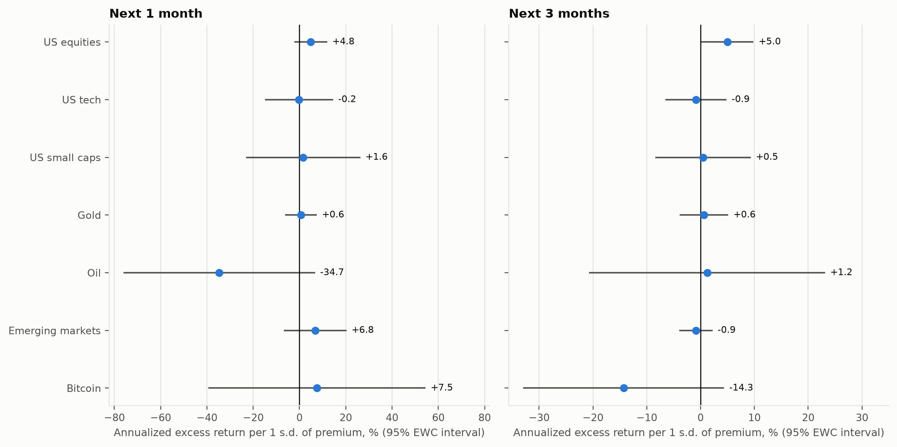

# The variance risk premium across seven markets

Options imply more variance than markets go on to deliver in 7 of 7 markets. Over the next 30 days, implied volatility exceeded the volatility that followed by 6.0 points on average in oil, the widest gap, and by 2.4 in gold, the narrowest. A short position in 30-day VIX futures returned -11.9% a year compounded from 2011-12-30 to 2026-11-06. Its arithmetic mean was 45.9% a year at 77% volatility, so the Sharpe ratio is 0.59 while the compounded return is negative; skewness was -3.58 and the worst drawdown -99.9%. Sized by the forecast premium, the position lost 157% of the account's equity on 2018-02-05 and wiped it out. No surviving sizing rule beat the unconditional position on the same days.

| Market | Implied index | Options on | Sample | Implied minus realized vol, points | Implied over realized variance | Days with a positive premium | HAR forecast against persistence |
| --- | --- | --- | --- | --- | --- | --- | --- |
| US equities | VIX | S&P 500 index options (SPX) | 1993-02-01 to 2026-10-07 | +3.8 | 1.29 | 84% | 28% |
| US tech | VXN | Nasdaq-100 index options (NDX) | 2009-09-14 to 2026-10-07 | +3.2 | 1.20 | 80% | 19% |
| US small caps | RVX | Russell 2000 index options (RUT) | 2009-09-16 to 2026-10-07 | +3.8 | 1.26 | 83% | 29% |
| Gold | GVZ | options on GLD | 2009-09-18 to 2026-10-07 | +2.4 | 1.22 | 79% | 23% |
| Oil | OVX | options on USO | 2009-09-18 to 2026-10-07 | +6.0 | 1.31 | 79% | 11% |
| Emerging markets | VXEEM | options on EEM | 2011-03-16 to 2026-10-07 | +3.6 | 1.27 | 81% | -13% |
| Bitcoin | DVOL | Deribit bitcoin options | 2021-03-24 to 2026-10-01 | +5.5 | 1.16 | 71% | 23% |

The premium is measured over 30 calendar days, the window every index here quotes. "Against persistence" is the out-of-sample cut in squared forecast error from the HAR model over the realized variance of the past 30 days.



## Question, data, method

Selling volatility earns a premium in calm years and gives it back in crashes. This project measures that premium in 7 markets, tests what predicts it, and asks whether sizing a short volatility position by a forecast of the premium beats selling it unconditionally once the crashes are included.

Each implied volatility index is matched to the instrument its options are written on: VIX with SPY; VXN with QQQ; RVX with IWM; GVZ with GLD; OVX with USO; VXEEM with EEM; DVOL with BTCUSDT. Daily ETF prices come from Tiingo, adjusted for dividends and splits; Cboe publishes the indices and the VX futures; bitcoin's minute bars come from Binance Vision, DVOL from Deribit and the option chains are rebuilt from Deribit's public trade history. Each index is squared and scaled to a 30-day variance, and realized variance is summed over the same 30 calendar days, overnight moves included. The ex-ante premium replaces realized variance with a HAR forecast (Corsi 2009) refit each month on data that had already settled.

The range estimators were calibrated on bitcoin first, against realized variance from 5-minute returns. Garman-Klass had the smallest error of the three intraday estimators, so it measures the open-to-close part of each ETF day in the HAR forecasts, with the overnight move added. The forecast target stays the unbiased sum of squared daily returns.

<details>
<summary>More exhibits: estimator calibration, the Heston check, VIX futures, bitcoin variance swaps, return predictability</summary>



Over 3329 bitcoin days from 2017-08-18 to 2026-10-31: squared close-to-close returns -0.216, Parkinson -0.106, Garman-Klass -0.060, Rogers-Satchell -0.026 (bias of the daily estimate). The realized kernel sits at 0.915 times 5-minute variance and 1-minute variance at 1.110 times, which measures the microstructure noise at the finest sampling.





| Strategy, 2011-12-30 on | Annual return, compounded | Sharpe | Skewness | Expected shortfall, worst 5% of days | Maximum drawdown | Days from trough to recovery |
| --- | --- | --- | --- | --- | --- | --- |
| Unconditional | -11.9% | 0.59 ± 0.50 | -3.58 | -12.9% | -99.9% | not recovered |
| Sized by the forecast premium | -100.0% | 0.47 ± 0.56 | -9.68 | -5.7% | -100.0% | account lost on 2018-02-05 |
| Sized by the VIX9D / VIX3M slope | 7.1% | 0.48 ± 0.49 | -2.13 | -12.1% | -83.4% | not recovered |

| Episode | Unconditional | Sized by the forecast premium | Sized by the VIX9D / VIX3M slope | 
| --- | --- | --- | --- | 
| Autumn 2008 (2008-09-01 to 2008-12-31) | -74.8% | -73.7% | outside the sample | 
| August 2015 (2015-08-17 to 2015-09-04) | -53.0% | -62.3% | -19.3% | 
| February 2018 (2018-02-01 to 2018-02-28) | -99.5% | -100.0% | -6.2% | 
| March 2020 (2020-02-20 to 2020-04-30) | -79.9% | -71.6% | -17.5% | 
| August 2024 (2024-07-31 to 2024-08-16) | -26.5% | -79.0% | 5.4% | 



On 5 monthly snapshots from 2026-06-01, the replicated 30-day volatility sat +1.24 points from DVOL on average (1.39 in absolute terms). A 30-day variance swap sold at the bid strip earned -0.21 volatility points per unit of vega on average over 102 months, positive in 75% of them; the worst month, 2017-12-01, lost 246.6.


</details>

## Limitations, and the workaround built for each

- **The ETF implied indices are not tradable variance swaps, so their premiums are measurements, not returns.** For bitcoin the 30-day variance swap rate is replicated from the Deribit chain itself (Carr and Madan 1998, in the discrete form of the Cboe method) at the bid, the mid and the ask, and a short position is priced at the bid each month: one premium becomes a strategy return with real costs, next to the VIX futures test.
- **There are no free daily option chains for the ETFs.** The replicated bitcoin rate is checked against DVOL on the same minute (1.39 points apart on average), which bounds how far a published index can sit from a rate built from the options themselves.
- **ETF variance can only be measured from daily bars.** The range estimators are calibrated on bitcoin, where minute data give the truth, and checked first on Heston paths whose integrated variance is known; the discrete-sampling bias they show follows Broadie, Glasserman and Kou (1997).
- **VX traded on ten times the index before 2007-03-26.** Those settles are divided by 10, and the build checks the nearest contract against VIX year by year and stops if the ratio leaves its band.
- **No free source keeps historical Deribit order books.** Deribit's history server keeps every trade, each with the option's mark price and the index at that instant, so each month's chain is rebuilt from the 24 hours of trades before 00:00 UTC on the 1st: put-call parity on the marks gives each expiry's forward, each option's last mark gives its implied volatility (a median 0.64 points from the volatility Deribit reports for the same mark near the money), and every option is repriced at the snapshot from that volatility. Bid and ask are the mark plus and minus the effective half-spread, the median distance between trade prices and the mark on the taker's side, by moneyness bucket (0.6% of the premium near the money). These are costs paid by real trades rather than quoted books; a mark is a median 4.8 hours old at the snapshot, and its volatility is carried to the snapshot unchanged.

## Reproduce

Tiingo needs a free API key from [tiingo.com](https://www.tiingo.com). In Windows PowerShell, one command per line:

```powershell
cd cross-asset-vrp
$env:TIINGO_API_KEY = "<your key>"
uv sync
uv run vrp results
uv run vrp check
uv run vrp check-provenance
```

The key lives only in that PowerShell window and is sent in a request header, never written to a file. The first run downloads every VX contract, the six ETFs, bitcoin's minute bars since 2017 and one option-chain snapshot a month; later runs download only what changed. `uv run vrp check-provenance --rehash` also hashes every downloaded file again. Without network access, `uv run vrp fixture mirror -o configs/ci.yaml` and then `uv run vrp results -o configs/ci.yaml --mirror mirror` run the whole pipeline on synthetic data.

## Layout

| Path | What it holds |
| --- | --- |
| [`configs/research.yaml`](configs/research.yaml) | Every choice with its reason: the index-instrument pairs, windows, HAR lags, futures rules, episodes |
| [`src/cross_asset_vrp/data`](src/cross_asset_vrp/data) | Sources, parsers, the resumable downloader with its SHA-256 manifest, the synthetic fixture |
| [`src/cross_asset_vrp/models`](src/cross_asset_vrp/models) | Realized measures and range estimators, HAR, variance swap replication, VX futures, Heston, regressions |
| [`src/cross_asset_vrp/evaluation`](src/cross_asset_vrp/evaluation) | The estimate stage |
| [`reports`](reports) | results.json, figures and tables, all rebuilt by `uv run vrp results` |
| [`paper`](paper) | The paper template and the built PDF |
| [`tests`](tests) | Estimator theory, HAR recovery, replication on a known smile, file formats, the end-to-end fixture run |

## References

- Barndorff-Nielsen, O. E., Hansen, P. R., Lunde, A. and Shephard, N. (2008). Designing realized kernels to measure the ex post variation of equity prices in the presence of noise. *Econometrica* 76(6), 1481-1536.
- Bollerslev, T., Tauchen, G. and Zhou, H. (2009). Expected stock returns and variance risk premia. *Review of Financial Studies* 22(11), 4463-4492.
- Broadie, M., Glasserman, P. and Kou, S. (1997). A continuity correction for discrete barrier options. *Mathematical Finance* 7(4), 325-349.
- Carr, P. and Madan, D. (1998). Towards a theory of volatility trading. In *Volatility: New Estimation Techniques for Pricing Derivatives*, 417-427.
- Corsi, F. (2009). A simple approximate long-memory model of realized volatility. *Journal of Financial Econometrics* 7(2), 174-196.
- Garman, M. B. and Klass, M. J. (1980). On the estimation of security price volatilities from historical data. *Journal of Business* 53(1), 67-78.
- Lazarus, E., Lewis, D. J., Stock, J. H. and Watson, M. W. (2018). HAR inference: recommendations for practice. *Journal of Business and Economic Statistics* 36(4), 541-559.
- Parkinson, M. (1980). The extreme value method for estimating the variance of the rate of return. *Journal of Business* 53(1), 61-65.
- Rogers, L. C. G. and Satchell, S. E. (1991). Estimating variance from high, low and closing prices. *Annals of Applied Probability* 1(4), 504-512.
- Yang, D. and Zhang, Q. (2000). Drift-independent volatility estimation based on high, low, open, and close prices. *Journal of Business* 73(3), 477-491.

Author: Ian Wachira. Built 2026-11-07 08:24 UTC from 526 source files (manifest digest `0eabbc765a48`, config `0614ad05051d`).
