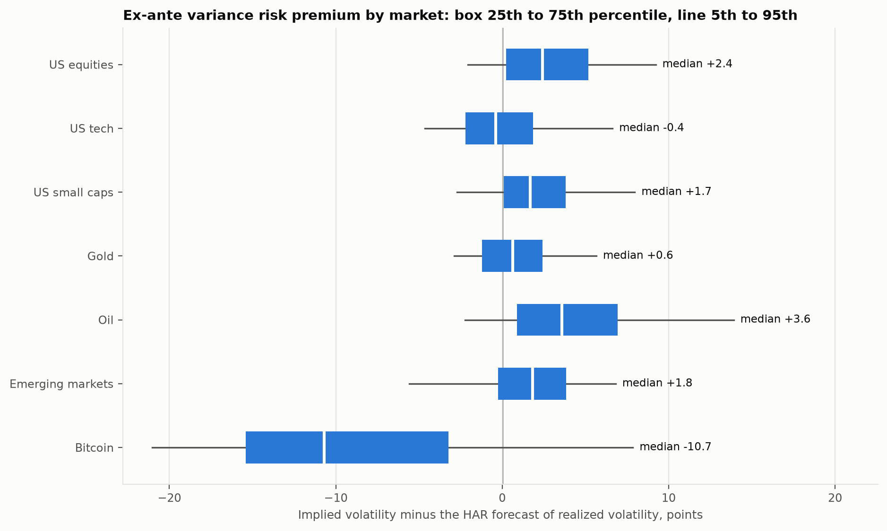
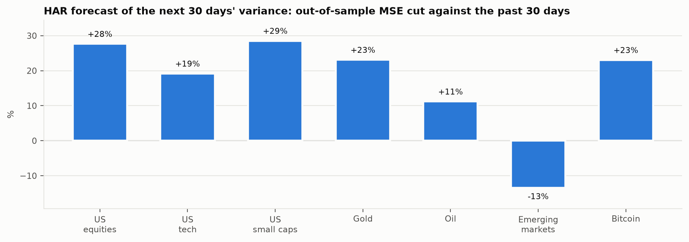
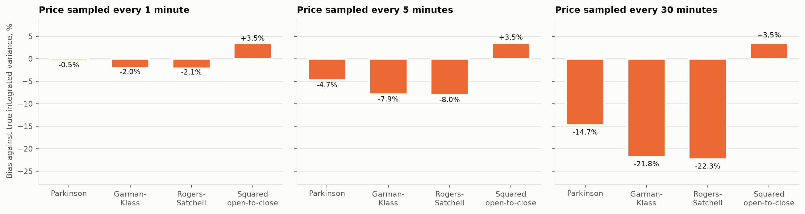
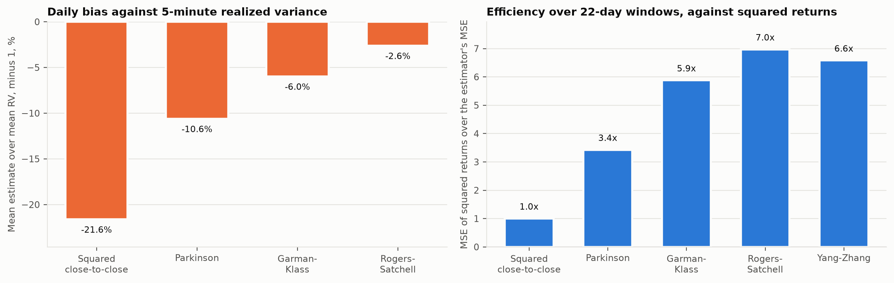
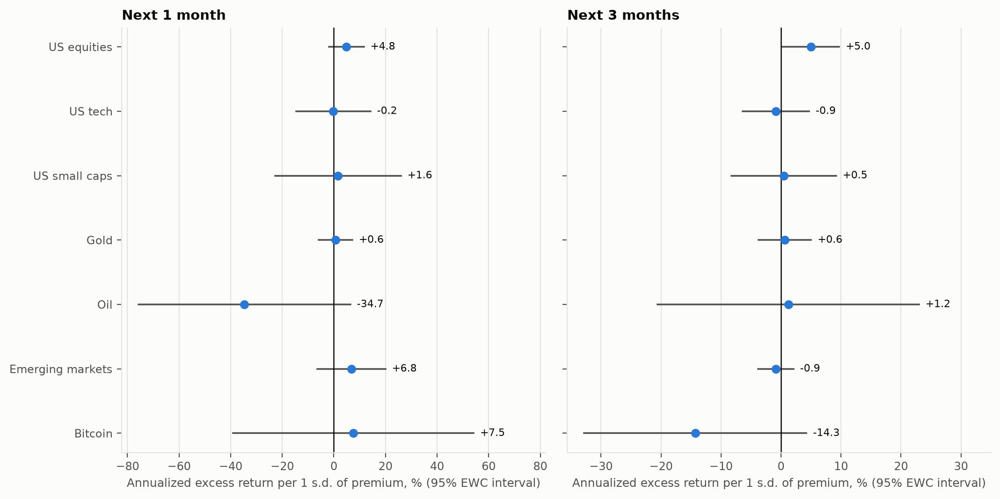
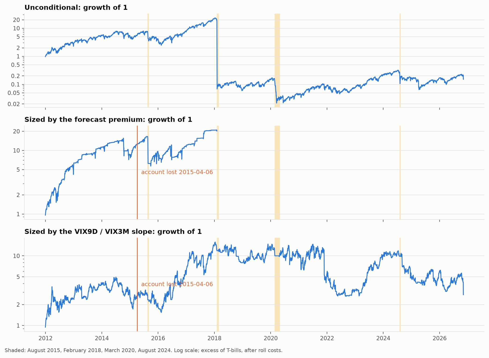
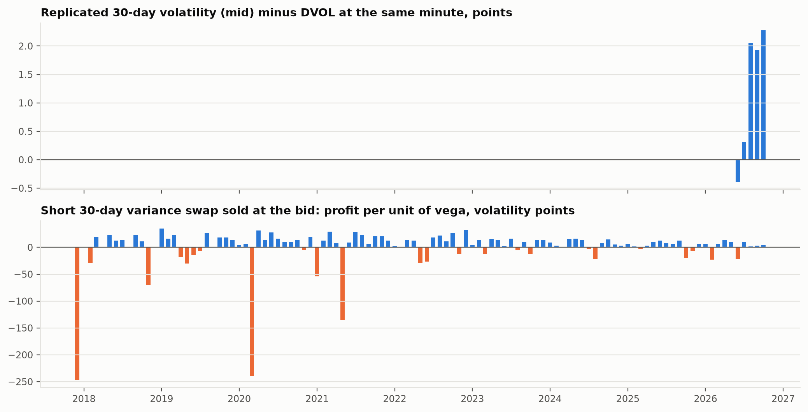

<% set e = r.estimates %>
<% set s = r.settings %>
<% set h = r.headline %>
<% set prem = e.premium %>
<% set fut = e.futures %>
<% set rep = e.replication %>
<% set cal = e.calibration %>
<% set hes = e.heston %>
<% set names = {"close_to_close": "Squared close-to-close return", "parkinson": "Parkinson", "garman_klass": "Garman-Klass", "rogers_satchell": "Rogers-Satchell", "yang_zhang": "Yang-Zhang", "open_to_close_squared": "Squared open-to-close return"} %>
<% set sizing = {"unconditional": "Unconditional", "premium": "Forecast premium", "slope": s.term_short ~ " / " ~ s.term_long ~ " slope"} %>
<% set u = fut.strategies.unconditional.common %>
<% set best = fut.strategies[h.best_sizing].common if h.best_sizing else none %>
<% set abstract %>
<% if r.provenance != "official" %>Synthetic fixture run: the numbers test the pipeline and describe no real market. <% endif %>Implied variance exceeds the variance that follows in << h.positive_premium_assets | length >> of << prem | length >> markets (<< s.assets | map(attribute="label") | map("inline") | join_words >>), each matched to the instrument its options are written on. The gap in volatility points runs from << prem[h.smallest_gap].vol_gap_points | num(1) >> in << prem[h.smallest_gap].label | inline >> to << prem[h.largest_gap].vol_gap_points | num(1) >> in << prem[h.largest_gap].label | inline >>. Range estimators are calibrated against minute-level bitcoin variance, after a check on Heston paths with known variance. Short << s.target_days >>-day VIX futures return << u.annual_return | pct(1) >> a year compounded, from an arithmetic mean of << u.annual_mean | pct(1) >> at << u.vol | pct(0) >> volatility, with a Sharpe ratio of << u.sharpe | num >> and skewness << u.skew | num >><% if h.best_sizing and h.best_sizing != "unconditional" %>; sizing by the << sizing[h.best_sizing] | inline >> raises the Sharpe ratio to << best.sharpe | num >><% endif %>.<% for k in h.ruined_sizing %> Sized by the << sizing[k] | inline >>, the position loses << (-fut.strategies[k].ruin_day_return) | pct(0) >> of its equity on << fut.strategies[k].common.ruined_on >> and the account is wiped out.<% endfor %><% if rep.short_mean is defined %> A bitcoin variance swap replicated from Deribit's trade history and sold at the bid earns << rep.short_mean | num(2) >> vega points a month.<% endif %>
<% endset %>
---
title: "<< r.title >>"
subtitle: "Implied against realized variance in equities, commodities, emerging markets and bitcoin, and what selling it pays"
author: "<< r.author >>"
date: "<< r.generated_at[:10] >>"
abstract: << abstract | trim | tojson >>
format:
  typst:
    papersize: a4
    margin:
      x: 2.2cm
      y: 2.4cm
    fontsize: 10pt
    section-numbering: "1.1"
  html:
    toc: true
    embed-resources: true
---

# Question

An option's price embeds a forecast of variance and a price for bearing it. When implied variance sits above the variance that follows, sellers of options are paid for carrying crash risk. Most work on this premium stops at the VIX. Here the same measurement runs across << s.assets | length >> markets, then asks three things: how large the premium is, whether it predicts returns, and whether sizing a short volatility position by a forecast of the premium beats selling volatility unconditionally once the crashes are counted.

# Data

| Market | Implied index | Instrument | Options the index is built on |
| --- | --- | --- | --- |
<% for a in s.assets %>
| << a.label >> | << a.implied >> | << a.instrument >> | << a.options_on >> |
<% endfor %>

: Each implied index and the instrument its realized variance is measured on. {#tbl-assets}

Cboe publishes the index histories and one settlement file per VX contract. Contracts expiring before 2013 are in an archive; the per-contract files of the first 2013 expiries start partway through each contract's life, so those contracts are merged from both sources, and the build stops if the blended series misses more than << s.max_gap_days >> calendar days. Tiingo supplies daily ETF prices adjusted for dividends and splits, FRED the << s.risk_free >> Treasury bill rate, Binance Vision bitcoin's minute bars, Deribit the DVOL index and, from its public history server, every bitcoin option trade in the << s.window_hours >> hours before each month starts. << fut.contracts >> monthly VX contracts trade from << fut.first_trade >> to << fut.last_trade >>. Every input is hashed in a SHA-256 manifest (digest `<< r.manifest_digest[:12] >>`, << r.manifest_files >> files).

# Method

## Variance on a common clock

Each index is a << s.variance_days >>-calendar-day volatility annualized over << s.days_per_year >> days, so the implied variance over the window is

$$
\mathrm{IV}^2_{t} = \left(\frac{\mathrm{index}_t}{100}\right)^2 \frac{<< s.variance_days >>}{<< s.days_per_year >>}
$$

Realized variance is the sum of squared daily log returns over the trading days inside the next << s.variance_days >> calendar days, overnight moves included; for bitcoin, which trades every day, it is the sum of << s.btc_sample_minutes >>-minute squared returns. The ex-post premium is the difference; the ex-ante premium replaces realized variance with its forecast:

$$
\mathrm{VRP}_t = \mathrm{IV}^2_t - \mathbb{E}_t\left[\mathrm{RV}_{t,t+<< s.variance_days >>}\right]
$$

## Forecasting realized variance

The forecast is a direct HAR projection (Corsi 2009): the sum of daily variance over the next << s.variance_days >> days on its means over the last << s.har_lags | join_words >> trading days (<< s.btc_har_lags | join_words >> calendar days for bitcoin). Coefficients are re-estimated at each month start on rows whose target window had closed, after at least << s.min_train_days >> rows. The target is always the unbiased measure. The regressors use a more efficient one: for the ETFs, the squared overnight return plus the intraday range estimator that the bitcoin calibration below finds most accurate.

## Range estimators, checked twice

Parkinson, Garman-Klass and Rogers-Satchell measure a day's variance from its open, high, low and close; Yang-Zhang combines them with the overnight move over a window of << s.yang_zhang_window >> days. Each is checked first on Heston paths (κ = << s.heston.kappa >>, θ = << s.heston.theta >>, ξ = << s.heston.xi >>, ρ = << s.heston.rho >>) whose integrated variance is known, then on bitcoin against << s.btc_sample_minutes >>-minute realized variance and a Parzen realized kernel (Barndorff-Nielsen, Hansen, Lunde and Shephard 2008).

## Predictability

At each month end the annualized log excess return over the next << s.horizons_months | join_words >> months is regressed on the standardized ex-ante premium. Overlapping returns are serially correlated, so standard errors use the equal-weighted cosine long-run variance (Lazarus, Lewis, Stock and Watson 2018). For the S&P 500 the test is also run on the months after Bollerslev, Tauchen and Zhou's (2009) sample, which ends in << s.btz_sample_end >>.

## Harvesting the premium in VX futures

The first two monthly VX contracts are blended to a constant << s.target_days >>-day maturity and held short. The blend's weights are set at each close and earn the next day's settle-to-settle change; each unit of weight traded pays << s.cost_points_per_side >> index points. Three sizing rules run on the same days: one unit throughout; the ex-ante VIX premium over its expanding mean; and the << s.term_short >> / << s.term_long >> slope over the expanding mean of its positive part, zero when the curve is inverted. Both conditional rules are capped at << s.sizing_cap | num(0) >> units and start after << s.min_signal_history_days >> days of signal.

## Bitcoin variance swaps from the trade history

Deribit keeps no public archive of its order books, but its history server keeps every trade with the option's mark price, the index price and the taker's side. The chain at 00:00 UTC on the first of each month is rebuilt from the << s.window_hours >> hours of trades before it. For each expiry, put-call parity on the latest marks of strikes within 15% of the index gives the basis F/S: a premium of p bitcoin is worth p F forward dollars, so (C - P) F = F - K and F = K / (1 - C + P), and the basis is the median of F/S over those strikes. Parity needs a call and a put priced at one moment and the last trades of the two legs are hours apart, so each leg is first carried to the snapshot on the current basis, as below, and parity there updates the basis until it settles. Each option's last mark, worth that many forward dollars at its own trade time, is inverted through Black-76 for an implied volatility, and the option is repriced at the snapshot on the forward F = (F/S) S, with S the index at the window's last trade. A taker buys above the mark and sells below it, so the signed distance between trade price and mark, as a share of the mark, is an effective half-spread h; its median in each bucket of log(K/F) with edges << s.spread_buckets | join(", ") >> gives bid = mark (1 - h) and ask = mark (1 + h), and a bucket with fewer than << s.min_spread_trades >> trades takes the median of all trades. For each expiry the variance is replicated from out-of-the-money options (Carr and Madan 1998) in the discrete form of the Cboe method, stopping after << s.zero_bid_stop >> consecutive strikes without a price. Deribit premiums are paid in bitcoin, so a premium of p BTC is worth p F dollars at expiry, with F the expiry's own forward. The two expiries that bracket << s.variance_days >> days, the nearer at least << s.min_expiry_days >> days out, are interpolated to a << s.variance_days >>-day rate from the bid, mid and ask strips. A short swap is entered at the bid and settled against realized variance from << s.btc_sample_minutes >>-minute returns.

# Results

## The premium

| Market | From | To | Implied vol | Realized vol | Gap | IV² / RV | Days > 0 | t |
| --- | --- | --- | --- | --- | --- | --- | --- | --- |
<% for key, p in prem.items() %>
| << p.label >> | << p.first >> | << p.last >> | << (100 * p.mean_iv_var ** 0.5) | num(1) >> | << (100 * p.mean_rv ** 0.5) | num(1) >> | << p.vol_gap_points | signed(1) >> | << p.ex_post_ratio | num(2) >> | << p.ex_post_share_positive | pct >> | << p.ex_post_t | num(1) >> |
<% endfor %>

: Ex-post premium by market. Volatilities, in points, are square roots of mean annualized variances; the gap is the mean of implied minus realized volatility. The t statistic uses month-end observations and an EWC long-run variance. {#tbl-premium}

@fig-premium shows the distribution of the ex-ante premium. Its medians, in volatility points: <% for key, p in prem.items() if p.ex_ante_points_median is defined %><< p.label | inline >> << p.ex_ante_points_median | signed(1) >><< ", " if not loop.last else "." >><% endfor %>

{#fig-premium}

## Forecasting realized variance

<% set skill = prem.values() | selectattr("har_r2_vs_persistence", "ne", none) | list %>
<% set lo = skill | min(attribute="har_r2_vs_persistence") %>
<% set hi = skill | max(attribute="har_r2_vs_persistence") %>
Out of sample, the HAR forecast cuts squared error against persistence by << lo.har_r2_vs_persistence | pct(0) >> in << lo.label | inline >> up to << hi.har_r2_vs_persistence | pct(0) >> in << hi.label | inline >> (@fig-har).

{#fig-har}

## Range estimators

On the Heston paths (@fig-heston), sampled every minute, the three range estimators are within << (hes.bias | selectattr("step_minutes", "equalto", 1) | rejectattr("estimator", "equalto", "open_to_close_squared") | map(attribute="bias") | map("abs") | max * 100) | num(1) >>% of the true variance. Sampled more coarsely they understate it, because a sampled path misses its own extremes. Broadie, Glasserman and Kou (1997) put the shortfall of the range at 2β σ √Δt with β = 0.5826: <% for d in hes.range_deficit %>at << d.step_minutes >> minutes the measured shortfall in log range is << (10000 * d.measured) | num(2) >> bp against << (10000 * d.predicted) | num(2) >> bp predicted<< "; " if not loop.last else "." >><% endfor %>

{#fig-heston}

| Estimator | Daily bias | Daily efficiency | Window efficiency |
| --- | --- | --- | --- |
<% for row in cal.rows if row.level == "window" %>
<% set day = cal.rows | selectattr("estimator", "equalto", row.estimator) | selectattr("level", "equalto", "day") | list %>
| << names[row.estimator] >> | << (day[0].bias | pct(1)) if day else "" >> | << (day[0].efficiency_vs_cc | num(1)) ~ "x" if day else "" >> | << row.efficiency_vs_cc | num(1) >>x |
<% endfor %>

: Range estimators against << s.btc_sample_minutes >>-minute realized variance over << cal.days >> bitcoin days from << cal.first >> to << cal.last >>. Efficiency is the squared-return MSE over the estimator's MSE, daily and over << s.yang_zhang_window >>-day windows. {#tbl-calibration}

On bitcoin (@tbl-calibration, @fig-calibration), << names[cal.chosen] >> has the smallest daily error of the three intraday estimators and is the one used for the ETFs. The realized kernel averages << cal.kernel_over_rv5 | num(3) >> times << s.btc_sample_minutes >>-minute variance and 1-minute variance << cal.rv1_over_rv5 | num(3) >> times, so noise at the finest sampling is small but visible.

{#fig-calibration}

## Does the premium predict returns?

| Market | Sample | Months ahead | Slope | 95% interval | t | R² | N |
| --- | --- | --- | --- | --- | --- | --- | --- |
<% for row in e.predictability %>
| << row.label >> | << "after BTZ" if row.sample == "after_btz" else "full" >> | << row.horizon >> | << (100 * row.slope) | signed(1) >> | [<< (100 * row.ci_low) | num(1) >>, << (100 * row.ci_high) | num(1) >>] | << row.t | num(2) >> | << row.r2 | pct(1) >> | << row.observations >> |
<% endfor %>

: Annualized excess return over the next months, in percent, per standard deviation of the ex-ante premium; EWC standard errors; N is the number of months. {#tbl-predict}

{#fig-predict}

## Selling VX futures

| Rule | Compounded return | Sharpe | Skew | ES 5% | Drawdown | Trough | Recovery |
| --- | --- | --- | --- | --- | --- | --- | --- |
<% for name, st in fut.strategies.items() %>
<% set c = st.common %>
| << sizing[name] >> | << c.annual_return | pct(1) >> | << c.sharpe | num >> ± << (1.96 * c.sharpe_se) | num >> | << c.skew | num >> | << c.expected_shortfall_5 | pct(1) >> | << c.max_drawdown | pct(1) >> | << c.drawdown_trough >> | << ("account lost " ~ c.ruined_on) if c.ruined_on else ((c.recovery_days | num(0)) ~ " days" if c.recovery_days is not none else "none") >> |
<% endfor %>

: Short constant-maturity VX futures from << fut.common_start >>, excess of T-bills, after roll costs. Return is annual and compounded, a rule whose account reaches zero holds cash from that day on, the Sharpe interval 95% EWC, ES 5% the mean of the worst 5% of days, and recovery the days from the worst trough back to the prior peak. {#tbl-futures}

<% set full = fut.strategies.unconditional.full %>
<% if fut.gaps_before_full %><% set g = fut.gaps_before_full %>In << g | length >> stretch<< "es" if g | length != 1 else "" >> up to << g[-1].after >>, a contract's file ends before its expiry and the blended series has no return for more than << s.max_gap_days >> calendar days. No other source has those days, so the long sample starts after the last of them. <% endif %>Over the longer unconditional sample from << full.first >>, the short earned << full.annual_return | pct(1) >> a year with a worst day of << full.worst_day | pct(1) >> on << full.worst_day_date >>.

| Episode | From | To | <% for name in fut.strategies %><< sizing[name] >> | <% endfor %>

| --- | --- | --- | <% for name in fut.strategies %>--- | <% endfor %>

<% for ep in fut.episodes %>
| << ep.name >> | << ep.start >> | << ep.end >> | <% for name in fut.strategies %><< (ep[name] | pct(1)) if ep[name] is not none else "outside sample" >> | <% endfor %>

<% endfor %>

: Return over each stress episode. {#tbl-episodes}

{#fig-futures}

<% if rep.months %>
## Bitcoin variance swaps

<< rep.priced >> of << rep.months >> monthly chains from << rep.first >> to << rep.last >> give a << s.variance_days >>-day rate. A median chain rests on << rep.window_trades_median | num(0) >> trades and << rep.options_median | num(0) >> options whose last mark is a median << (rep.mark_age_minutes_median / 60) | num(1) >> hours old; near the money, the volatility inverted on the parity forward sits a median << rep.iv_gap_median_abs | num(2) >> points from the one Deribit reports for the same mark, which checks the forward, and the effective half-spread is << rep.atm_half_spread_median | pct(1) >> of the premium, and the median bid-ask spread of the strip is << rep.spread_points_median | num(2) >> volatility points.<% if rep.gap_months %> Against DVOL at the same minute, the replicated mid sits << rep.gap_mean | signed(2) >> points away on average and << rep.gap_mean_abs | num(2) >> in absolute terms over << rep.gap_months >> months.<% endif %><% if rep.short_mean is defined %> Sold at the bid, the swap earned << rep.short_mean | num(2) >> volatility points per unit of vega a month<% if rep.short_t is not none %> (t = << rep.short_t | num(2) >>)<% endif %>, positive in << rep.short_hit_rate | pct >> of << rep.settled >> months, with skewness << rep.short_skew | num(2) >>; the worst month, << rep.short_worst_month >>, lost << (-rep.short_worst) | num(1) >>.<% endif %>

{#fig-replication}

<% endif %>
# Validation

- Heston paths: the range estimators recover the known integrated variance at fine sampling, and their coarse-sampling shortfall matches the Broadie-Glasserman-Kou correction.
- HAR on a simulated HAR process recovers its coefficients.
- The same simulated path summed on trading days and on calendar days gives one variance once each convention is applied.
- Replication on a chain priced at one known volatility returns that volatility squared.
- The chain rebuild, on trades whose marks follow one volatility on a drifting index with a forward basis, recovers the basis, the volatility and the planted half-spread in each moneyness bucket, and ignores trades after the snapshot.
- The VX expiry rule reproduces the published final settlement dates, holidays included, and the pre-<< s.rescale_before[:4] >> rescaling is checked against VIX year by year.
- The synthetic fixture plants a premium in every market, a contango in VX, microstructure noise in the bitcoin minutes and a flat smile and a known effective spread in each month's trades, and the end-to-end test recovers each.

# Limitations

The ETF premiums are measurements, not tradable returns, because free daily ETF option chains do not exist. The bitcoin replication turns one of them into a strategy with costs, and its distance from DVOL bounds how far a published index sits from a rate built from the options. Its chains are rebuilt from trades, not read from order books: the costs are effective spreads that real trades paid, pooled by moneyness rather than quoted strike by strike, and each mark's volatility is carried unchanged from its last trade to the snapshot, so an option that last traded hours earlier is priced at that hour's volatility. Range estimators can only stand in for intraday data; they were calibrated where minute data exist. VX roll costs use a fixed half-tick per unit traded rather than quoted spreads. The predictive regressions use overlapping returns, which EWC standard errors account for but do not make independent.

# References

Barndorff-Nielsen, O. E., Hansen, P. R., Lunde, A. and Shephard, N. (2008). Designing realized kernels to measure the ex post variation of equity prices in the presence of noise. *Econometrica* 76(6), 1481-1536.

Bollerslev, T., Tauchen, G. and Zhou, H. (2009). Expected stock returns and variance risk premia. *Review of Financial Studies* 22(11), 4463-4492.

Broadie, M., Glasserman, P. and Kou, S. (1997). A continuity correction for discrete barrier options. *Mathematical Finance* 7(4), 325-349.

Carr, P. and Madan, D. (1998). Towards a theory of volatility trading. In *Volatility: New Estimation Techniques for Pricing Derivatives*, 417-427.

Corsi, F. (2009). A simple approximate long-memory model of realized volatility. *Journal of Financial Econometrics* 7(2), 174-196.

Garman, M. B. and Klass, M. J. (1980). On the estimation of security price volatilities from historical data. *Journal of Business* 53(1), 67-78.

Lazarus, E., Lewis, D. J., Stock, J. H. and Watson, M. W. (2018). HAR inference: recommendations for practice. *Journal of Business and Economic Statistics* 36(4), 541-559.

Parkinson, M. (1980). The extreme value method for estimating the variance of the rate of return. *Journal of Business* 53(1), 61-65.

Rogers, L. C. G. and Satchell, S. E. (1991). Estimating variance from high, low and closing prices. *Annals of Applied Probability* 1(4), 504-512.

Yang, D. and Zhang, Q. (2000). Drift-independent volatility estimation based on high, low, open, and close prices. *Journal of Business* 73(3), 477-491.
