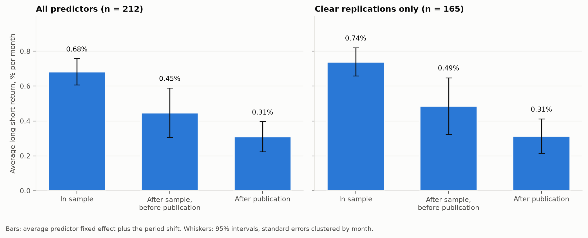
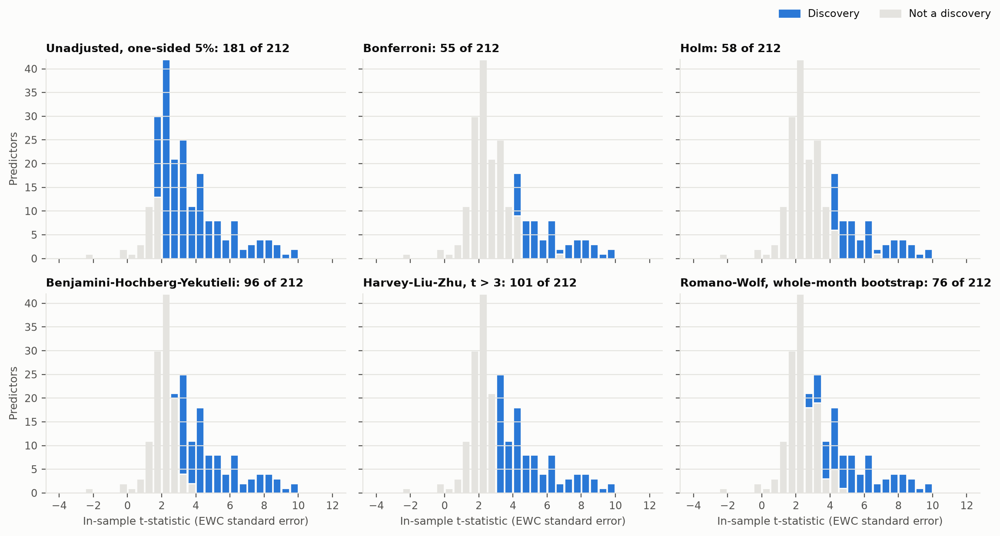
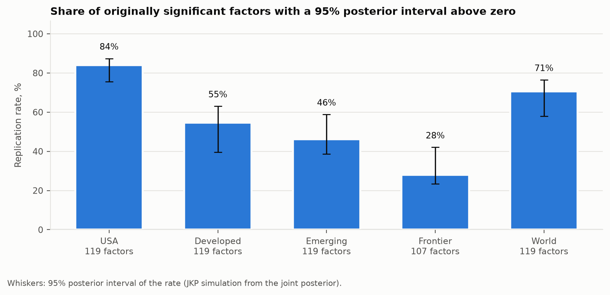
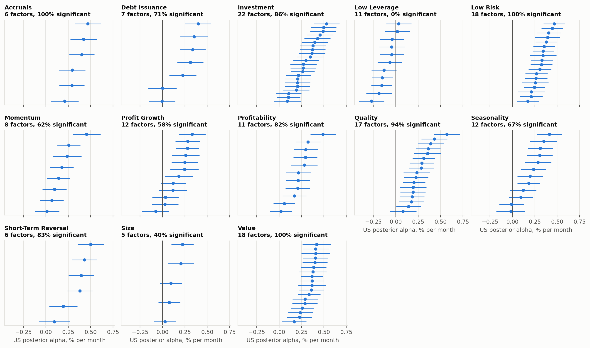
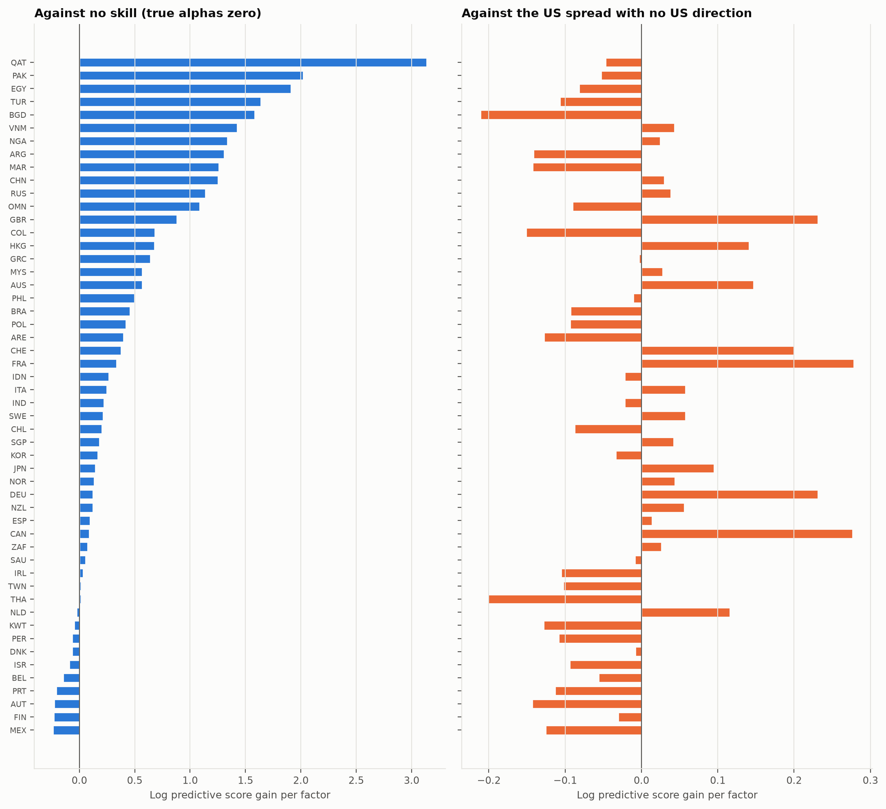
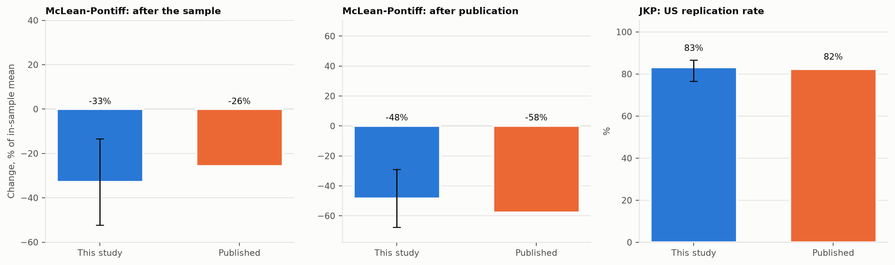
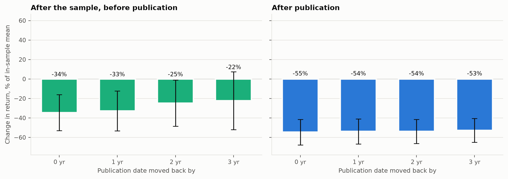
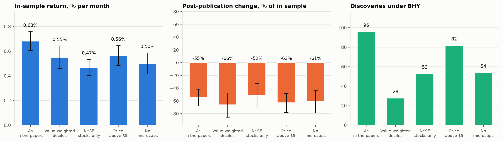
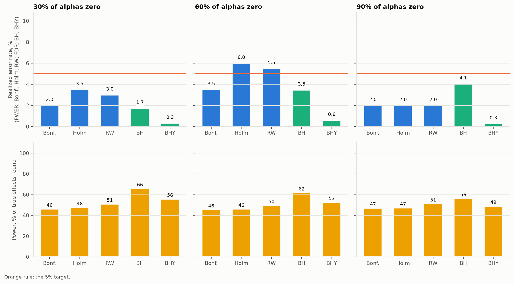









# The factor zoo on trial


> **These numbers come from the synthetic fixture, not from the data.** They check that the pipeline runs and recovers a planted truth, and they say nothing about real anomalies. Run `uv run fzt results` to rebuild this page from Open Source Asset Pricing, Global Factor Data and the French library. `uv run fzt check-provenance` passes only after that.


After publication, the average of {{ d.n_signals }} published US equity predictors earns {{ d.post_publication.value | num }}% a month against {{ d.in_sample.value | num }}% in sample, a change of {{ d.share_post_publication.value | pct }} (95% interval {{ d.share_post_publication.low | pct }} to {{ d.share_post_publication.high | pct }}). {{ t.counts.bhy }} of {{ t.n_tests }} survive a false discovery control valid under any dependence, and {{ us.replication_rate | pct(1) }} of the originally significant JKP factors replicate in the US.



| Test | This study | Published benchmark |
| --- | --- | --- |
| Decay after publication | {{ d.share_post_publication.value | pct }} of the in-sample mean ({{ d.share_post_publication.low | pct }} to {{ d.share_post_publication.high | pct }}); after the sample, before publication: {{ d.share_post_sample.value | pct }} | McLean and Pontiff (2016): {{ mp.published.share_post_publication | pct }} and {{ mp.published.share_post_sample | pct }}; on their window this study gets {{ mp.estimate.share_post_publication.value | pct }} and {{ mp.estimate.share_post_sample.value | pct }} |
| In-sample discoveries out of {{ t.n_tests }} | Unadjusted {{ t.counts.unadjusted }}, Holm {{ t.counts.holm }}, BHY {{ t.counts.bhy }}, Romano-Wolf {{ t.counts.romano_wolf }}, t > {{ r.settings.hlz_threshold | num(1) }}: {{ t.counts.hlz }}; Storey share of true nulls {{ t.storey_pi0 | pct }} | Harvey, Liu and Zhu (2016) hurdle t > {{ r.settings.hlz_threshold | num(1) }} |
| Empirical Bayes replication, US | {{ us.replication_rate | pct(1) }} of {{ us.n_counted }} factors ({{ us.replication_low | pct }} to {{ us.replication_high | pct }}); the US posterior out-predicts no skill in {{ sp.share_transfer_beats_no_skill | pct }} of {{ sp.n_countries }} countries, but a prior with the US spread and no US direction in only {{ sp.share_transfer_beats_dispersion | pct }} | Jensen, Kelly and Pedersen (2023): {{ jb.published.replication_rate | pct(1) }} of {{ jb.published.n_factors }}; on their window this study gets {{ jb.estimate.replication_rate | pct(1) }} of {{ jb.estimate.n_counted }}Jensen, Kelly and Pedersen (2023): no benchmark window in the data |

## Question, data, method

Of the published US equity return predictors, how many hold up once the tests account for how many were tried? How much of their return is left after the original sample and after publication? Do they replicate in other countries? Open Source Asset Pricing (release {{ r.osap_release }}) provides {{ e.osap.n_predictors }} long-short predictors from {{ e.osap.first_month[:4] }} to {{ e.osap.last_month[:4] }}, each with its paper's sample period and publication year. Global Factor Data provides {{ e.jkp.n_factors }} factors in {{ e.jkp.n_countries_downloaded }} countries. The decay is the McLean-Pontiff panel regression with predictor fixed effects and month-clustered errors. In-sample t-statistics go through six multiple-testing procedures, one of them a bootstrap that resamples whole months. Alphas are shrunk by the JKP hierarchical empirical Bayes model. The US posterior is then scored as a forecast of each other country's alphas.

## Supporting exhibits



The same {{ t.n_tests }} t-statistics in every panel. Each correction shades a different set of discoveries: {{ t.counts.unadjusted }} with no correction, {{ t.counts.bonferroni }} under Bonferroni.



Replication rate in each JKP region, counting factors that were significant in the original paper.



US posterior alphas with 95% intervals, one panel per theme cluster. Significant: the 95% posterior interval lies above zero. The prior has mean zero, so every alpha is pulled toward zero.



Out of sample in space: per-factor log predictive gain of the US posterior over two alternatives, for each country with at least {{ r.settings.space_min_factors }} factors. The median country gains {{ sp.median_gain_vs_no_skill | num(3) }} over no skill and {{ sp.median_gain_vs_dispersion | num(3) }} over a prior with the US spread but no US direction.

<details>
<summary>More exhibits: benchmarks, publication shifts, tradability, simulation</summary>



McLean-Pontiff, on returns to {{ mp.last_month }} and predictors published by then: post-publication change {{ mp.estimate.share_post_publication.value | pct }} against {{ mp.published.share_post_publication | pct }} published, a difference of {{ (100 * mp.difference.share_post_publication) | num(0) }} percentage points. This study's sample is a different set of predictors, rebuilt by OSAP rather than by the original authors, so some gap is expected. JKP, US to {{ jb.last_month }}: {{ jb.estimate.replication_rate | pct(1) }} against {{ jb.published.replication_rate | pct(1) }}, with {{ jb.estimate.n_counted }} factors counted against their {{ jb.published.n_factors }}. Benjamini-Yekutieli gives {{ jb.estimate.by_rate | pct(1) }} against their {{ jb.published.by_rate | pct(1) }}.




Moving each publication date back by up to {{ r.settings.publication_shifts[-1] }} years, to allow for working-paper circulation, changes the post-publication decline from {{ r.shifts[r.settings.publication_shifts[0] | string].share_post_publication.value | pct }} to {{ r.shifts[r.settings.publication_shifts[-1] | string].share_post_publication.value | pct }}.




The same decay and discovery counts on value-weighted, NYSE-only, price-screened and microcap-free portfolios. Without microcaps the in-sample return is {{ nm.decay.in_sample.value | num }}% a month against {{ d.in_sample.value | num }}%, and BHY keeps {{ nm.testing.counts.bhy }} predictors against {{ t.counts.bhy }}.





{{ r.settings.simulation.replications }} simulated zoos of {{ sim.empirical_bayes.n_factors }} factors from a {{ r.settings.simulation.latent_factors }}-factor structure fitted to the real panel. Error rates against the {{ r.settings.level | pct }} target, and power, by share of true nulls. {{ near | join_words }} {{ "is" if near | length == 1 else "are" }} above the target but within two Monte Carlo standard errors of it ({{ (200 * se) | num(1) }} percentage points with {{ r.settings.simulation.replications }} replications). {{ far | join_words }} {{ "exceeds" if far | length == 1 else "exceed" }} the target by more than two Monte Carlo standard errors. Empirical Bayes 95% intervals cover the true alpha {{ sim.empirical_bayes.coverage | pct(1) }} of the time. Estimated tau_c is {{ sim.empirical_bayes.tau_c_mean | num(3) }} against a true {{ sim.empirical_bayes.tau_c_true | num(3) }}, and tau_w {{ sim.empirical_bayes.tau_w_mean | num(3) }} against {{ sim.empirical_bayes.tau_w_true | num(3) }}.

</details>

## Limitations, and the workaround built for each


- **OSAP rebuilds each predictor from public data, so some returns differ from the papers.** Every result is also run on the {{ e.osap.n_clear }} predictors OSAP classifies as clear replications. Their post-publication change is {{ dc.share_post_publication.value | pct }} against {{ d.share_post_publication.value | pct }} for all predictors. The full grid is in [`reports/tables/decay_grid.csv`](reports/tables/decay_grid.csv).
- **The journal year is not when the market learned of a predictor.** Publication dates are shifted back by {{ r.settings.publication_shifts | map('string') | join_words }} years and the decay is reported for each shift (figure above).
- **Predictor returns are strongly cross-correlated.** Errors are clustered by month. False discoveries are controlled with BHY, which holds under any dependence. The Romano-Wolf bootstrap resamples whole months in {{ r.settings.romano_wolf_block_months }}-month circular blocks, so the cross-section and serial dependence survive in each of {{ r.settings.romano_wolf_draws }} draws.
- **Both sources publish revised releases.** The OSAP release and the JKP reference commit are pinned in [`configs/research.yaml`](configs/research.yaml), and every file is hashed in `data/manifest.json`. `uv run fzt check-release` compares the pin with the newest release on Hugging Face, and `uv run fzt check-release --write` moves the pin; `uv run fzt results` then downloads only the files that changed and rebuilds every number on this page.
- **Factors outnumber months in many countries, so sample covariances are singular.** Correlations are estimated pairwise and shrunk toward the identity with the Schafer-Strimmer intensity ({{ us.shrinkage_intensity | num(3) }} in the US).
- **Pairwise correlations from factors with different start dates do not form a valid correlation matrix.** Raising its negative eigenvalues to a numerical zero would treat some combinations of alphas as known exactly, and every likelihood along them explodes. Eigenvalues are instead raised to the Marchenko-Pastur lower edge, (1 - sqrt(K/n))^2 for K factors and the median pairwise overlap n: {{ us.eigenvalue_floor | num(2) }} in the US, where {{ us.eigenvalues_clipped }} of {{ us.n_factors }} eigenvalues are raised. A test with zero true alphas on a staggered panel pins the effect: the per-factor chi-square statistic stays below 3 with the floor and is more than a hundred times larger with a numerical floor. Countries sharing fewer than {{ r.settings.space_min_factors }} factors with the US are left out of the space test and listed in `results.json`.
- **CAPM and FF5 + momentum adjustments use full-sample betas.** The headline uses raw returns, as McLean and Pontiff do. On adjusted returns the post-publication change is {{ r.bases.capm.share_post_publication.value | pct }} (CAPM) and {{ r.bases.ff6.share_post_publication.value | pct }} (FF5 + momentum).

## Reproduce

Windows PowerShell, one command per line:

```powershell
cd factor-zoo-trial
uv sync
uv run fzt results
uv run fzt check
uv run fzt check-provenance
```

On the first run `fzt results` downloads {{ r.download_mb.osap | num(0) }} MB of OSAP portfolio files and {{ r.download_mb.jkp | num(0) }} MB of JKP files ({{ r.manifest_files }} files in all). If the connection drops, run it again: downloads resume and skip files that have not changed. `uv run fzt results --skip-paper` skips the PDF. `uv run fzt --help` lists each stage. Without network access, `uv run fzt fixture mirror` followed by `uv run fzt results -o configs/ci.yaml --mirror mirror` runs the whole pipeline on synthetic data.

## Layout

| Path | Contents |
| --- | --- |
| [`configs/research.yaml`](configs/research.yaml) | Every research choice, each with its reason |
| [`src/factor_zoo_trial/data`](src/factor_zoo_trial/data) | Resumable downloads, SHA-256 manifest, parsers, synthetic fixture |
| [`src/factor_zoo_trial/models`](src/factor_zoo_trial/models) | Fixed-effects panel, multiple testing, covariance shrinkage, empirical Bayes, transfer scoring |
| [`src/factor_zoo_trial/evaluation`](src/factor_zoo_trial/evaluation) | Periods, decay, discoveries, replication, space test, simulation |
| [`reports/`](reports) | Figures, tables and `results.json` |
| [`paper/`](paper) | Full write-up (Quarto, Typst PDF and HTML) |

## References

- Benjamini, Y. and Yekutieli, D. (2001). The control of the false discovery rate in multiple testing under dependency. *Annals of Statistics* 29(4), 1165-1188.
- Chen, A. Y. and Zimmermann, T. (2022). Open source cross-sectional asset pricing. *Critical Finance Review* 11(2), 207-264.
- Harvey, C. R., Liu, Y. and Zhu, H. (2016). ... and the cross-section of expected returns. *Review of Financial Studies* 29(1), 5-68.
- Jensen, T. I., Kelly, B. and Pedersen, L. H. (2023). Is there a replication crisis in finance? *Journal of Finance* 78(5), 2465-2518.
- Lazarus, E., Lewis, D. J., Stock, J. H. and Watson, M. W. (2018). HAR inference: recommendations for practice. *Journal of Business and Economic Statistics* 36(4), 541-559.
- McLean, R. D. and Pontiff, J. (2016). Does academic research destroy stock return predictability? *Journal of Finance* 71(1), 5-32.
- Romano, J. P. and Wolf, M. (2005). Stepwise multiple testing as formalized data snooping. *Econometrica* 73(4), 1237-1282.
- Laloux, L., Cizeau, P., Bouchaud, J.-P. and Potters, M. (1999). Noise dressing of financial correlation matrices. *Physical Review Letters* 83(7), 1467-1470.
- Schafer, J. and Strimmer, K. (2005). A shrinkage approach to large-scale covariance matrix estimation. *Statistical Applications in Genetics and Molecular Biology* 4(1).
- Storey, J. D. (2002). A direct approach to false discovery rates. *Journal of the Royal Statistical Society B* 64(3), 479-498.
- Storey, J. D., Taylor, J. E. and Siegmund, D. (2004). Strong control, conservative point estimation and simultaneous conservative consistency of false discovery rates. *Journal of the Royal Statistical Society B* 66(1), 187-205.

Data: Open Source Asset Pricing (CC BY 4.0), Global Factor Data (CC BY-NC 4.0) and the Kenneth R. French data library. This project is not affiliated with any of them.

<sub>Generated {{ r.generated_at }} from configuration `{{ r.config_fingerprint }}` and inputs `{{ r.manifest_digest[:12] }}` ({{ r.provenance }}).</sub>
