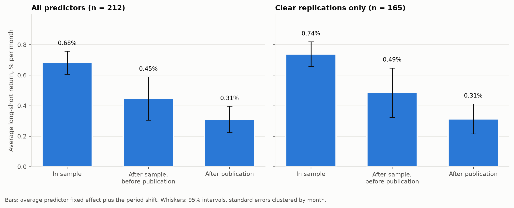
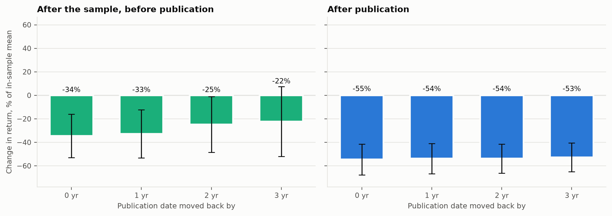
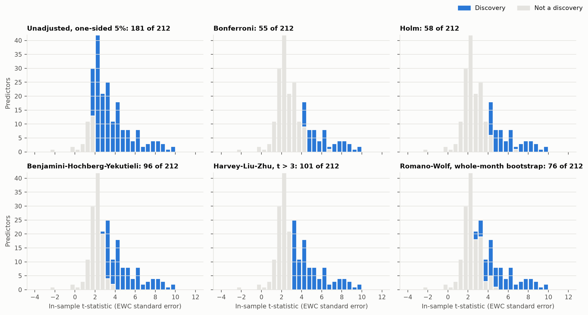
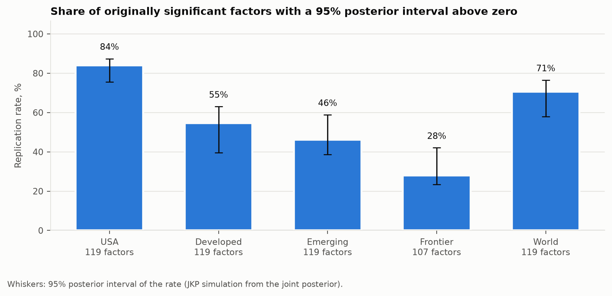
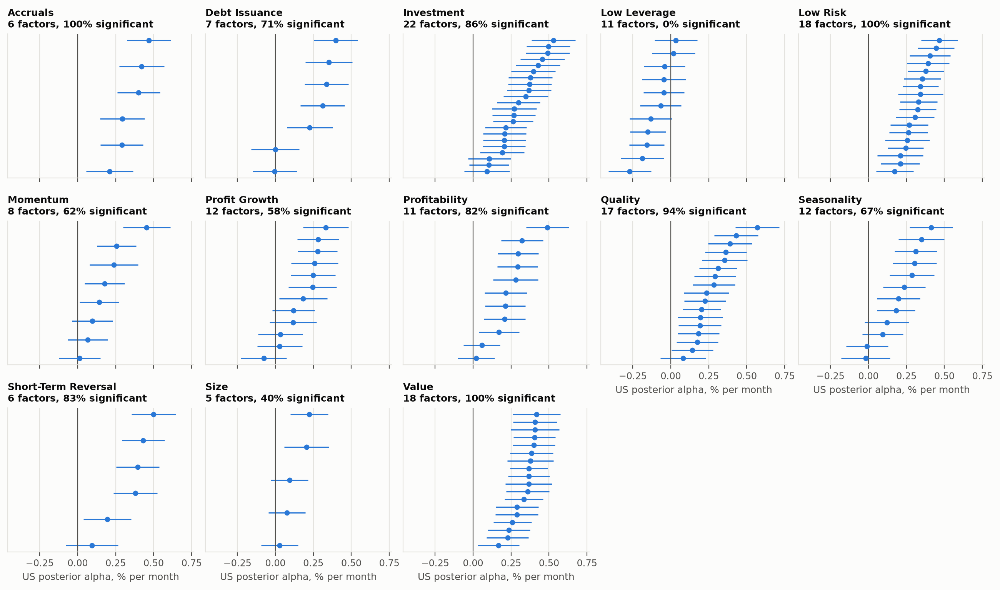
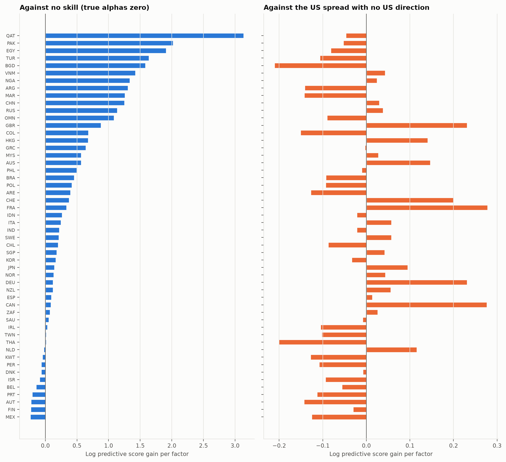
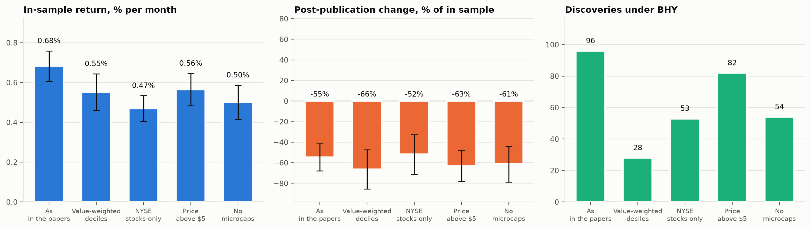
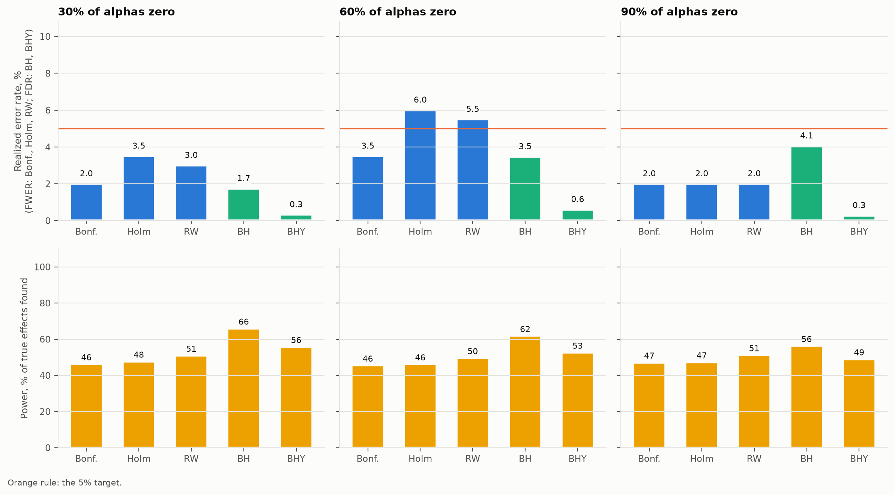
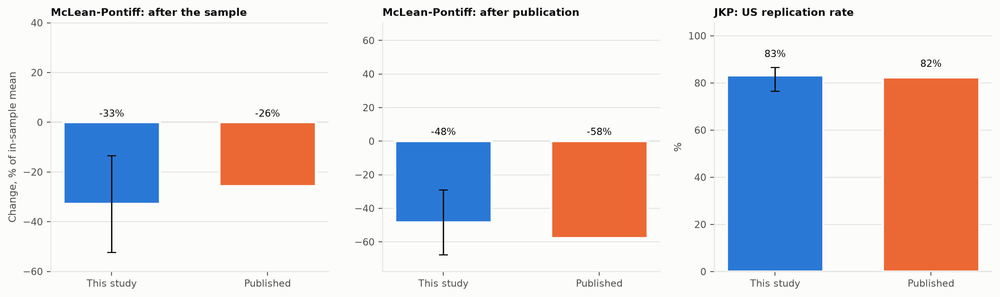

# Question

The literature has produced hundreds of variables that predict the cross-section of US stock returns. Three questions decide how much of it to believe. Does a predictor's return survive the end of the sample its authors studied, and its publication? How many of the in-sample t-statistics clear a bar that accounts for how many were tried and for how correlated they are? Does a predictor found in the US also work elsewhere? Two of the answers have published benchmarks, McLean and Pontiff (2016) and Jensen, Kelly and Pedersen (2023), which this study reproduces on their own windows.

# Data

Open Source Asset Pricing (Chen and Zimmermann 2022), release Data-Release-2026.10, provides monthly long-short returns for 212 predictors built as in the original papers, from 1926-01 to 2025-12. Its SignalDoc gives each predictor's sample start and end years and its journal year (1973 to 2016). OSAP also publishes value-weighted, NYSE-only, price-screened and microcap-free variants of the same portfolios. Global Factor Data provides 153 factors signed by the original paper's direction, with capped value weights, for 71 countries and regional aggregates. Its reference files map each factor to one of 13 theme clusters and flag whether the original paper found it significant. The Kenneth French library supplies the market, the five Fama-French factors and momentum. Every file is downloaded with resumable, conditional requests and hashed in a SHA-256 manifest (digest `3a8ed902c8b6`).

# Method

## Periods and decay

A month is in sample when its year lies between the paper's sample start and end years. Publication is placed at the end of the journal year (month 12), optionally moved back by $s$ years. Months after it are post publication; months between the sample end and publication are post sample. Months before the sample start are dropped. For predictor $i$ in month $t$,

$$
R_{i,t} = \alpha_i + \beta_1 \, \mathrm{PostSample}_{i,t} + \beta_2 \, \mathrm{PostPub}_{i,t} + \varepsilon_{i,t},
$$

with predictor fixed effects $\alpha_i$ and standard errors clustered by month, since predictor returns move together. The fixed effects are estimated as coefficients rather than demeaned away, so the covariance between their average $\bar\alpha$ and the slopes is available. The decay is $\beta_k / \bar\alpha$, with a delta-method interval. Predictors need 36 in-sample months to enter.

## Multiple testing

Each predictor's in-sample mean is tested against zero, one-sided, with an autocorrelation-robust standard error. Newey-West with a Student-t reference rejects too often in the far tail that Bonferroni and Holm use, so the long-run variance is the equal-weighted cosine estimator of Lazarus, Lewis, Stock and Watson (2018), with $\nu = 0.4 T^{2/3}$ cosine terms and a $t_\nu$ reference. The median first-order autocorrelation of in-sample returns is 0.091, well inside the range where that rule keeps its size. The p-values go through Bonferroni and Holm (family-wise error), Benjamini-Hochberg and Benjamini-Yekutieli (false discovery rate, the latter under any dependence), and the Harvey-Liu-Zhu hurdle $t > 3.0$. The Romano-Wolf step-down uses studentized means and draws whole calendar months in 12-month circular blocks, 5000 times. Every predictor sees the same resampled calendar, so the cross-sectional dependence that breaks plain Benjamini-Hochberg is kept in the null distribution. The share of true nulls $\pi_0$ is Storey's (2002) estimator at a fixed $\lambda = 0.5$. The bootstrap choice of $\lambda$ (Storey, Taylor and Siegmund 2004) is reported alongside it. In the simulation the bootstrap rule underestimates $\pi_0$, because it targets the smallest of several noisy estimates.

## Empirical Bayes

Following Jensen, Kelly and Pedersen (2023), each factor's return is made market neutral against its own region's market and scaled to 10% annual volatility. Its alpha estimate $\hat\alpha_i$ is the mean. The model is

$$
\alpha_i = c_{k(i)} + w_i, \quad c_k \sim N(0, \tau_c^2), \quad w_i \sim N(0, \tau_w^2), \quad \hat\alpha \mid \alpha \sim N(\alpha, \Sigma),
$$

so $\alpha \sim N(0, \Omega)$ with $\Omega = \tau_c^2 M M' + \tau_w^2 I$ for cluster membership $M$. The hyperparameters maximize the marginal likelihood of $\hat\alpha \sim N(0, \Omega + \Sigma)$. $\Sigma$ comes from pairwise correlations of the scaled returns, shrunk toward the identity with the Schafer-Strimmer intensity, because in many countries factors outnumber useful months. Pairwise correlations from factors with different start dates are not a valid correlation matrix, so its eigenvalues are raised to the Marchenko-Pastur lower edge $(1-\sqrt{K/n})^2$ for $K$ factors and median pairwise overlap $n$ (Laloux et al. 1999) and the matrix is rescaled to a unit diagonal (0.34 in the US, where 106 of 153 eigenvalues are raised). A numerical floor instead leaves directions in which the alphas look known exactly. The posterior mean is $\Omega(\Omega+\Sigma)^{-1}\hat\alpha$. The replication rate is the share of originally significant factors whose 95% posterior interval lies above zero. Its interval follows JKP: draw from the joint posterior and count factors whose drawn alpha exceeds 1.96 posterior standard deviations.

## Out of sample in space

The US posterior $N(m, V)$ is scored as a forecast of each other country's alpha estimates $\hat\alpha_c$ over the factors both share. Four predictive densities compete: transfer, $N(m, V + \eta^2 I + \Sigma_c)$, with $\eta$ estimated on every other country; strict transfer with $\eta = 0$; dispersion only, $N(0, \Omega + \Sigma_c)$, which knows the US spread of alphas but not their direction; and no skill, $N(0, \Sigma_c)$. The score is the log predictive density per factor.

# Results

## Decay

@fig-headline shows the three levels. Across 212 predictors (138686 predictor-months), the in-sample average is 0.683% a month. After the sample and before publication it changes by -0.235 (t = -3.68), or -34%. After publication it changes by -0.373 (t = -6.71), or -55% with 95% interval -68% to -41%. On the 165 clear replications the post-publication change is -58%.

{#fig-headline}

Interacting the dummies with the standardized in-sample t-statistic gives a post-publication slope of -0.195 (t = -6.21) per standard deviation. Stronger in-sample predictors lose more after publication. The interaction with the liquidity rank (the share of in-sample return that survives the microcap screen) is +0.194 (t = 1.14).

Moving publication back by 3 years moves the post-publication change to -53% (@fig-shifts). Against CAPM and FF5 plus momentum the change is -46% and -35%.

{#fig-shifts}

## How many are real

@fig-discoveries shades each procedure's discoveries. With no correction, 181 of 212 are significant at the one-sided 5% level. Bonferroni keeps 55, Holm 58, Benjamini-Hochberg 178, Benjamini-Yekutieli 96, the $t > 3.0$ hurdle 101 and Romano-Wolf 76. Storey's estimate puts the share of true nulls at 3% ($\lambda$ = 0.5), which implies about 206 real effects among the 212. The bootstrap $\lambda$ (0.60) gives 1%.

{#fig-discoveries}

## Replication

- usa: 84.0% of 119 factors (76% to 87%), $\tau_c$ = 0.257, $\tau_w$ = 0.131, 1200 months.
- developed: 54.6% of 119 factors (39% to 63%), $\tau_c$ = 0.163, $\tau_w$ = 0.135, 480 months.
- emerging: 46.2% of 119 factors (39% to 59%), $\tau_c$ = 0.224, $\tau_w$ = 0.156, 454 months.
- frontier: 28.0% of 107 factors (23% to 42%), $\tau_c$ = 0.202, $\tau_w$ = 0.181, 227 months.
- world: 70.6% of 119 factors (58% to 76%), $\tau_c$ = 0.221, $\tau_w$ = 0.130, 482 months.

{#fig-regions}

{#fig-clusters}

## Out of sample in space

Across 52 countries with at least 20 shared factors, transfer beats no skill in 81% of them and beats the dispersion-only prior in 40%. The median per-factor gain over no skill is 0.235. The median $\eta$, the typical deviation of a country's alpha from the US posterior, is 0.090% a month in scaled units.

{#fig-space}

## Tradability

@fig-trade repeats the headline on the alternative constructions. Without microcaps, the in-sample return is 0.50% a month, the post-publication change -61% and BHY keeps 54 predictors.

{#fig-trade}

# Validation

## Known truth

200 zoos of 200 factors are simulated from a 5-factor structure fitted to the real in-sample panel, with 30%, 60% and 90% of alphas set to zero. The rest are exponential, with mean 0.600%, the median positive in-sample mean.

| Share of nulls | Procedure | Target | Realized | Power |
| --- | --- | --- | --- | --- |
| 30% | Bonferroni | FWER at 5% | 2.0% | 46% |
| 30% | Holm | FWER at 5% | 3.5% | 48% |
| 30% | Romano-Wolf | FWER at 5% | 3.0% | 51% |
| 30% | Benjamini-Hochberg | FDR at 5% | 1.7% | 66% |
| 30% | Benjamini-Yekutieli | FDR at 5% | 0.3% | 56% |
| 60% | Bonferroni | FWER at 5% | 3.5% | 46% |
| 60% | Holm | FWER at 5% | 6.0% | 46% |
| 60% | Romano-Wolf | FWER at 5% | 5.5% | 50% |
| 60% | Benjamini-Hochberg | FDR at 5% | 3.5% | 62% |
| 60% | Benjamini-Yekutieli | FDR at 5% | 0.6% | 53% |
| 90% | Bonferroni | FWER at 5% | 2.0% | 47% |
| 90% | Holm | FWER at 5% | 2.0% | 47% |
| 90% | Romano-Wolf | FWER at 5% | 2.0% | 51% |
| 90% | Benjamini-Hochberg | FDR at 5% | 4.1% | 56% |
| 90% | Benjamini-Yekutieli | FDR at 5% | 0.3% | 49% |

The largest realized error rate is 6.0% against a 5% target; with 200 replications one Monte Carlo standard error is 1.5 percentage points, so every procedure is within two standard errors of its target.

With 90% true nulls, the fixed-$\lambda$ Storey estimate averages 87.7% and the bootstrap-$\lambda$ estimate 71.2%.

Empirical Bayes intervals cover the true alpha 93.9% of the time against a nominal 95%. Estimated $\tau_c$ averages 0.248 (true 0.257) and $\tau_w$ 0.135 (true 0.131). The posterior mean's error is 0.082 against 0.116 for OLS.

{#fig-sim}

## Published benchmarks

On returns to 2013-12 and predictors published by 2013, the post-sample change is -33% and the post-publication change -48%, against McLean and Pontiff's -26% and -58%. The in-sample mean is 0.687% against their 0.582%. The predictor sets differ: OSAP's rebuilt set against their 97 original portfolios.
For JKP's US sample to 2019-12, with their unshrunk covariance, the replication rate is 83.2% of 119 factors against their 82.4% of 119. Benjamini-Yekutieli gives 79.0% against 75.6%. The public file is a later vintage than the paper's, which accounts for part of the difference.

{#fig-bench}

# Limitations

OSAP rebuilds predictors from public data, so each result is reported for the clear-replication subset too. Journal years overstate when the market learned of a predictor, so decay is reported for each publication shift. Full-sample betas in the CAPM and FF6 bases use future information; the headline uses raw returns. Global Factor Data samples outside the US are short, which the covariance shrinkage (intensity 0.007 in the US) and the minimum of 20 shared factors address. The space test uses the full US sample, so it is out of sample in space, not in time.

# References

Benjamini, Y. and Yekutieli, D. (2001). The control of the false discovery rate in multiple testing under dependency. *Annals of Statistics* 29(4), 1165-1188.

Chen, A. Y. and Zimmermann, T. (2022). Open source cross-sectional asset pricing. *Critical Finance Review* 11(2), 207-264.

Harvey, C. R., Liu, Y. and Zhu, H. (2016). ... and the cross-section of expected returns. *Review of Financial Studies* 29(1), 5-68.

Jensen, T. I., Kelly, B. and Pedersen, L. H. (2023). Is there a replication crisis in finance? *Journal of Finance* 78(5), 2465-2518.

Lazarus, E., Lewis, D. J., Stock, J. H. and Watson, M. W. (2018). HAR inference: recommendations for practice. *Journal of Business and Economic Statistics* 36(4), 541-559.

McLean, R. D. and Pontiff, J. (2016). Does academic research destroy stock return predictability? *Journal of Finance* 71(1), 5-32.

Romano, J. P. and Wolf, M. (2005). Stepwise multiple testing as formalized data snooping. *Econometrica* 73(4), 1237-1282.

Laloux, L., Cizeau, P., Bouchaud, J.-P. and Potters, M. (1999). Noise dressing of financial correlation matrices. *Physical Review Letters* 83(7), 1467-1470.

Schafer, J. and Strimmer, K. (2005). A shrinkage approach to large-scale covariance matrix estimation. *Statistical Applications in Genetics and Molecular Biology* 4(1).

Storey, J. D. (2002). A direct approach to false discovery rates. *Journal of the Royal Statistical Society B* 64(3), 479-498.

Storey, J. D., Taylor, J. E. and Siegmund, D. (2004). Strong control, conservative point estimation and simultaneous conservative consistency of false discovery rates. *Journal of the Royal Statistical Society B* 66(1), 187-205.
