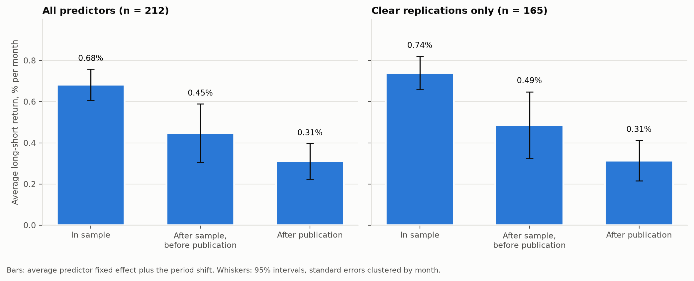
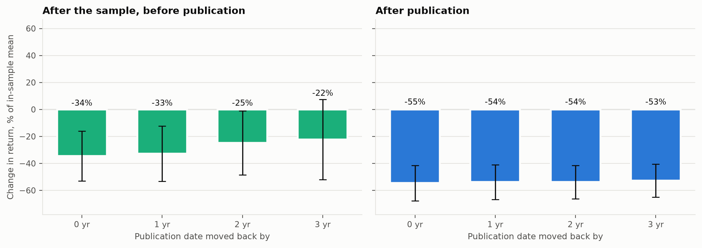
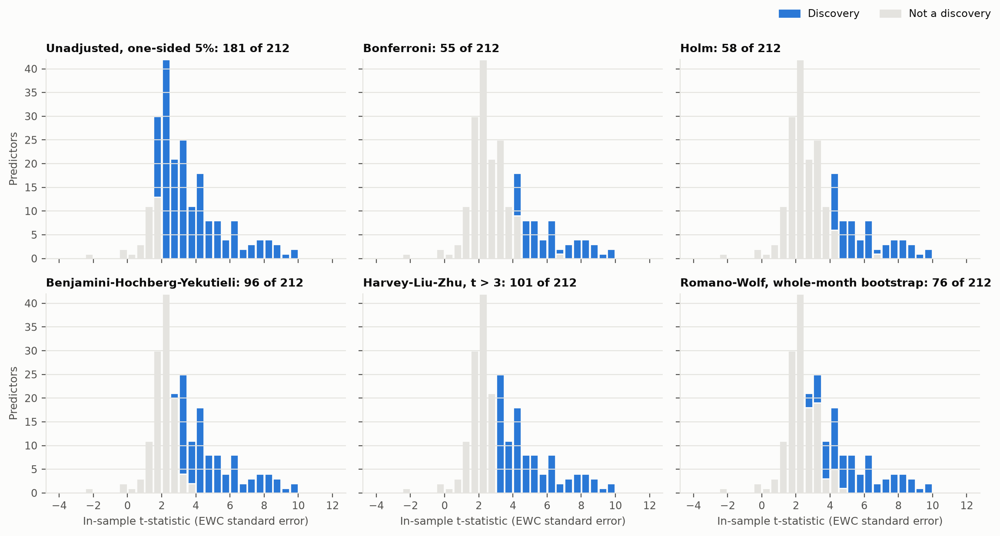
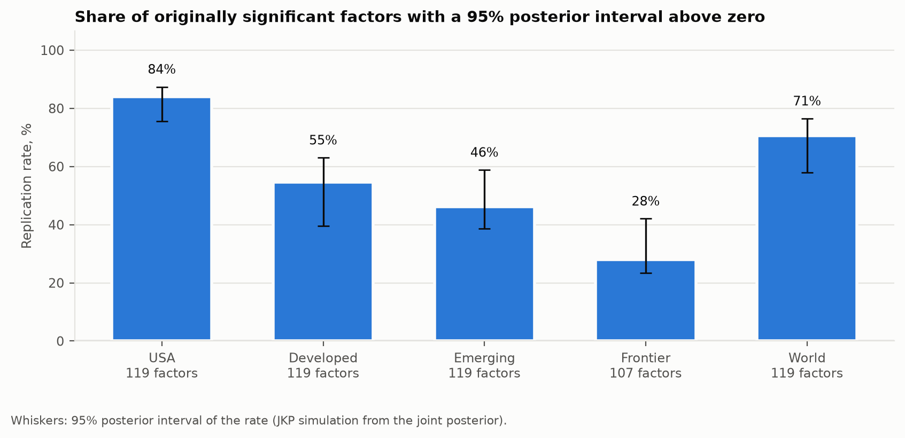
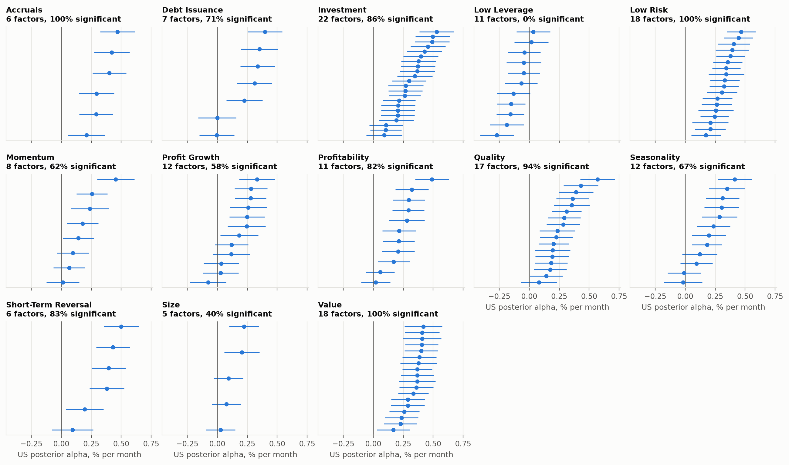
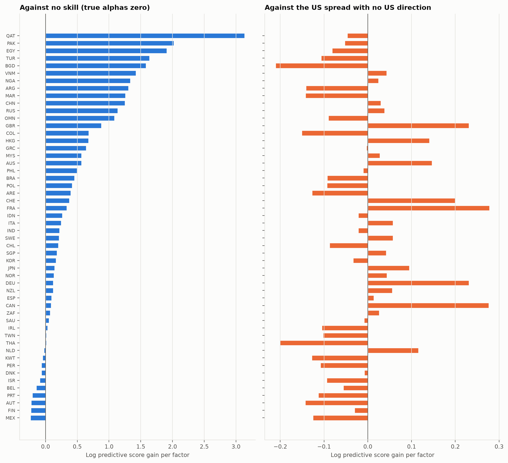
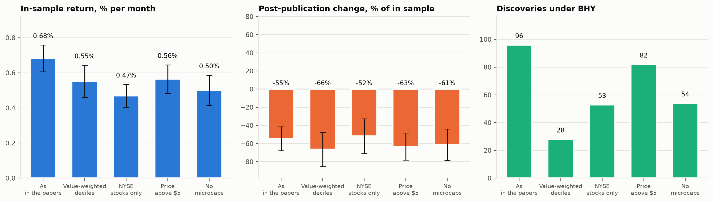
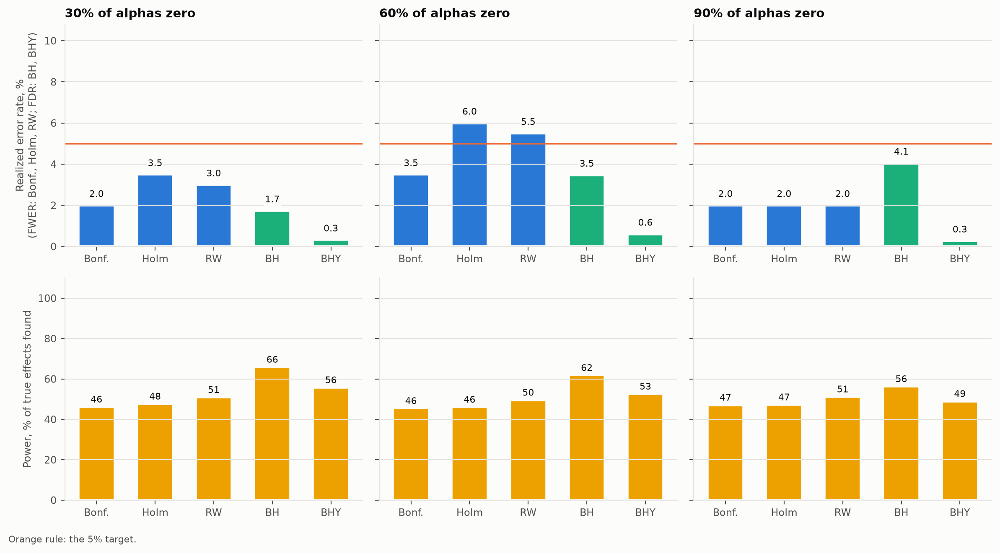
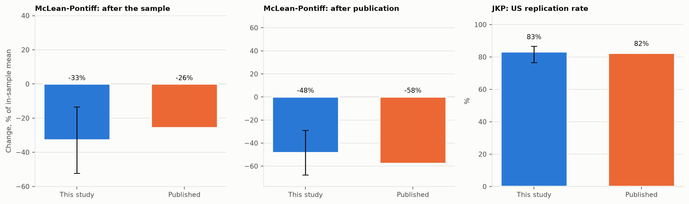

<% set h = r.headline %>
<% set d = h.decay %>
<% set dc = h.decay_clear %>
<% set t = h.testing %>
<% set us = h.us %>
<% set sp = h.space %>
<% set e = r.estimates %>
<% set mp = e.osap.mclean_pontiff %>
<% set jb = e.jkp.benchmark %>
<% set sim = e.simulation %>
<% set ia = e.osap.interactions.coefficients %>
<% set abstract %>
<% if r.provenance != "official" %>Synthetic fixture run: the numbers below test the pipeline and describe no real anomaly. <% endif %>We audit << e.osap.n_predictors >> published US equity return predictors from Open Source Asset Pricing and << e.jkp.n_factors >> factors from Global Factor Data. In a McLean-Pontiff panel with month-clustered errors, the average predictor's long-short return falls from << d.in_sample.value | num >>% a month in sample to << d.post_publication.value | num >>% after publication, a change of << d.share_post_publication.value | pct >>. Of << t.n_tests >> in-sample tests, << t.counts.bhy >> survive Benjamini-Yekutieli and << t.counts.romano_wolf >> survive a Romano-Wolf step-down that resamples whole months. A hierarchical empirical Bayes model gives a US replication rate of << us.replication_rate | pct(1) >>, and the US posterior forecasts other countries' alphas better than no skill in << sp.share_transfer_beats_no_skill | pct >> of << sp.n_countries >> countries.
<% endset %>
---
title: "The factor zoo on trial"
subtitle: "Decay, multiple testing and replication of published equity anomalies"
author: "Ian Wachira"
date: "<< r.generated_at[:10] >>"
abstract: << abstract | trim | tojson >>
format:
  typst:
    papersize: a4
    margin:
      x: 2.2cm
      y: 2.4cm
    fontsize: 10pt
    section-numbering: "1.1"
  html:
    toc: true
    embed-resources: true
---

# Question

The literature has produced hundreds of variables that predict the cross-section of US stock returns. Three questions decide how much of it to believe. Does a predictor's return survive the end of the sample its authors studied, and its publication? How many of the in-sample t-statistics clear a bar that accounts for how many were tried and for how correlated they are? Does a predictor found in the US also work elsewhere? Two of the answers have published benchmarks, McLean and Pontiff (2016) and Jensen, Kelly and Pedersen (2023), which this study reproduces on their own windows.

# Data

Open Source Asset Pricing (Chen and Zimmermann 2022), release << r.osap_release >>, provides monthly long-short returns for << e.osap.n_predictors >> predictors built as in the original papers, from << e.osap.first_month[:7] >> to << e.osap.last_month[:7] >>. Its SignalDoc gives each predictor's sample start and end years and its journal year (<< e.osap.publication_years[0] >> to << e.osap.publication_years[1] >>). OSAP also publishes value-weighted, NYSE-only, price-screened and microcap-free variants of the same portfolios. Global Factor Data provides << e.jkp.n_factors >> factors signed by the original paper's direction, with capped value weights, for << e.jkp.n_countries_downloaded >> countries and regional aggregates. Its reference files map each factor to one of << e.jkp.n_clusters >> theme clusters and flag whether the original paper found it significant. The Kenneth French library supplies the market, the five Fama-French factors and momentum. Every file is downloaded with resumable, conditional requests and hashed in a SHA-256 manifest (digest `<< r.manifest_digest[:12] >>`).

# Method

## Periods and decay

A month is in sample when its year lies between the paper's sample start and end years. Publication is placed at the end of the journal year (month << r.settings.publication_month >>), optionally moved back by $s$ years. Months after it are post publication; months between the sample end and publication are post sample. Months before the sample start are dropped. For predictor $i$ in month $t$,

$$
R_{i,t} = \alpha_i + \beta_1 \, \mathrm{PostSample}_{i,t} + \beta_2 \, \mathrm{PostPub}_{i,t} + \varepsilon_{i,t},
$$

with predictor fixed effects $\alpha_i$ and standard errors clustered by month, since predictor returns move together. The fixed effects are estimated as coefficients rather than demeaned away, so the covariance between their average $\bar\alpha$ and the slopes is available. The decay is $\beta_k / \bar\alpha$, with a delta-method interval. Predictors need << r.settings.min_months_in_sample >> in-sample months to enter.

## Multiple testing

Each predictor's in-sample mean is tested against zero, one-sided, with an autocorrelation-robust standard error. Newey-West with a Student-t reference rejects too often in the far tail that Bonferroni and Holm use, so the long-run variance is the equal-weighted cosine estimator of Lazarus, Lewis, Stock and Watson (2018), with $\nu = << r.settings.ewc_coefficient | num(1) >> T^{2/3}$ cosine terms and a $t_\nu$ reference. The median first-order autocorrelation of in-sample returns is << t.median_rho1 | num(3) >>, well inside the range where that rule keeps its size. The p-values go through Bonferroni and Holm (family-wise error), Benjamini-Hochberg and Benjamini-Yekutieli (false discovery rate, the latter under any dependence), and the Harvey-Liu-Zhu hurdle $t > << r.settings.hlz_threshold | num(1) >>$. The Romano-Wolf step-down uses studentized means and draws whole calendar months in << r.settings.romano_wolf_block_months >>-month circular blocks, << r.settings.romano_wolf_draws >> times. Every predictor sees the same resampled calendar, so the cross-sectional dependence that breaks plain Benjamini-Hochberg is kept in the null distribution. The share of true nulls $\pi_0$ is Storey's (2002) estimator at a fixed $\lambda = << r.settings.storey_lambda | num(1) >>$. The bootstrap choice of $\lambda$ (Storey, Taylor and Siegmund 2004) is reported alongside it. In the simulation the bootstrap rule underestimates $\pi_0$, because it targets the smallest of several noisy estimates.

## Empirical Bayes

Following Jensen, Kelly and Pedersen (2023), each factor's return is made market neutral against its own region's market and scaled to << r.settings.vol_target | num(0) >>% annual volatility. Its alpha estimate $\hat\alpha_i$ is the mean. The model is

$$
\alpha_i = c_{k(i)} + w_i, \quad c_k \sim N(0, \tau_c^2), \quad w_i \sim N(0, \tau_w^2), \quad \hat\alpha \mid \alpha \sim N(\alpha, \Sigma),
$$

so $\alpha \sim N(0, \Omega)$ with $\Omega = \tau_c^2 M M' + \tau_w^2 I$ for cluster membership $M$. The hyperparameters maximize the marginal likelihood of $\hat\alpha \sim N(0, \Omega + \Sigma)$. $\Sigma$ comes from pairwise correlations of the scaled returns, shrunk toward the identity with the Schafer-Strimmer intensity, because in many countries factors outnumber useful months. Pairwise correlations from factors with different start dates are not a valid correlation matrix, so its eigenvalues are raised to the Marchenko-Pastur lower edge $(1-\sqrt{K/n})^2$ for $K$ factors and median pairwise overlap $n$ (Laloux et al. 1999) and the matrix is rescaled to a unit diagonal (<< us.eigenvalue_floor | num(2) >> in the US, where << us.eigenvalues_clipped >> of << us.n_factors >> eigenvalues are raised). A numerical floor instead leaves directions in which the alphas look known exactly. The posterior mean is $\Omega(\Omega+\Sigma)^{-1}\hat\alpha$. The replication rate is the share of originally significant factors whose 95% posterior interval lies above zero. Its interval follows JKP: draw from the joint posterior and count factors whose drawn alpha exceeds 1.96 posterior standard deviations.

## Out of sample in space

The US posterior $N(m, V)$ is scored as a forecast of each other country's alpha estimates $\hat\alpha_c$ over the factors both share. Four predictive densities compete: transfer, $N(m, V + \eta^2 I + \Sigma_c)$, with $\eta$ estimated on every other country; strict transfer with $\eta = 0$; dispersion only, $N(0, \Omega + \Sigma_c)$, which knows the US spread of alphas but not their direction; and no skill, $N(0, \Sigma_c)$. The score is the log predictive density per factor.

# Results

## Decay

@fig-headline shows the three levels. Across << d.n_signals >> predictors (<< d.n_obs >> predictor-months), the in-sample average is << d.in_sample.value | num(3) >>% a month. After the sample and before publication it changes by << d.beta_post_sample.value | signed(3) >> (t = << d.beta_post_sample.t | num >>), or << d.share_post_sample.value | pct >>. After publication it changes by << d.beta_post_publication.value | signed(3) >> (t = << d.beta_post_publication.t | num >>), or << d.share_post_publication.value | pct >> with 95% interval << d.share_post_publication.low | pct >> to << d.share_post_publication.high | pct >>. On the << dc.n_signals >> clear replications the post-publication change is << dc.share_post_publication.value | pct >>.

{#fig-headline}

Interacting the dummies with the standardized in-sample t-statistic gives a post-publication slope of << ia.post_publication_x_t_in_sample.value | signed(3) >> (t = << ia.post_publication_x_t_in_sample.t | num >>) per standard deviation. Stronger in-sample predictors lose more after publication. The interaction with the liquidity rank (the share of in-sample return that survives the microcap screen) is << ia.post_publication_x_liquidity.value | signed(3) >> (t = << ia.post_publication_x_liquidity.t | num >>).

Moving publication back by << r.settings.publication_shifts[-1] >> years moves the post-publication change to << r.shifts[r.settings.publication_shifts[-1] | string].share_post_publication.value | pct >> (@fig-shifts). Against CAPM and FF5 plus momentum the change is << r.bases.capm.share_post_publication.value | pct >> and << r.bases.ff6.share_post_publication.value | pct >>.

{#fig-shifts}

## How many are real

@fig-discoveries shades each procedure's discoveries. With no correction, << t.counts.unadjusted >> of << t.n_tests >> are significant at the one-sided << r.settings.level | pct >> level. Bonferroni keeps << t.counts.bonferroni >>, Holm << t.counts.holm >>, Benjamini-Hochberg << t.counts.bh >>, Benjamini-Yekutieli << t.counts.bhy >>, the $t > << r.settings.hlz_threshold | num(1) >>$ hurdle << t.counts.hlz >> and Romano-Wolf << t.counts.romano_wolf >>. Storey's estimate puts the share of true nulls at << t.storey_pi0 | pct >> ($\lambda$ = << t.storey_lambda | num(1) >>), which implies about << t.storey_true_effects | num(0) >> real effects among the << t.n_tests >>. The bootstrap $\lambda$ (<< t.storey_lambda_bootstrap | num(2) >>) gives << t.storey_pi0_bootstrap | pct >>.

{#fig-discoveries}

## Replication

<% for name, g in e.jkp.regions.items() %>
- << name >>: << g.replication_rate | pct(1) >> of << g.n_counted >> factors (<< g.replication_low | pct >> to << g.replication_high | pct >>), $\tau_c$ = << g.tau_c | num(3) >>, $\tau_w$ = << g.tau_w | num(3) >>, << g.months >> months.
<% endfor %>

{#fig-regions}

{#fig-clusters}

## Out of sample in space

Across << sp.n_countries >> countries with at least << r.settings.space_min_factors >> shared factors, transfer beats no skill in << sp.share_transfer_beats_no_skill | pct >> of them and beats the dispersion-only prior in << sp.share_transfer_beats_dispersion | pct >>. The median per-factor gain over no skill is << sp.median_gain_vs_no_skill | num(3) >>. The median $\eta$, the typical deviation of a country's alpha from the US posterior, is << sp.eta_median | num(3) >>% a month in scaled units.

{#fig-space}

## Tradability

<% set nm = r.variants[r.settings.liquidity_variant] %>
@fig-trade repeats the headline on the alternative constructions. Without microcaps, the in-sample return is << nm.decay.in_sample.value | num >>% a month, the post-publication change << nm.decay.share_post_publication.value | pct >> and BHY keeps << nm.testing.counts.bhy >> predictors.

{#fig-trade}

# Validation

## Known truth

<< r.settings.simulation.replications >> zoos of << r.settings.simulation.n_factors >> factors are simulated from a << r.settings.simulation.latent_factors >>-factor structure fitted to the real in-sample panel, with << r.settings.simulation.null_shares | map('pct') | join_words >> of alphas set to zero. The rest are exponential, with mean << sim.effect_mean | num(3) >>%, the median positive in-sample mean.

| Share of nulls | Procedure | Target | Realized | Power |
| --- | --- | --- | --- | --- |
<% for share, block in sim.testing.items() %>
<% for proc in ["bonferroni", "holm", "romano_wolf", "bh", "bhy"] %>
| << share | float | pct >> | << {"bonferroni": "Bonferroni", "holm": "Holm", "romano_wolf": "Romano-Wolf", "bh": "Benjamini-Hochberg", "bhy": "Benjamini-Yekutieli"}[proc] >> | << block[proc].target | upper >> at << r.settings.level | pct >> | << block[proc].realized | pct(1) >> | << block[proc].power | pct >> |
<% endfor %>
<% endfor %>

<% set se = (r.settings.level * (1 - r.settings.level) / r.settings.simulation.replications) ** 0.5 %>
<% set worst = namespace(x=0.0) %>
<% for share, block in sim.testing.items() %><% for proc in ["bonferroni", "holm", "romano_wolf", "bh", "bhy"] %><% if block[proc].realized > worst.x %><% set worst.x = block[proc].realized %><% endif %><% endfor %><% endfor %>
The largest realized error rate is << worst.x | pct(1) >> against a << r.settings.level | pct >> target; with << r.settings.simulation.replications >> replications one Monte Carlo standard error is << (100 * se) | num(1) >> percentage points, so <% if worst.x - r.settings.level <= 2 * se %>every procedure is within two standard errors of its target<% else %>at least one procedure exceeds its target by more than two standard errors<% endif %>.

<% set last = sim.testing[sim.testing | list | last] %>
With << (r.settings.simulation.null_shares[-1]) | pct >> true nulls, the fixed-$\lambda$ Storey estimate averages << last.storey_pi0.mean | pct(1) >> and the bootstrap-$\lambda$ estimate << last.storey_pi0.mean_bootstrap | pct(1) >>.

Empirical Bayes intervals cover the true alpha << sim.empirical_bayes.coverage | pct(1) >> of the time against a nominal << sim.empirical_bayes.nominal | pct >>. Estimated $\tau_c$ averages << sim.empirical_bayes.tau_c_mean | num(3) >> (true << sim.empirical_bayes.tau_c_true | num(3) >>) and $\tau_w$ << sim.empirical_bayes.tau_w_mean | num(3) >> (true << sim.empirical_bayes.tau_w_true | num(3) >>). The posterior mean's error is << sim.empirical_bayes.rmse_posterior | num(3) >> against << sim.empirical_bayes.rmse_ols | num(3) >> for OLS.

{#fig-sim}

## Published benchmarks

On returns to << mp.last_month >> and predictors published by << mp.last_month[:4] >>, the post-sample change is << mp.estimate.share_post_sample.value | pct >> and the post-publication change << mp.estimate.share_post_publication.value | pct >>, against McLean and Pontiff's << mp.published.share_post_sample | pct >> and << mp.published.share_post_publication | pct >>. The in-sample mean is << mp.estimate.in_sample.value | num(3) >>% against their << mp.published.in_sample_mean | num(3) >>%. The predictor sets differ: OSAP's rebuilt set against their 97 original portfolios.
<% if jb is defined %>
For JKP's US sample to << jb.last_month >>, with their unshrunk covariance, the replication rate is << jb.estimate.replication_rate | pct(1) >> of << jb.estimate.n_counted >> factors against their << jb.published.replication_rate | pct(1) >> of << jb.published.n_factors >>. Benjamini-Yekutieli gives << jb.estimate.by_rate | pct(1) >> against << jb.published.by_rate | pct(1) >>. The public file is a later vintage than the paper's, which accounts for part of the difference.
<% endif %>

{#fig-bench}

# Limitations

OSAP rebuilds predictors from public data, so each result is reported for the clear-replication subset too. Journal years overstate when the market learned of a predictor, so decay is reported for each publication shift. Full-sample betas in the CAPM and FF6 bases use future information; the headline uses raw returns. Global Factor Data samples outside the US are short, which the covariance shrinkage (intensity << us.shrinkage_intensity | num(3) >> in the US) and the minimum of << r.settings.space_min_factors >> shared factors address. The space test uses the full US sample, so it is out of sample in space, not in time.

# References

Benjamini, Y. and Yekutieli, D. (2001). The control of the false discovery rate in multiple testing under dependency. *Annals of Statistics* 29(4), 1165-1188.

Chen, A. Y. and Zimmermann, T. (2022). Open source cross-sectional asset pricing. *Critical Finance Review* 11(2), 207-264.

Harvey, C. R., Liu, Y. and Zhu, H. (2016). ... and the cross-section of expected returns. *Review of Financial Studies* 29(1), 5-68.

Jensen, T. I., Kelly, B. and Pedersen, L. H. (2023). Is there a replication crisis in finance? *Journal of Finance* 78(5), 2465-2518.

Lazarus, E., Lewis, D. J., Stock, J. H. and Watson, M. W. (2018). HAR inference: recommendations for practice. *Journal of Business and Economic Statistics* 36(4), 541-559.

McLean, R. D. and Pontiff, J. (2016). Does academic research destroy stock return predictability? *Journal of Finance* 71(1), 5-32.

Romano, J. P. and Wolf, M. (2005). Stepwise multiple testing as formalized data snooping. *Econometrica* 73(4), 1237-1282.

Laloux, L., Cizeau, P., Bouchaud, J.-P. and Potters, M. (1999). Noise dressing of financial correlation matrices. *Physical Review Letters* 83(7), 1467-1470.

Schafer, J. and Strimmer, K. (2005). A shrinkage approach to large-scale covariance matrix estimation. *Statistical Applications in Genetics and Molecular Biology* 4(1).

Storey, J. D. (2002). A direct approach to false discovery rates. *Journal of the Royal Statistical Society B* 64(3), 479-498.

Storey, J. D., Taylor, J. E. and Siegmund, D. (2004). Strong control, conservative point estimation and simultaneous conservative consistency of false discovery rates. *Journal of the Royal Statistical Society B* 66(1), 187-205.
