








# What funding carry actually pays


> **These numbers come from the synthetic fixture, not from market data.** They check that the pipeline runs and recovers a planted truth, and they say nothing about real funding. Run `uv run pfc results` to rebuild this page from Binance Vision, Binance, Bybit and OKX. `uv run pfc check-provenance` passes only after that.


Long spot, short perpetual, rebalanced into the {{ pf.top_k }} contracts with the highest forecast funding at {{ pf.leverage | num(0) }}x: {{ pf.annual_return | pct(1) }} a year from {{ pf.first }} to {{ pf.last }} after fees, spreads, basis and margin, against {{ h.gross_funding_annual | pct(1) }} from funding alone. The Sharpe ratio is {{ pf.sharpe | num }} ({{ pf.liquidations }} liquidation{{ "" if pf.liquidations == 1 else "s" }}), and its deflated Sharpe ratio across {{ h.trials }} variants is {{ h.deflated_sharpe | num }}. Measured against equity each year, funding paid {{ e.portfolio.decomposition.funding | pct(1) }}, fees took {{ (-e.portfolio.decomposition.fees) | pct(1) }}, spreads {{ (-e.portfolio.decomposition.spread) | pct(1) }}, and basis, liquidations and margin {{ e.portfolio.decomposition.other | pct(1) }}. The same trade in {{ r.settings.core_bases[0] }} alone returned {{ h.btc_carry.annual_return | pct(1) }} a year.

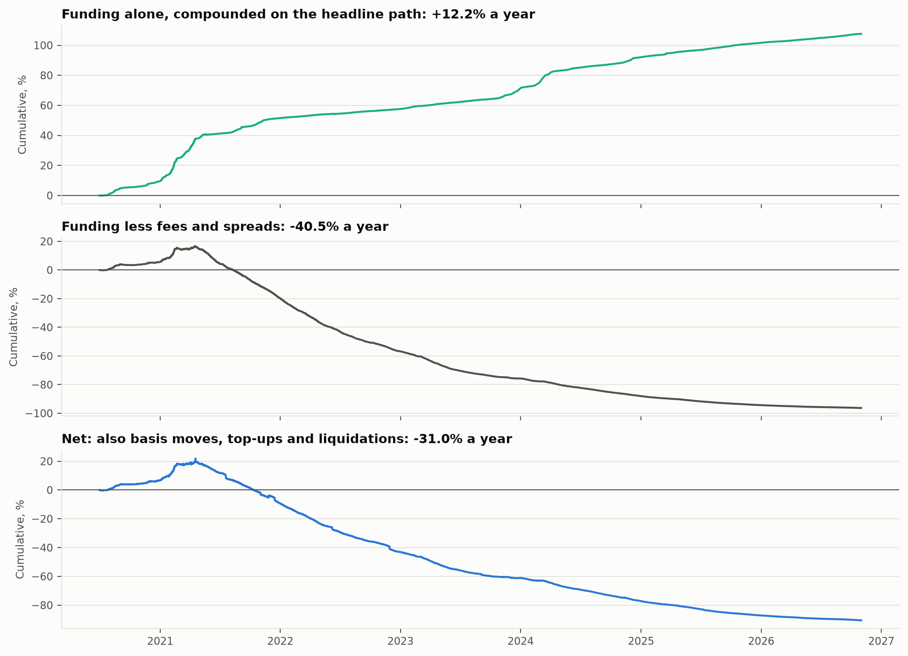

| Question | Answer | Detail |
| --- | --- | --- |
| Can Binance funding be rebuilt from its premium index? | {{ rb.conventions[rb.best].share_within | pct(1) }} of {{ rb.n_prints }} prints within {{ r.settings.rebuild_tolerance_bp | num(0) }} bpNo overlapping premium data | '{{ rb.best }}' conventionboth conventions (only {{ rb.intervals | map('string') | join('/') }}-hour prints), {{ rb.symbols | join(", ") }}, {{ rb.first }} to {{ rb.last }}; median error {{ rb.conventions[rb.best].median_abs_error_bp | num(2) }} bp |
| Does the carry portfolio beat {{ r.settings.core_bases | join_words }} alone? | {{ pf.annual_return | pct(1) }} a year, Sharpe {{ pf.sharpe | num }} ± {{ (1.96 * pf.sharpe_se) | num }} | {{ r.settings.core_bases | join(" + ") }} carry: {{ h.core_mix_carry.annual_return | pct(1) }}, Sharpe {{ h.core_mix_carry.sharpe | num }}; max drawdown {{ pf.max_drawdown | pct(1) }} |
| Can funding be forecast? | {{ hz }}: {{ s.r2_vs_persistence | pct(0) }}{{ "; " if not loop.last }} | Out-of-sample MSE reduction against persistence, by horizon in 8-hour periods |

## Question, data, method

The long-spot, short-perpetual trade is sold as a riskless yield. This project measures what it earns after fees, margin, liquidation and basis moves, whether funding can be forecast, and whether a cross-sectional carry portfolio beats {{ r.settings.core_bases | join_words }} alone. Binance Vision supplies {{ u.contracts }} USDT perpetuals with a spot pair, {{ u.delisted }} of them since delisted, with funding, mark and spot prices from {{ u.first }} to {{ u.last }}. Each funding print is first rebuilt from the 1-minute premium index. The trade is then simulated bar by bar, with isolated margin checked against mark-price highs and three margin paths. Funding forecasts are fitted walk-forward and scored against persistence. Counterparty failure and stablecoin depeg risk are priced as scenarios, since price data cannot show them.

## Supporting exhibits

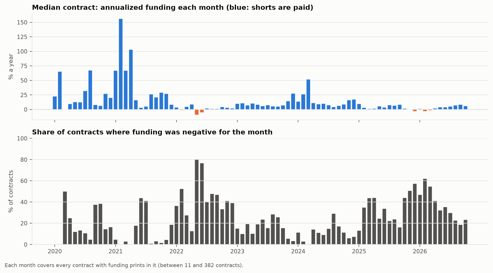

Across {{ cs.contract_months }} contract-months the median paid {{ cs.median_annualized | pct(1) }} a year, and {{ cs.share_contract_months_negative | pct }} of contract-months had negative funding, which the short pays. The median contract was negative in {{ cs.share_months_median_negative | pct }} of {{ cs.months }} months; negative funding was most widespread in {{ cs.most_negative_month }}, when {{ cs.most_negative_share | pct }} of contracts paid longs.

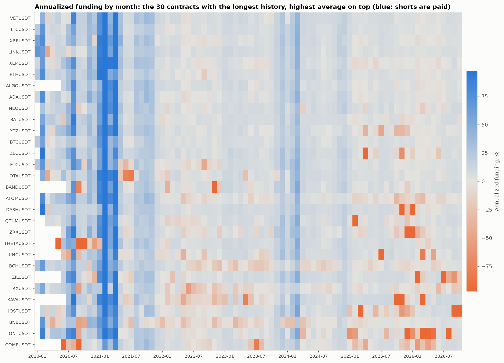

The same funding contract by contract, for the {{ cs.symbols_shown }} contracts with the longest history.

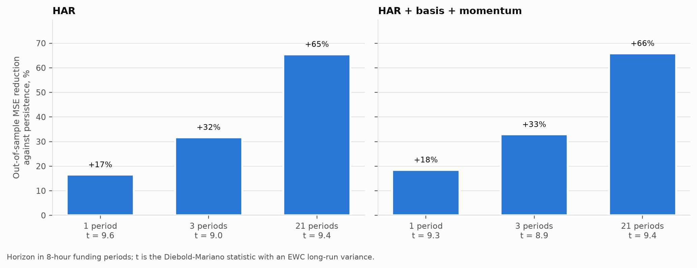

Out-of-sample skill over {{ fc.n_symbols }} contracts from {{ fc.oos_first }}. Positive bars beat the last print.

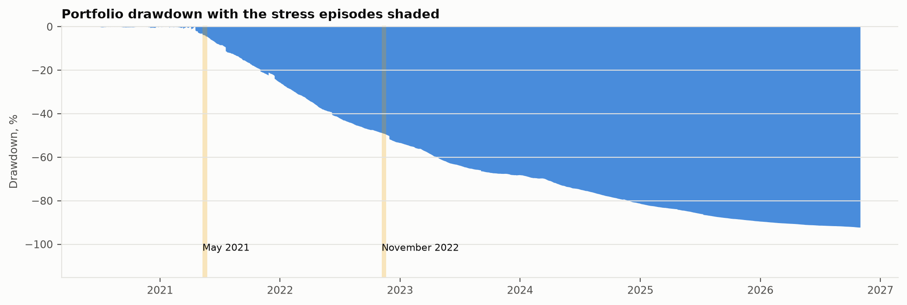

The worst drawdown is {{ pf.max_drawdown | pct(1) }}, from {{ pf.drawdown_peak }} to {{ pf.drawdown_trough }}, recovered by {{ pf.recovered }}, not yet recovered.

<details>
<summary>More exhibits: rebuild accuracy, liquidations, every variant, venues, counterparty risk, benchmarks</summary>


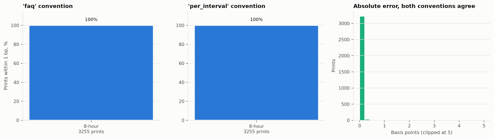

The two readings of Binance's formula agree for 8-hour contracts and differ for shorter ones. On the {{ rb.decisive_prints }} prints where they differ, '{{ rb.best }}' reproduces {{ rb.conventions[rb.best].share_within_decisive | pct(1) }}. Every print in this window is {{ rb.intervals | map('string') | join('/') }}-hourly, so the window cannot tell them apart. Caps and floors can bind on the {{ rb.n_large }} prints of {{ r.settings.cap_test_threshold | pct(1) }} or more, where {{ rb.conventions[rb.best].share_within_large | pct }} are reproduced (none in this sample).


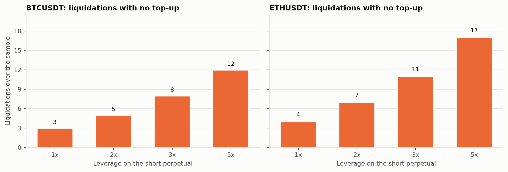

With no top-ups, liquidations at each leverage over the full sample, checked on {{ r.settings.core_bar_interval }} mark-price highs.

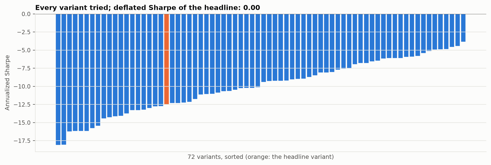

{{ h.trials }} variants: {{ r.settings.models | length }} forecast models, top {{ r.settings.top_k | map('string') | join_words }}, {{ r.settings.volumes | length }} liquidity filters and {{ r.settings.leverages | length }} leverages. {{ e.portfolio.share_variants_positive | pct }} have a positive return.


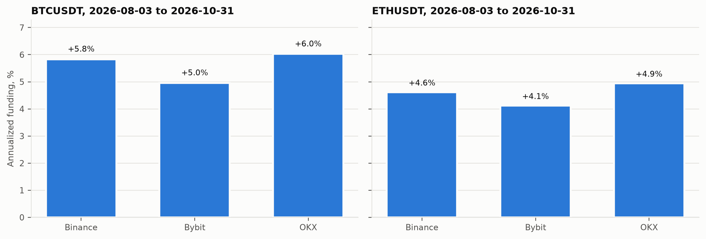

Funding on dates every venue covers. OKX's public history is about three months deep, so its prints accumulate in a local store with each run.


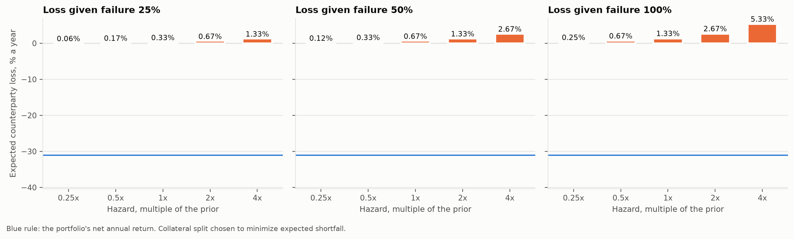

At the prior hazards ({{ r.settings.venue_names[v] }} {{ hz | pct(1) }}{{ ", " if not loop.last }} a year) and {{ cp.lgd | pct }} loss given failure, the split that minimizes {{ r.settings.es_level | pct }} expected shortfall is {{ r.settings.venue_names[v] }} {{ cp["w_" ~ v] | pct }}{{ ", " if not loop.last }}, with a shortfall of {{ cp.expected_shortfall | pct(1) }} against {{ cp.single_venue_shortfall | pct(1) }} with everything on the safest venue. Expected loss is {{ cp.expected_loss | pct(2) }} a year, which leaves {{ cp.net_annual_return | pct(1) }} of net carry. Carry is gone once hazards reach {{ e.counterparty.breakeven_scale | num(1) }} times the prior.

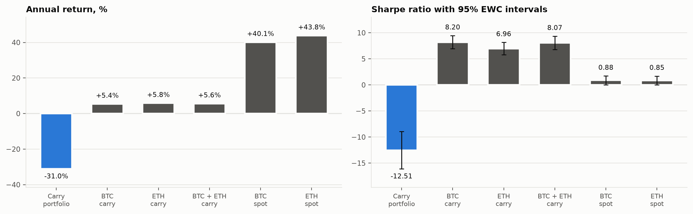

</details>

## Limitations, and the workaround built for each

- **Exchange failure cannot be backtested from prices.** A scenario layer gives each venue an annual failure hazard (a prior swept from {{ e.counterparty.grid[0].hazard_scale | num(2) }} to {{ e.counterparty.grid[-1].hazard_scale | num(0) }} times, with FTX in November 2022 as the reference event) and a loss given failure. It then picks the collateral split that minimizes expected shortfall. Carry is reported net of the expected loss.
- **USDT is not USD.** Equity is marked to USD through {{ r.settings.stablecoin_pair }} at every bar: {{ pf.annual_return_usd | pct(1) }} a year in USD against {{ pf.annual_return | pct(1) }} in USDT. A {{ e.stablecoin.scenario_shock | pct }} depeg would take {{ e.stablecoin.days_of_carry_to_recover | num(0) }} days of carry to earn back.
- **OKX history is about 93 days deep.** Every run appends OKX prints to `data/collected/okx_funding.csv`, which is kept under version control. Running and committing at least once every three months leaves no gaps in the store. Cross-venue figures use only dates all venues cover, and the dates are stated with them.
- **Spreads cannot be read from price bars, and historical quotes are not public for every pair.** `pfc snapshot` measures the best bid and ask of every spot and perpetual pair, each run adds a snapshot to `data/collected/book_snapshots.csv`, and half-spreads are fitted to volume across contracts (perpetual slope {{ e.spread_model.perp.slope | num }}, spot {{ e.spread_model.spot.slope | num }}, from {{ e.spread_model.snapshots }} snapshot{{ "" if e.spread_model.snapshots == 1 else "s" }}). Past bars get the half-spread their volume implies. Because that assumes the relation held in the past, the headline is rerun with all costs at {{ r.settings.cost_multiples | map("string") | join(", ") }} times: {{ row.cost_multiple | num(1) }}x {{ row.annual_return | pct(1) }}{{ ", " if not loop.last }} a year.
- **Binance samples the premium every 5 seconds; the public record is 1-minute klines.** The rebuild uses each minute's close, and both the share within {{ r.settings.rebuild_tolerance_bp | num(0) }} bp and the error distribution are reported.
- **Leverage brackets need a signed request.** Tier-1 maintenance rates are kept in the config with their source, and the positions stay inside tier 1 at the capacity reported: the median rebalance could absorb {{ (e.portfolio.capacity_median_usd or 0) | num(0) }} USD at {{ r.settings.participation | pct }} of daily volume.
- **Unlimited margin is not a tradable path.** It is shown as the frictionless bound. The headline uses top-ups from a reserve of {{ r.settings.reserve_share | pct }}, and the no-top-up path is reported alongside.

## Reproduce

Windows PowerShell, one command per line:

```powershell
cd perp-funding-carry
uv sync
uv run pfc results
uv run pfc check
uv run pfc check-provenance
```

The first run lists the Binance Vision bucket and downloads every monthly file for each contract: funding, mark price, perpetual and spot klines, the 1-minute premium index for the rebuild symbols and daily open interest for {{ r.settings.core_bases | join_words }}. If the connection drops, run it again: files whose MD5 matches the bucket listing are skipped. `uv run pfc results --skip-paper` skips the PDF, and `uv run pfc --help` lists each stage. Without network access, run `uv run pfc fixture mirror` and then `uv run pfc results -o configs/ci.yaml --mirror mirror` to run the whole pipeline on synthetic data.

There is no scheduled refresh workflow. GitHub's hosted runners are in the United States, and the Binance and Bybit APIs refuse requests from there, so a scheduled run would fail every time. Refresh from your own machine instead: `uv run pfc results` downloads only what changed, adds an OKX batch and an order-book snapshot, and the run must happen at least once every three months to keep the OKX store gap-free. Commit `data/collected/` with the results.

## Layout

| Path | Contents |
| --- | --- |
| [`configs/research.yaml`](configs/research.yaml) | Every research choice, fee and margin rate, each with its reason |
| [`src/perp_funding_carry/data`](src/perp_funding_carry/data) | Bucket listing, resumable downloads, REST collectors, parsers, synthetic fixture |
| [`src/perp_funding_carry/models`](src/perp_funding_carry/models) | Funding rebuild, liquidation price, carry and portfolio simulators, forecasts, statistics, counterparty split |
| [`src/perp_funding_carry/evaluation`](src/perp_funding_carry/evaluation) | Bar preparation and every analysis |
| [`reports/`](reports) | Figures, tables and `results.json` |
| [`paper/`](paper) | Full write-up (Quarto, Typst PDF and HTML) |

## References

- Abdi, F. and Ranaldo, A. (2017). A simple estimation of bid-ask spreads from daily close, high, and low prices. *Review of Financial Studies* 30(12), 4437-4480.
- Bailey, D. H. and Lopez de Prado, M. (2014). The deflated Sharpe ratio. *Journal of Portfolio Management* 40(5), 94-107.
- Corsi, F. (2009). A simple approximate long-memory model of realized volatility. *Journal of Financial Econometrics* 7(2), 174-196.
- Diebold, F. X. and Mariano, R. S. (1995). Comparing predictive accuracy. *Journal of Business and Economic Statistics* 13(3), 253-263.
- Duan, N. (1983). Smearing estimate: a nonparametric retransformation method. *Journal of the American Statistical Association* 78(383), 605-610.
- Lazarus, E., Lewis, D. J., Stock, J. H. and Watson, M. W. (2018). HAR inference: recommendations for practice. *Journal of Business and Economic Statistics* 36(4), 541-559.
- Rockafellar, R. T. and Uryasev, S. (2000). Optimization of conditional value-at-risk. *Journal of Risk* 2(3), 21-41.

Data: Binance Vision, the Binance, Bybit and OKX public APIs. Fees from the Binance fee schedule, retrieved {{ r.settings.fees_retrieved }}. This project is not affiliated with any exchange.

<sub>Generated {{ r.generated_at }} from configuration `{{ r.config_fingerprint }}` and inputs `{{ r.manifest_digest[:12] }}` ({{ r.provenance }}).</sub>
