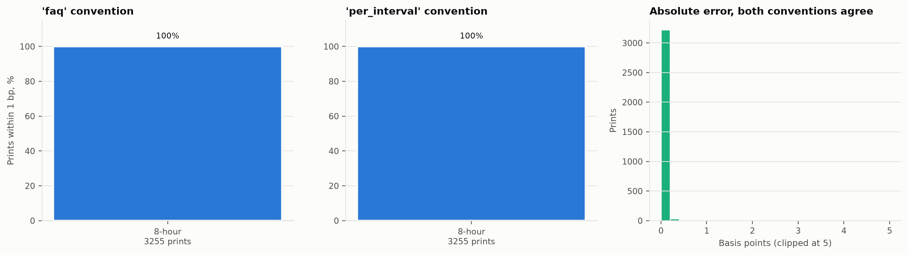
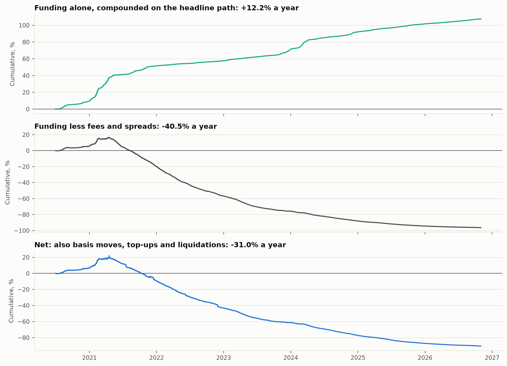
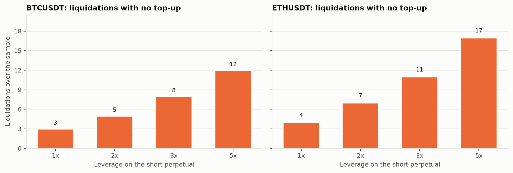
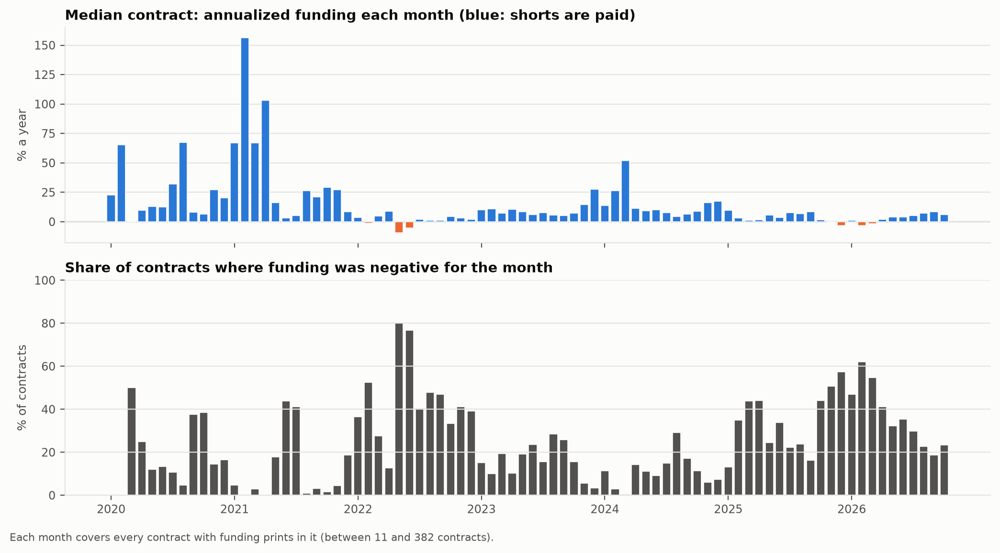
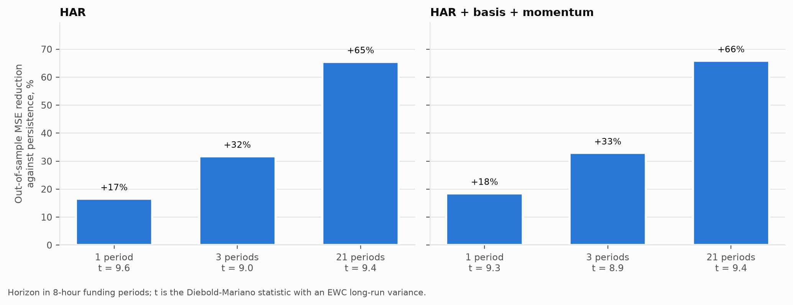
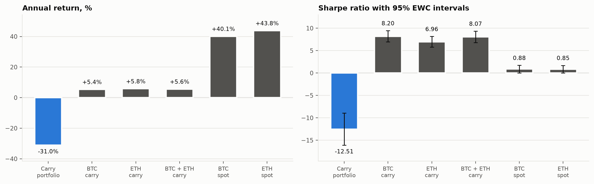
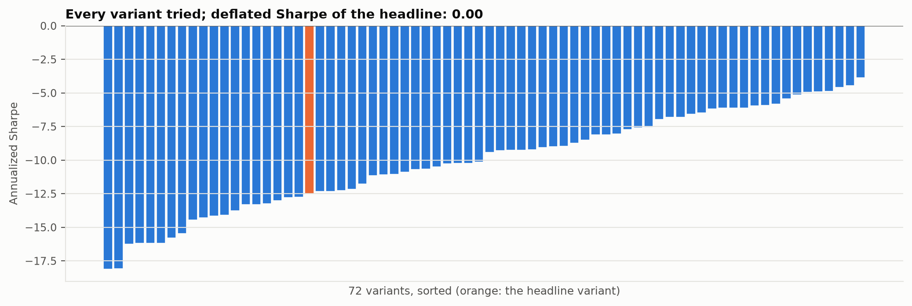
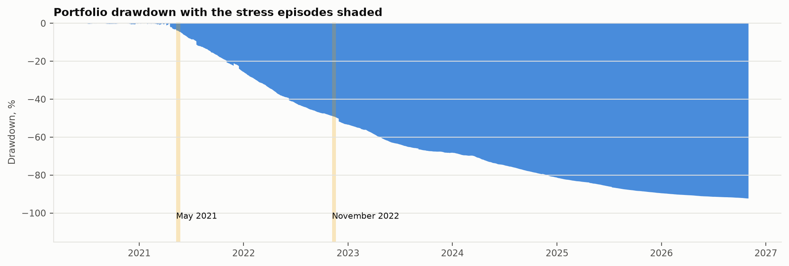
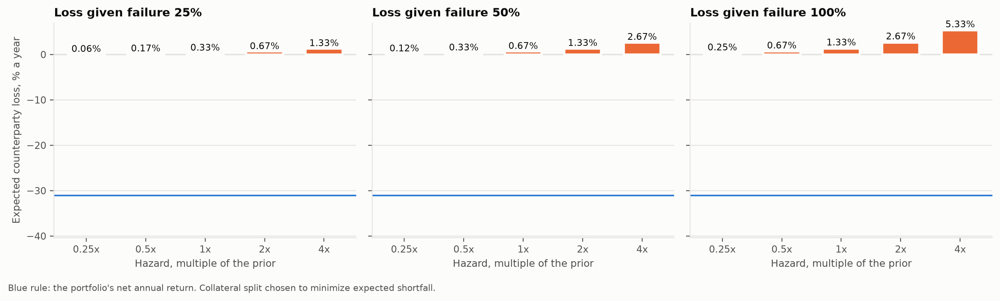

<% set h = r.headline %>
<% set pf = h.portfolio %>
<% set paths = h.paths %>
<% set e = r.estimates %>
<% set rb = e.rebuild %>
<% set fc = e.forecast %>
<% set cp = h.counterparty %>
<% set u = e.universe %>
<% set path_names = {"ideal": "unlimited margin", "topup": "top-ups from the reserve", "liquidate": "no top-ups"} %>
<% set sm = e.spread_model %>
<% set dc = e.portfolio.decomposition %>
<% set abstract %>
<% if r.provenance != "official" %>Synthetic fixture run: the numbers test the pipeline and describe no real market. <% endif %>We measure what the long-spot, short-perpetual funding trade earns on Binance USD-M contracts from << u.first >> to << u.last >>, including << u.delisted >> contract<< "" if u.delisted == 1 else "s" >> later delisted. Funding prints are first rebuilt from the exchange's premium index<% if rb.n_prints %>, and << rb.conventions[rb.best].share_within | pct(1) >> are reproduced within << r.settings.rebuild_tolerance_bp | num(0) >> bp<% endif %>. With isolated margin checked against mark-price highs, a top-<< pf.top_k >> carry portfolio at << pf.leverage | num(0) >>x returns << pf.annual_return | pct(1) >> a year against << h.gross_funding_annual | pct(1) >> from funding alone. Its Sharpe ratio is << pf.sharpe | num >> and its deflated Sharpe ratio << h.deflated_sharpe | num >> across << h.trials >> variants. Expected counterparty loss at the prior hazards is << (cp.expected_loss if cp else 0) | pct(2) >> a year.
<% endset %>
---
title: "What funding carry actually pays"
subtitle: "Fees, margin, liquidation and counterparty risk in perpetual futures carry"
author: "Ian Wachira"
date: "<< r.generated_at[:10] >>"
abstract: << abstract | trim | tojson >>
format:
  typst:
    papersize: a4
    margin:
      x: 2.2cm
      y: 2.4cm
    fontsize: 10pt
    section-numbering: "1.1"
  html:
    toc: true
    embed-resources: true
---

# Question

A perpetual future has no expiry; a funding payment every few hours ties its price to spot. When perpetuals trade rich, shorts are paid, so long spot and short perpetual earn the funding with no net price exposure. The trade is sold as a riskless yield. It is not one. Both legs pay fees and spread. The short leg sits on isolated margin and is liquidated if the price rises far enough between top-ups. The basis moves. Funding changes sign. The collateral is a stablecoin held at an exchange that can fail. This paper puts a number on each of these.

# Data

Binance Vision publishes monthly files for every USD-M contract, including contracts later delisted. The contract list is read from the bucket listing itself: perpetuals are the folders under the monthly funding files, each mapped to its USDT spot pair (contracts quoted per 1,000 units map to the unprefixed spot pair). That gives << u.contracts >> contracts, << u.delisted >> of them delisted, with << u.funding_prints >> funding prints and << r.settings.bar_interval >> bars of mark, perpetual and spot prices. << r.settings.core_bases | join_words >> are also simulated on << r.settings.core_bar_interval >> bars, with daily open interest from the metrics files. Bybit's funding history and OKX's last three months come from their public APIs. OKX prints accumulate in a local store across runs. The bucket listing gives every file's MD5, so unchanged files are skipped and new ones are verified. Every input is hashed in a SHA-256 manifest (digest `<< r.manifest_digest[:12] >>`). Rows a price or size cannot take are dropped before any estimate<% set sc = u.screened %>: << sc.bars + sc.core_bars >> bar<< "" if sc.bars + sc.core_bars == 1 else "s" >> with a zero, negative or missing price, << sc.oi >> open-interest record<< "" if sc.oi == 1 else "s" >> of zero and << sc.stable >> stablecoin bar<< "" if sc.stable == 1 else "s" >>. One such row would otherwise turn a log return or a basis into infinity.

# Method

## Funding from first principles

Binance computes a premium index every 5 seconds and averages it over the funding interval. Weights rise linearly for most contracts; hourly contracts weight samples equally. Funding is the average premium $P$ plus a clamped interest term:

$$
F_{\text{faq}} = \frac{P + \operatorname{clamp}(I_8 - P, -c, c)}{8/N}, \qquad
F_{\text{per interval}} = P + \operatorname{clamp}\!\left(\tfrac{N}{8} I_8 - P, -c, c\right),
$$

with $I_8$ = 0.01% per 8 hours, $c$ = 0.05% and $N$ the interval in hours, held inside the contract's cap and floor. The exchange's FAQ reads as the first form; common implementations use the second. The two agree for 8-hour contracts and differ for 4- and 1-hour ones, so only prints from shorter intervals can decide between them. Each minute's close of the public 1-minute premium index stands in for its twelve 5-second samples.

## The trade, bar by bar

Capital $C$ buys $q$ units of spot and posts $N/L$ of isolated margin on a short of $q$ units, with $N = (1 - \rho) C / (1 + 1/L)$ and a reserve share $\rho$ = << r.settings.reserve_share | pct >>. Funding settles into the isolated wallet at each print. The liquidation price of the short follows Binance's one-way formula, with the isolated wallet balance $W$, entry price $E$ and maintenance rate $m$:

$$
\text{LP} = \frac{W + q E}{q (1 + m)}.
$$

The position is liquidated when a bar's mark-price high reaches LP. The isolated wallet is then lost, as Binance passes the remainder to its insurance fund, and the spot leg is sold. Three margin paths are run. The first has unlimited margin, a frictionless bound. The second tops up from the reserve whenever effective leverage reaches << r.settings.topup_multiple | num(1) >> times the target, and sweeps excess back. The third never tops up and re-enters after each liquidation. Every leg pays the taker fee from the published schedule (spot << r.settings.spot_taker | pct(2) >>, perpetual << r.settings.perp_taker | pct(2) >>, retrieved << r.settings.fees_retrieved >>) plus half the quoted spread, from the cost model below.

## Trading costs

Spreads cannot be read from price bars. On a crypto pair the quoted spread is a few basis points while the price moves several percent in four hours, so a range-based estimator such as Abdi and Ranaldo (2017) measures volatility rather than spread, and sets the cost of an alt round trip near a percent. Quotes are measured instead: `pfc snapshot` records the best bid and ask of every spot and perpetual pair with its 24-hour volume, and each run adds one snapshot. Across << sm.contracts >> contracts in << sm.snapshots >> snapshot<< "" if sm.snapshots == 1 else "s" >> (<< sm.first[:10] >><% if sm.last[:10] != sm.first[:10] %> to << sm.last[:10] >><% endif %>), log half-spread is regressed on the log of the perpetual's 24-hour volume, leg by leg. The slope is << sm.perp.slope | num >> for perpetuals ($R^2$ << sm.perp.r2 | num >>) and << sm.spot.slope | num >> for spot ($R^2$ << sm.spot.r2 | num >>). The fitted law, retransformed with Duan's (1983) smearing factor, gives every past bar a half-spread from its contract's trailing median daily volume. It is held between the << (100 * r.settings.spread_clip_quantiles[0]) | ordinal >> and << (100 * r.settings.spread_clip_quantiles[1]) | ordinal >> percentiles of measured half-spreads: << (1e4 * sm.perp.lower) | num(2) >> to << (1e4 * sm.perp.upper) | num(1) >> bp for perpetuals and << (1e4 * sm.spot.lower) | num(2) >> to << (1e4 * sm.spot.upper) | num(1) >> bp for spot. A new listing with no volume history pays the upper bound. The law assumes today's relation between spread and volume held in the past, so every cost is also scaled by << r.settings.cost_multiples | map("string") | join_words >> and the headline rerun.

## Forecasting funding

Prints are summed into 8-hour windows, so contracts with different intervals share one unit. The target at horizon $h$ is mean funding over the next $h$ windows. Persistence uses the last window. HAR regresses on means over the last << r.settings.har_lags | map('string') | join_words >> windows. HAR+ adds the basis (mark over spot) and spot momentum. Pooled OLS is refit at each month start on rows whose targets have settled. Skill is the out-of-sample reduction in mean squared error against persistence, with a Diebold-Mariano test on the per-window mean loss differential. Its long-run variance is the equal-weighted cosine estimator of Lazarus, Lewis, Stock and Watson (2018).

## The carry portfolio

At each 8-hour funding time, contracts are ranked by forecast funding among those whose trailing median daily volume clears the liquidity filter. The portfolio enters the top $k$ and holds a contract until it falls below rank << r.settings.exit_rank_multiple | num(0) >>$k$. Without this hysteresis it would pay a round trip to chase forecast differences smaller than the cost. Each position is an isolated carry trade sized at equity over $k$ when it opens. A contract whose data stop is closed at its last prices. Every combination of << r.settings.models | length >> models, << r.settings.top_k | length >> values of $k$, << r.settings.volumes | length >> liquidity filters and << r.settings.leverages | length >> leverages is run. The deflated Sharpe ratio of Bailey and Lopez de Prado (2014) charges the headline for all << h.trials >> trials.

## Counterparty and stablecoin risk

Each venue fails within a year with a prior probability. FTX in November 2022 is the reference event. A failure loses a fraction of the capital held there. With independent failures the loss distribution over $2^V$ states is exact. The collateral split minimizing << r.settings.es_level | pct >> expected shortfall is a Rockafellar-Uryasev linear program. Positions follow collateral, so margin needs are met by construction. Equity is marked to USD through << r.settings.stablecoin_pair >>.

# Results

## The rebuild

<% if rb.n_prints %>
Over << rb.n_prints >> prints of << rb.symbols | join_words >> from << rb.first >> to << rb.last >>:

<% for name, c in rb.conventions.items() %>
- '<< name >>': << c.share_within | pct(1) >> within << r.settings.rebuild_tolerance_bp | num(0) >> bp, median error << c.median_abs_error_bp | num(2) >> bp, 95th percentile << c.p95_abs_error_bp | num(2) >> bp.
<% endfor %>

<% if rb.decided %>
The two conventions give different rates on << rb.decisive_prints >> of these prints, all on contracts with intervals shorter than 8 hours. On those prints '<< rb.best >>' reproduces << rb.conventions[rb.best].share_within_decisive | pct(1) >>, so it is the formula Binance uses.
<% else %>
Every print in this window comes from a contract on << rb.intervals | map("string") | join_words >>-hour funding, where the two conventions give the same rate. The window therefore confirms the formula but cannot tell the two readings apart; that needs a rebuild symbol on 4-hour or 1-hour funding inside the window.
<% endif %>

{#fig-rebuild}
<% else %>
No print overlaps the premium window, so the rebuild is not reported.
<% endif %>

## What the trade earns

@fig-headline follows the headline portfolio from what funding alone would have compounded to, through fees and spreads, to the net return after basis moves, top-ups and liquidations. The unlimited-margin path is the frictionless bound. Results by path:

<% for name, v in paths.items() %>
- << path_names[name] | capitalize >><< " (headline)" if name == "topup" >>: << v.annual_return | pct(1) >> a year, Sharpe << v.sharpe | num >>, maximum drawdown << v.max_drawdown | pct(1) >>, << v.liquidations >> liquidation<< "" if v.liquidations == 1 else "s" >>.
<% endfor %>

{#fig-headline}

## Where the return goes

@tbl-decomp splits the headline portfolio's return into what it was paid and what it spent, each as a share of equity per year. It opens << dc.turnover | num(2) >> positions per rebalance, so the average position is held about << dc.holding_days | num(1) >> days. The median modelled half-spread is << e.portfolio.half_spread_bp.spot | num(2) >> bp on spot and << e.portfolio.half_spread_bp.perp | num(2) >> bp on the perpetual.

| Component | % of equity a year |
| --- | --- |
| Funding received | << dc.funding | pct(1) >> |
| Taker fees | << dc.fees | pct(1) >> |
| Spreads | << dc.spread | pct(1) >> |
| Basis, liquidations and margin | << dc.other | pct(1) >> |
| Total | << dc.total | pct(1) >> |

: Return of the headline portfolio by source, top-up path. The total is the arithmetic annual return, so it differs from the compounded figure above. {#tbl-decomp}

| Cost multiple | Annual return | Sharpe |
| --- | --- | --- |
<% for row in e.portfolio.cost_sensitivity %>
| << row.cost_multiple | num(1) >>x | << row.annual_return | pct(1) >> | << row.sharpe | num >> |
<% endfor %>

: The headline portfolio with every fee and spread scaled. {#tbl-costs}

For << r.settings.core_bases | join_words >> alone at << r.settings.headline_leverage | num(0) >>x on << r.settings.core_bar_interval >> bars:

| Contract | Path | Annual return | Sharpe | Liquidations | Top-ups |
| --- | --- | --- | --- | --- | --- |
<% for symbol, block in r.core.items() %>
<% for name, v in block.items() %>
<% if v %>
| << symbol >> | << path_names[name] >> | << v.annual_return | pct(1) >> | << v.sharpe | num >> | << v.liquidations >> | << v.topups >> |
<% endif %>
<% endfor %>
<% endfor %>

{#fig-liq}

## Funding across contracts and venues

<% set cs = e.cross_section %>
<% set vn = r.settings.venue_names %>
Two questions come before any trading rule: how much does a typical contract pay the short, and does the same contract pay the same elsewhere?

**Across contracts.** Over << cs.contract_months >> contract-months, the median contract-month paid << cs.median_annualized | pct(1) >> a year, and << cs.share_contract_months_negative | pct >> of contract-months had negative funding, which the short pays. @fig-cross shows the median contract month by month. The median was negative in << cs.share_months_median_negative | pct >> of the << cs.months >> months. Its best month was << cs.best_month >> at << cs.best_month_median | pct(1) >> a year and its worst << cs.worst_month >> at << cs.worst_month_median | pct(1) >>. Negative funding was most widespread in << cs.most_negative_month >>, when << cs.most_negative_share | pct >> of contracts paid longs.

{#fig-cross}

<% if e.venues %>
**Across venues.** @tbl-venues compares annualized funding for the same contracts on each venue, over the dates every venue in the row covers.
<% set short = [] %><% set deep = [] %><% for v in vn %><% if v in r.settings.full_history_venues %><% set _ = deep.append(vn[v]) %><% else %><% set _ = short.append(vn[v]) %><% endif %><% endfor %>
<% if short %><< short | join_words >> publish<< "es" if short | length == 1 >> only about three months of history, so the rows with every venue are short; the rows with only << deep | join_words >> span the whole sample.<% endif %>

| Contract | From | To | <% for v in vn %><< vn[v] >> | <% endfor %>Correlation |
| --- | --- | --- | <% for v in vn %>--- | <% endfor %>--- |
<% for symbol, block in e.venues.items() %><% for label in ("all", "full_history") %><% if block[label] %><% set b = block[label] %>
| << symbol >> | << b.first >> | << b.last >> | <% for v in vn %><< (b.annualized[v] | pct(1)) if v in b.annualized else "" >> | <% endfor %><< b.correlation | num(3) >> |
<% endif %><% endfor %><% endfor %>

: Annualized funding by venue. A blank cell means the venue is not in that comparison. Correlation is the mean pairwise correlation of 8-hour funding. {#tbl-venues}

<% set gaps = [] %><% for symbol, block in e.venues.items() %><% for label in ("all", "full_history") %><% if block[label] and block[label].widest_gap %><% set _ = gaps.append((block[label].widest_gap.gap, symbol, block[label].widest_gap.venues, block[label].first, block[label].last)) %><% endif %><% endfor %><% endfor %>
<% if gaps %><% set g = gaps | sort(attribute="0") | last %>
The widest gap is << (100 * g[0]) | num(1) >> percentage points a year, between << vn[g[2][0]] >> and << vn[g[2][1]] >> on << g[1] >> from << g[3] >> to << g[4] >>. A gap that size is what moving the short leg to the better-paying venue would add before costs, and it comes with the counterparty exposure priced in @sec-cp.
<% endif %>
<% endif %>

## Forecasts

| Model | Horizon | MSE reduction | DM t | Windows |
| --- | --- | --- | --- | --- |
<% for key, s in fc.skill.items() %>
| << s.model >> | << s.horizon >> | << s.r2_vs_persistence | pct(1) >> | << s.dm_t | num >> | << s.windows >> |
<% endfor %>

<% if fc.core_oi %>
For << r.settings.core_bases | join_words >> over the window the open-interest files cover (first forecast << fc.core_oi.first >>), adding the change in open interest gives: <% for key, s in fc.core_oi.skill.items() %><% if s.model == "har_plus_extra" %>horizon << s.horizon >>: << s.r2_vs_persistence | pct(1) >><< "; " if not loop.last >><% endif %><% endfor %>.
<% endif %>

{#fig-fc}

## The portfolio against << r.settings.core_bases | join_words >>

{#fig-bench}

The headline portfolio's Sharpe ratio is << pf.sharpe | num >> with a 95% EWC interval of ± << (1.96 * pf.sharpe_se) | num >>. Across the << h.trials >> variants, the expected maximum Sharpe under zero skill is << e.portfolio.sr0_annual | num >>, so the deflated Sharpe ratio is << h.deflated_sharpe | num >>. << e.portfolio.share_variants_positive | pct >> of variants have a positive return. Median capacity at << r.settings.participation | pct >> of daily volume is << (e.portfolio.capacity_median_usd or 0) | num(0) >> USD.

{#fig-var}

## Stress episodes

<% set outside = e.episodes | rejectattr("in_sample") | map(attribute="name") | list %>
Each episode runs from its start to its end date inclusive; the portfolio figures use the top-up path.<% if outside %> << outside | join_words >> <% if outside | length == 1 %>falls<% else %>fall<% endif %> outside the sample and <% if outside | length == 1 %>is<% else %>are<% endif %> left out.<% endif %>

<% if e.episodes | selectattr("in_sample") | list %>
| Episode | Dates | Portfolio return | Worst drawdown |
| --- | --- | --- | --- |
<% for ep in e.episodes if ep.in_sample %>
| << ep.name >> | << ep.start >> to << ep.end >> | << ep.portfolio_return | pct(1) >> | << ep.portfolio_drawdown | pct(1) >> |
<% endfor %>

: Portfolio during each stress episode. {#tbl-episodes}

| Episode | Contract | Prints | Negative | Sign flips | Lowest print | Liquidations at << r.settings.headline_leverage | num(0) >>x |
| --- | --- | --- | --- | --- | --- | --- |
<% for ep in e.episodes if ep.in_sample %><% for c in ep.contracts %>
| << ep.name >> | << c.symbol >> | << c.prints >> | << c.negative_share | pct >> | << c.sign_flips >> | << c.min_rate | pct(3) >> | << c.liquidations >> |
<% endfor %><% endfor %>

: Funding prints and no-top-up liquidations of the core contracts in each episode. {#tbl-episode-contracts}
<% endif %>

{#fig-dd}

## Counterparty and stablecoin risk {#sec-cp}

<% if cp %>
At the prior hazards and a << cp.lgd | pct >> loss given failure, the expected-shortfall split is <% for v in r.settings.venue_hazards %><< r.settings.venue_names[v] >> << cp["w_" ~ v] | pct >><< ", " if not loop.last >><% endfor %>. Expected loss is << cp.expected_loss | pct(2) >> a year. The << r.settings.es_level | pct >> expected shortfall is << cp.expected_shortfall | pct(1) >>, against << cp.equal_split_shortfall | pct(1) >> for an equal split and << cp.single_venue_shortfall | pct(1) >> with everything on the safest venue. The chance that some venue fails in the year is << cp.any_failure_probability | pct(1) >><% if cp.any_failure_probability < 1 - r.settings.es_level %>, below the << (1 - r.settings.es_level) | pct >> tail, so the tail also holds years with no failure and the split leans toward concentration<% endif %>. Net carry is << cp.net_annual_return | pct(1) >>.
<% endif %>
USDT traded between << e.stablecoin.min_usd_per_usdt | num(4) >> and << e.stablecoin.max_usd_per_usdt | num(4) >> USD. In USD the portfolio returned << pf.annual_return_usd | pct(1) >> a year.

{#fig-cp}

# Validation

The liquidation formula reproduces both worked examples in Binance's documentation (1,153.26 for ETH and 26,316.89 for BTC). A synthetic market with constant funding and constant prices returns the analytic carry, funding times notional, less the configured costs, to machine precision. The synthetic fixture plants a known structure:

- funding computed with the per-interval convention, which the rebuild recovers
- a delisting, which the portfolio closes when the data stop
- a price spike, which liquidates the no-top-up path
- a USDC depeg, which shows up in the USD equity

# Limitations

Exchange failure, stablecoin depegs and execution at size cannot be read from prices. The first two are priced as scenarios. The third is bounded by the capacity measure. The 1-minute premium index approximates 5-second sampling. Maintenance rates are tier-1 values from the config, because the bracket endpoint needs a signed request. Funding paid within a bar is credited at that bar's closing mark. Spreads come from today's books carried back through volume; the cost multiples in @tbl-costs bound how much that assumption can move the result.

# References

Abdi, F. and Ranaldo, A. (2017). A simple estimation of bid-ask spreads from daily close, high, and low prices. *Review of Financial Studies* 30(12), 4437-4480.

Bailey, D. H. and Lopez de Prado, M. (2014). The deflated Sharpe ratio. *Journal of Portfolio Management* 40(5), 94-107.

Corsi, F. (2009). A simple approximate long-memory model of realized volatility. *Journal of Financial Econometrics* 7(2), 174-196.

Duan, N. (1983). Smearing estimate: a nonparametric retransformation method. *Journal of the American Statistical Association* 78(383), 605-610.

Diebold, F. X. and Mariano, R. S. (1995). Comparing predictive accuracy. *Journal of Business and Economic Statistics* 13(3), 253-263.

Lazarus, E., Lewis, D. J., Stock, J. H. and Watson, M. W. (2018). HAR inference: recommendations for practice. *Journal of Business and Economic Statistics* 36(4), 541-559.

Rockafellar, R. T. and Uryasev, S. (2000). Optimization of conditional value-at-risk. *Journal of Risk* 2(3), 21-41.
