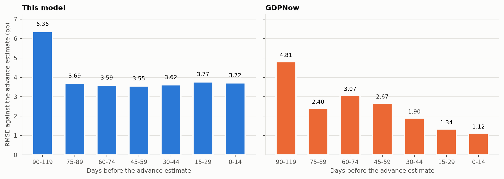
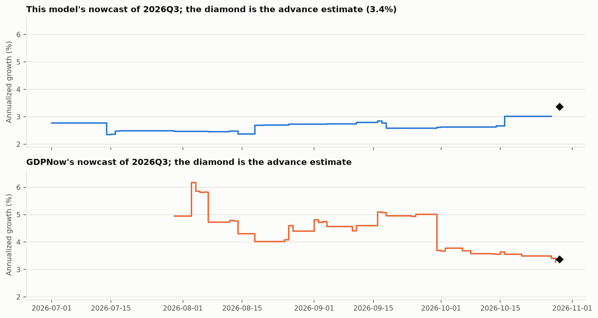
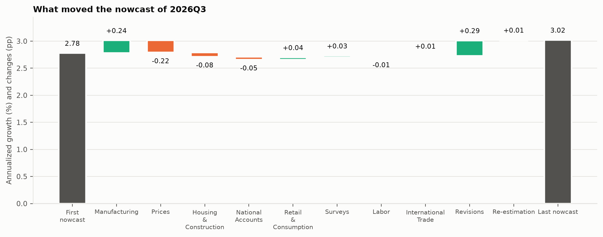
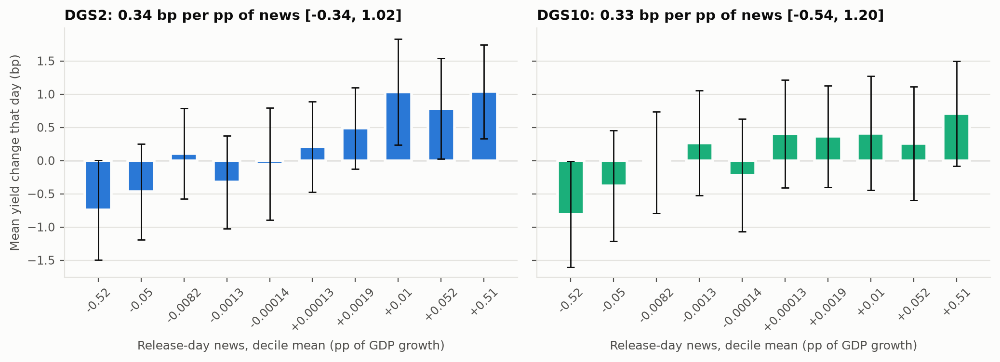
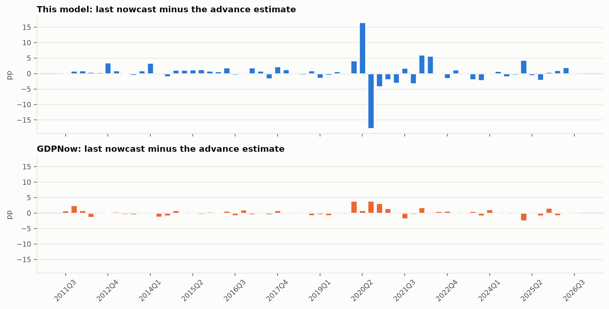

# A real-time GDP nowcast against GDPNow

A dynamic factor model that only sees data as they were published on each day nowcasts US real GDP growth for 61 quarters, 2011Q3 to 2026Q3. On the last day GDPNow published before each advance estimate, its root mean squared error was 3.66 percentage points against 1.15 for the Atlanta Fed's GDPNow: not significantly different from GDPNow's by a Diebold-Mariano test at 5%. Without 2020 the two were 1.84 and 0.84: higher than GDPNow's, and a Diebold-Mariano test finds the gap significant at 5%. On 1794 release days the DGS2 yield moved 0.34 basis points per percentage point of the model's news (95% interval -0.34 to 1.02), not significantly different from zero; without 2020, 1.33 (0.37 to 2.29), significantly positive.



| Days before the advance estimate | Quarters | Model RMSE | GDPNow RMSE | DM p (squared) | Model MAE | GDPNow MAE | DM p (absolute) | RMSE without 2020, model / GDPNow |
| --- | --- | --- | --- | --- | --- | --- | --- | --- |
| 0-14 | 59 | 3.72 | 1.12 | 0.07 | 1.99 | 0.74 | 0.00 | 1.87 / 0.78 |
| 15-29 | 61 | 3.77 | 1.34 | 0.08 | 2.03 | 0.85 | 0.00 | 1.86 / 0.90 |
| 30-44 | 61 | 3.62 | 1.90 | 0.12 | 1.98 | 1.13 | 0.01 | 1.84 / 1.18 |
| 45-59 | 61 | 3.55 | 2.67 | 0.36 | 1.93 | 1.38 | 0.09 | 1.86 / 1.16 |
| 60-74 | 58 | 3.59 | 3.07 | 0.60 | 1.92 | 1.65 | 0.38 | 1.85 / 1.30 |
| 75-89 | 55 | 3.69 | 2.40 | 0.15 | 2.02 | 1.57 | 0.11 | 1.85 / 1.53 |
| 90-119 | 34 | 6.36 | 4.81 | 0.23 | 2.78 | 2.19 | 0.17 | 2.02 / 1.51 |

Each quarter contributes one pair to each row: the day in that window, closest to the release, on which GDPNow published, with the model read on the same day. Errors are against the advance estimate, the first number both models aim at.

## Question, data, method

Most macro forecasting code trains on today's revised data, which carries information nobody had at the time. Here every input is rebuilt as it was published. ALFRED keeps each value of each series with the days during which it was the published one, so the panel on any day holds exactly what a forecaster could have downloaded that morning, with the ragged edge of releases still to come. The build stops if a value published after the panel's day ever reaches it.

The 25 series (23 monthly, 2 quarterly) are not picked here: they are the published specification of the New York Fed staff nowcast (Bok, Caratelli, Giannone, Sbordone and Tambalotti 2018), with its transformations and its four blocks (global, soft, real and labor). The model is the mixed-frequency factor model of Banbura and Modugno (2014): one AR(1) factor per block, AR(1) idiosyncratic parts, quarterly series tied to the monthly factors by the Mariano and Murasawa weights, estimated by EM with the Kalman smoother handling every missing value. The code is a Python port of the New York Fed's MATLAB, and on their example data it reproduces every matrix of their published estimates to within 1e-12. Parameters are re-estimated on the first day of each month on that day's vintage (184 times, median 13 EM iterations, each starting from the previous month's estimates unless a series has entered) and held fixed in between.

Every change in a nowcast gets a named cause. Between two days with the same parameters, the change splits into the effect of revisions to data already out and the news in each release: the release minus what the model expected, times its weight (Banbura and Modugno 2010). With fixed parameters the nowcast is linear in the data, so each weight is computed exactly as the derivative of the nowcast with respect to that datum, and the parts add up to the change to 7e-12 at worst over 2238 days. On re-estimation days the change from the new parameters is recorded as a cause of its own.







The news on a release day is the part of that day's change in the current-quarter nowcast that the releases explain, revisions and re-estimation left out. The regression of the daily yield change on it uses HC3 standard errors; without 2020 the DGS2 slope is 1.3 (95% interval 0.4 to 2.3).

<details>
<summary>More: every quarter's last error, the data checks</summary>



The advance estimates come from ALFRED: the growth of each quarter in the vintage of the day it was first published. They match the Atlanta Fed's own record within 0.05 points in 61 of 61 quarters (largest gap 0.00 in 2014Q2), and the release dates agree in 57; they differ in 2016Q2, 2020Q3, 2024Q3 and 2026Q3.

| Series | Frequency | First vintage | Vintages | Published values |
| --- | --- | --- | --- | --- |
| Payroll Employment (`PAYEMS`) | monthly | 1985-02-01 | 504 | 7229 |
| Job Openings (`JTSJOL`) | monthly | 2010-08-11 | 195 | 2152 |
| Consumer Price Index (`CPIAUCSL`) | monthly | 1985-02-26 | 519 | 2363 |
| Durable Goods Orders (`DGORDER`) | monthly | 1999-08-04 | 673 | 6502 |
| Retail Sales (`RSAFS`) | monthly | 2001-06-13 | 326 | 5566 |
| Unemployment Rate (`UNRATE`) | monthly | 1985-02-01 | 502 | 987 |
| Housing Starts (`HOUST`) | monthly | 1985-02-19 | 496 | 2840 |
| Industrial Production (`INDPRO`) | monthly | 1985-02-15 | 527 | 11313 |
| Personal Income (`DSPIC96`) | monthly | 1985-03-20 | 504 | 7674 |
| Exports (`BOPTEXP`) | monthly | 2010-04-13 | 199 | 2992 |
| Imports (`BOPTIMP`) | monthly | 2010-04-13 | 199 | 3012 |
| Construction Spending (`TTLCONS`) | monthly | 2011-07-01 | 181 | 2053 |
| Import Price Index (`IR`) | monthly | 2010-03-16 | 199 | 869 |
| Core Consumer Price Index (`CPILFESL`) | monthly | 1996-12-12 | 377 | 1925 |
| Core PCE Price Index (`PCEPILFE`) | monthly | 2000-08-01 | 317 | 5578 |
| PCE Price Index (`PCEPI`) | monthly | 2000-08-01 | 317 | 5586 |
| Building Permits (`PERMIT`) | monthly | 1999-08-17 | 625 | 2074 |
| Capacity Utilization Rate (`TCU`) | monthly | 1996-11-15 | 386 | 8356 |
| Business Inventories (`BUSINV`) | monthly | 1996-11-15 | 362 | 12877 |
| Export Price Index (`IQ`) | monthly | 2010-03-16 | 199 | 806 |
| Empire State Mfg Index (`GACDISA066MSFRBNY`) | monthly | 2014-03-17 | 152 | 1593 |
| Real Consumption Spending (`PCEC96`) | monthly | 1985-03-20 | 501 | 5791 |
| Philadelphia Fed Mfg Index (`GACDFSA066MSFRBPHI`) | monthly | 2015-04-16 | 147 | 1965 |
| Real Gross Domestic Product (`GDPC1`) | quarterly | 1991-12-04 | 420 | 2128 |
| Unit Labor Cost (`ULCNFB`) | quarterly | 1985-04-25 | 325 | 4719 |

</details>

## Validation

- On the New York Fed's example vintage, EM reproduces their published estimates (`ResDFM.mat`) to within 1e-12 in every matrix (1e-14 in the loadings, transition and shock variances, 4e-13 in the initial state); the test runs in CI against their files.
- A panel drawn from a factor model with known loadings, with holes punched where real releases leave them, is estimated and the factor recovered.
- Shock scales planted in a simulated pandemic are recovered by the Lenza and Primiceri step.
- The news weights match finite differences of the nowcast, and the decomposition adds up on every day of every run.
- A test builds panels on many days and fails if any value used on day d was published after d.

## Limitations, and the workaround built for each

- **The 2020 quarters swamp any squared-error metric and distort the estimated parameters.** The variances of all state shocks (factors and idiosyncratic parts) are scaled by factors estimated inside EM, free in 2020-03, 2020-04 and 2020-05 and decaying after (Lenza and Primiceri 2022), so the pandemic is down-weighted by the data rather than deleted by hand. Two further changes keep the estimates from breaking: each scale is at least one, the support of Lenza and Primiceri's prior, and the series are standardized on the months before 2020-03: Payroll Employment in 2020-04 was 106 standard deviations of a month before the pandemic, and with the pandemic months in, its standard deviation would be 5.1 times larger; standardized that way, every other month is squeezed toward zero and the fit runs toward a boundary that EM only creeps toward. EM is accelerated by SQUAREM (Varadhan and Roland 2008), which keeps its fixed point; 184 of 184 monthly estimations converged. At the last estimation the scales were 6.47, 53.02, 6.39, decaying at 0.90 a month.
- **ALFRED's record of some series starts years after the series itself.** Taking today's history of such a series back to earlier days would use values nobody had then, so a series enters the model at the first re-estimation after ALFRED holds two years of its values and is treated as unpublished before that. Empire State Mfg Index entered on 2014-04-01; Philadelphia Fed Mfg Index entered on 2015-05-01.- **One metric can be gamed by one quarter.** Squared error, absolute error and the sample without 2020 are produced on every run and all go into results.json and this README.
- **GDPNow is read from the Atlanta Fed's archive, which records the nowcast of each publication day.** The model is read on exactly those days and only from data published by then, so neither side gets an extra day of information.

## Reproduce

ALFRED needs a free FRED API key from [fredaccount.stlouisfed.org](https://fredaccount.stlouisfed.org/apikeys). In Windows PowerShell, one command per line:

```powershell
cd realtime-nowcast
$env:FRED_API_KEY = "<your key>"
uv sync
uv run rtn results
uv run rtn check
uv run rtn check-provenance
```

The key lives only in that PowerShell window. It is added to each request as it is sent and never written to the manifest, a file or an error message. Without network access, `uv run rtn fixture mirror -o configs/ci.yaml` and then `uv run rtn results -o configs/ci.yaml --mirror mirror` run the whole pipeline on synthetic data.

## Layout

| Path | What it holds |
| --- | --- |
| [`configs/research.yaml`](configs/research.yaml) | Every choice with its reason: the published panel, the EM settings, the pandemic months, the evaluation groups |
| [`src/realtime_nowcast/data`](src/realtime_nowcast/data) | ALFRED, FRED and GDPNow sources, the real-time panel, the downloader with its SHA-256 manifest, the fixture |
| [`src/realtime_nowcast/models`](src/realtime_nowcast/models) | Kalman filter and smoother, EM for the mixed-frequency factor model, the news decomposition |
| [`src/realtime_nowcast/evaluation`](src/realtime_nowcast/evaluation) | The real-time run, the comparison with GDPNow, the market test |
| [`reports`](reports) | results.json, figures and tables, all rebuilt by `uv run rtn results` |
| [`paper`](paper) | The paper template and the built PDF |
| [`tests`](tests) | The match with the New York Fed code, recovery, the leak test, file formats, the end-to-end fixture run |

## References

- Banbura, M. and Modugno, M. (2010). Maximum likelihood estimation of factor models on data sets with arbitrary pattern of missing data. ECB Working Paper 1189.
- Banbura, M. and Modugno, M. (2014). Maximum likelihood estimation of factor models on datasets with arbitrary pattern of missing data. *Journal of Applied Econometrics* 29(1), 133-160.
- Bok, B., Caratelli, D., Giannone, D., Sbordone, A. M. and Tambalotti, A. (2018). Macroeconomic nowcasting and forecasting with big data. *Annual Review of Economics* 10, 615-643.
- Diebold, F. X. and Mariano, R. S. (1995). Comparing predictive accuracy. *Journal of Business and Economic Statistics* 13(3), 253-263.
- Doz, C., Giannone, D. and Reichlin, L. (2012). A quasi-maximum likelihood approach for large, approximate dynamic factor models. *Review of Economics and Statistics* 94(4), 1014-1024.
- Harvey, D., Leybourne, S. and Newbold, P. (1997). Testing the equality of prediction mean squared errors. *International Journal of Forecasting* 13(2), 281-291.
- Higgins, P. (2014). GDPNow: a model for GDP "nowcasting". Federal Reserve Bank of Atlanta Working Paper 2014-7.
- Lenza, M. and Primiceri, G. E. (2022). How to estimate a vector autoregression after March 2020. *Journal of Applied Econometrics* 37(4), 688-699.
- Mariano, R. S. and Murasawa, Y. (2003). A new coincident index of business cycles based on monthly and quarterly series. *Journal of Applied Econometrics* 18(4), 427-443.
- Varadhan, R. and Roland, C. (2008). Simple and globally convergent methods for accelerating the convergence of any EM algorithm. *Scandinavian Journal of Statistics* 35(2), 335-353.

Author: Ian Wachira. Built 2026-11-07 05:42 UTC from 28 source files (manifest digest `d4d4f81e47e1`, config `7841a188f96d`). The New York Fed's nowcasting code is BSD-licensed; its example files used in the tests keep their licence in `tests/reference/frbny`.
