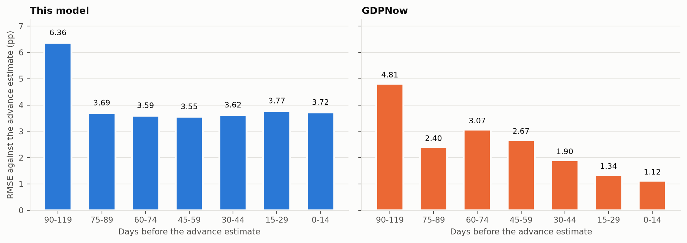
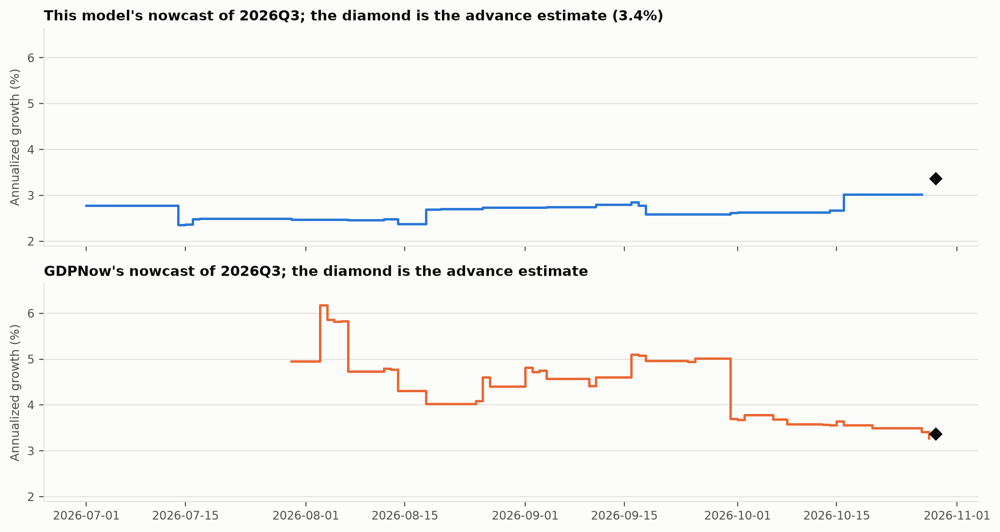
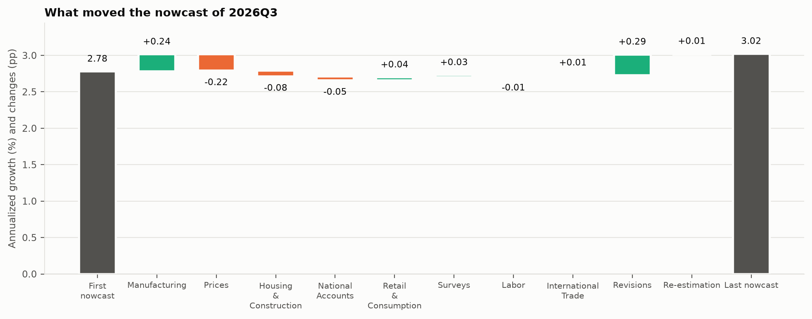
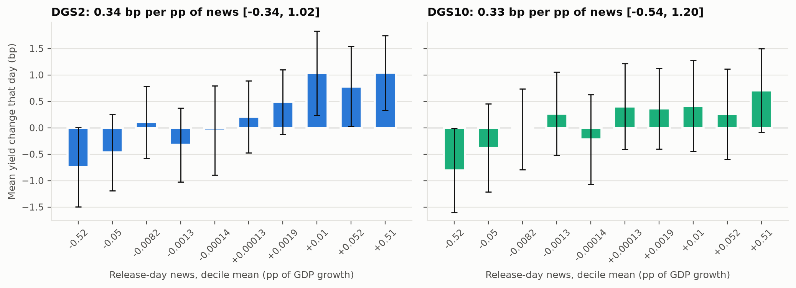
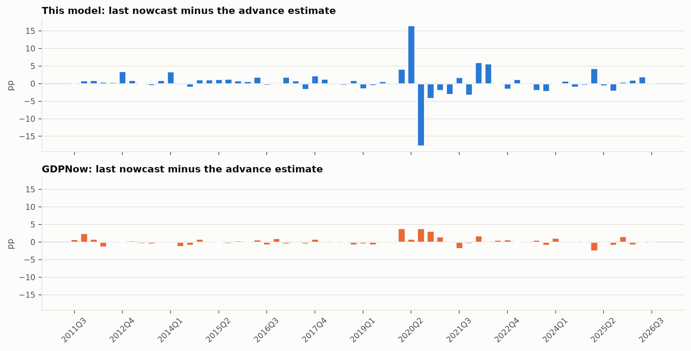










{% set words = {"better": "lower than GDPNow's, and a Diebold-Mariano test finds the gap significant at 5%", "worse": "higher than GDPNow's, and a Diebold-Mariano test finds the gap significant at 5%", "level": "not significantly different from GDPNow's by a Diebold-Mariano test at 5%"} %}
# {{ r.title }}


> **These numbers come from the synthetic fixture, not from published data.** They check that the pipeline runs and recovers a planted truth, and they say nothing about the US economy. Run `uv run rtn results` to build them from the sources.


A dynamic factor model that only sees data as they were published on each day nowcasts US real GDP growth for {{ ev.quarters }} quarters, {{ ev.first_quarter }} to {{ ev.last_quarter }}. On the last day GDPNow published before each advance estimate, its root mean squared error was {{ fin.all.model_rmse | num(2) }} percentage points against {{ fin.all.gdpnow_rmse | num(2) }} for the Atlanta Fed's GDPNow: {{ words[h.final_verdict_squared] }}. Without {{ s.excluded_years | join_words }} the two were {{ fin.ex_excluded.model_rmse | num(2) }} and {{ fin.ex_excluded.gdpnow_rmse | num(2) }}: {{ words[h.final_verdict_ex] }}. On {{ y.all.n }} release days the {{ s.primary_yield }} yield moved {{ y.all.slope | num(2) }} basis points per percentage point of the model's news (95% interval {{ y.all.ci_low | num(2) }} to {{ y.all.ci_high | num(2) }}): markets price the information the model extracts from the releases, the opposite sign to the one the model predicts, not significantly different from zero; without {{ s.excluded_years | join_words }}, {{ y.ex_excluded.slope | num(2) }} ({{ y.ex_excluded.ci_low | num(2) }} to {{ y.ex_excluded.ci_high | num(2) }}), significantly positive, significantly negative, not significantly different from zero.



| Days before the advance estimate | Quarters | Model RMSE | GDPNow RMSE | DM p (squared) | Model MAE | GDPNow MAE | DM p (absolute) | RMSE without {{ s.excluded_years | join_words }}, model / GDPNow |
| --- | --- | --- | --- | --- | --- | --- | --- | --- |

| {{ g.group }} | {{ g.all.n }} | {{ g.all.model_rmse | num(2) }} | {{ g.all.gdpnow_rmse | num(2) }} | {{ g.all.dm_squared_p | num(2) }} | {{ g.all.model_mae | num(2) }} | {{ g.all.gdpnow_mae | num(2) }} | {{ g.all.dm_absolute_p | num(2) }} | {{ g.ex_excluded.model_rmse | num(2) }} / {{ g.ex_excluded.gdpnow_rmse | num(2) }} |


Each quarter contributes one pair to each row: the day in that window, closest to the release, on which GDPNow published, with the model read on the same day. Errors are against the advance estimate, the first number both models aim at.

## Question, data, method

Most macro forecasting code trains on today's revised data, which carries information nobody had at the time. Here every input is rebuilt as it was published. ALFRED keeps each value of each series with the days during which it was the published one, so the panel on any day holds exactly what a forecaster could have downloaded that morning, with the ragged edge of releases still to come. The build stops if a value published after the panel's day ever reaches it.

The {{ s.n_series }} series ({{ s.n_monthly }} monthly, {{ s.n_quarterly }} quarterly) are not picked here: they are the published specification of the New York Fed staff nowcast (Bok, Caratelli, Giannone, Sbordone and Tambalotti 2018), with its transformations and its four blocks ({{ s.blocks | join_words }}). The model is the mixed-frequency factor model of Banbura and Modugno (2014): one AR(1) factor per block, AR(1) idiosyncratic parts, quarterly series tied to the monthly factors by the Mariano and Murasawa weights, estimated by EM with the Kalman smoother handling every missing value. The code is a Python port of the New York Fed's MATLAB, and on their example data it reproduces every matrix of their published estimates to within 1e-12. Parameters are re-estimated on the first day of each month on that day's vintage ({{ m.estimations }} times, median {{ m.median_iterations | num(0) }} EM iterations, each starting from the previous month's estimates unless a series has entered) and held fixed in between.

Every change in a nowcast gets a named cause. Between two days with the same parameters, the change splits into the effect of revisions to data already out and the news in each release: the release minus what the model expected, times its weight (Banbura and Modugno 2010). With fixed parameters the nowcast is linear in the data, so each weight is computed exactly as the derivative of the nowcast with respect to that datum, and the parts add up to the change to {{ "%.0e" | format(e.history.identity_max) }} at worst over {{ e.history.days }} days. On re-estimation days the change from the new parameters is recorded as a cause of its own.







The news on a release day is the part of that day's change in the current-quarter nowcast that the releases explain, revisions and re-estimation left out. The regression of the daily yield change on it uses HC3 standard errors; without {{ s.excluded_years | join_words }} the {{ s.primary_yield }} slope is {{ y.ex_excluded.slope | num(1) }} (95% interval {{ y.ex_excluded.ci_low | num(1) }} to {{ y.ex_excluded.ci_high | num(1) }}).

<details>
<summary>More: every quarter's last error, the data checks</summary>



The advance estimates come from ALFRED: the growth of each quarter in the vintage of the day it was first published. They match the Atlanta Fed's own record within 0.05 points in {{ adv.within_005 }} of {{ adv.quarters }} quarters (largest gap {{ adv.max_abs_diff | num(2) }} in {{ adv.worst_quarter }}), and the release dates agree in {{ adv.release_dates_agree }}; they differ in {{ adv.release_dates_differ | join_words }}.

| Series | Frequency | First vintage | Vintages | Published values |
| --- | --- | --- | --- | --- |

| {{ c.name }} (`{{ c.id }}`) | {{ "monthly" if c.frequency == "m" else "quarterly" }} | {{ c.first_vintage }} | {{ c.vintages }} | {{ c.published }} |


</details>

## Validation

- On the New York Fed's example vintage, EM reproduces their published estimates (`ResDFM.mat`) to within 1e-12 in every matrix (1e-14 in the loadings, transition and shock variances, 4e-13 in the initial state); the test runs in CI against their files.
- A panel drawn from a factor model with known loadings, with holes punched where real releases leave them, is estimated and the factor recovered.
- Shock scales planted in a simulated pandemic are recovered by the Lenza and Primiceri step.
- The news weights match finite differences of the nowcast, and the decomposition adds up on every day of every run.
- A test builds panels on many days and fails if any value used on day d was published after d.

## Limitations, and the workaround built for each

- **The 2020 quarters swamp any squared-error metric and distort the estimated parameters.** The variances of all state shocks (factors and idiosyncratic parts) are scaled by factors estimated inside EM, free in {{ s.pandemic_free | join_words }} and decaying after (Lenza and Primiceri 2022), so the pandemic is down-weighted by the data rather than deleted by hand. Two further changes keep the estimates from breaking: each scale is at least one, the support of Lenza and Primiceri's prior, and the series are standardized on the months before {{ s.pandemic_free[0] }}: {{ m.units.name }} in {{ m.units.largest_month }} was {{ m.units.largest_z | num(0) }} standard deviations of a month before the pandemic, and with the pandemic months in, its standard deviation would be {{ m.units.sd_ratio | num(1) }} times larger; standardized that way, every other month is squeezed toward zero and the fit runs toward a boundary that EM only creeps toward. EM is accelerated by SQUAREM (Varadhan and Roland 2008), which keeps its fixed point; {{ m.converged_count }} of {{ m.estimations }} monthly estimations converged. At the last estimation the scales were {{ m.pandemic_scales | map("round", 2) | join(", ") if m.pandemic_scales else "not yet in the sample" }}, decaying at {{ m.pandemic_rho | num(2) }} a month.
- **ALFRED's record of some series starts years after the series itself.** Taking today's history of such a series back to earlier days would use values nobody had then, so a series enters the model at the first re-estimation after ALFRED holds two years of its values and is treated as unpublished before that. {{ x.name }} entered on {{ x.entered }}{{ "; " if not loop.last else "." }}Every series was in the model from the first estimation.
- **One metric can be gamed by one quarter.** Squared error, absolute error and the sample without {{ s.excluded_years | join_words }} are produced on every run and all go into results.json and this README.
- **GDPNow is read from the Atlanta Fed's archive, which records the nowcast of each publication day.** The model is read on exactly those days and only from data published by then, so neither side gets an extra day of information.

## Reproduce

ALFRED needs a free FRED API key from [fredaccount.stlouisfed.org](https://fredaccount.stlouisfed.org/apikeys). In Windows PowerShell, one command per line:

```powershell
cd realtime-nowcast
$env:FRED_API_KEY = "<your key>"
uv sync
uv run rtn results
uv run rtn check
uv run rtn check-provenance
```

The key lives only in that PowerShell window. It is added to each request as it is sent and never written to the manifest, a file or an error message. Without network access, `uv run rtn fixture mirror -o configs/ci.yaml` and then `uv run rtn results -o configs/ci.yaml --mirror mirror` run the whole pipeline on synthetic data.

## Layout

| Path | What it holds |
| --- | --- |
| [`configs/research.yaml`](configs/research.yaml) | Every choice with its reason: the published panel, the EM settings, the pandemic months, the evaluation groups |
| [`src/realtime_nowcast/data`](src/realtime_nowcast/data) | ALFRED, FRED and GDPNow sources, the real-time panel, the downloader with its SHA-256 manifest, the fixture |
| [`src/realtime_nowcast/models`](src/realtime_nowcast/models) | Kalman filter and smoother, EM for the mixed-frequency factor model, the news decomposition |
| [`src/realtime_nowcast/evaluation`](src/realtime_nowcast/evaluation) | The real-time run, the comparison with GDPNow, the market test |
| [`reports`](reports) | results.json, figures and tables, all rebuilt by `uv run rtn results` |
| [`paper`](paper) | The paper template and the built PDF |
| [`tests`](tests) | The match with the New York Fed code, recovery, the leak test, file formats, the end-to-end fixture run |

## References

- Banbura, M. and Modugno, M. (2010). Maximum likelihood estimation of factor models on data sets with arbitrary pattern of missing data. ECB Working Paper 1189.
- Banbura, M. and Modugno, M. (2014). Maximum likelihood estimation of factor models on datasets with arbitrary pattern of missing data. *Journal of Applied Econometrics* 29(1), 133-160.
- Bok, B., Caratelli, D., Giannone, D., Sbordone, A. M. and Tambalotti, A. (2018). Macroeconomic nowcasting and forecasting with big data. *Annual Review of Economics* 10, 615-643.
- Diebold, F. X. and Mariano, R. S. (1995). Comparing predictive accuracy. *Journal of Business and Economic Statistics* 13(3), 253-263.
- Doz, C., Giannone, D. and Reichlin, L. (2012). A quasi-maximum likelihood approach for large, approximate dynamic factor models. *Review of Economics and Statistics* 94(4), 1014-1024.
- Harvey, D., Leybourne, S. and Newbold, P. (1997). Testing the equality of prediction mean squared errors. *International Journal of Forecasting* 13(2), 281-291.
- Higgins, P. (2014). GDPNow: a model for GDP "nowcasting". Federal Reserve Bank of Atlanta Working Paper 2014-7.
- Lenza, M. and Primiceri, G. E. (2022). How to estimate a vector autoregression after March 2020. *Journal of Applied Econometrics* 37(4), 688-699.
- Mariano, R. S. and Murasawa, Y. (2003). A new coincident index of business cycles based on monthly and quarterly series. *Journal of Applied Econometrics* 18(4), 427-443.
- Varadhan, R. and Roland, C. (2008). Simple and globally convergent methods for accelerating the convergence of any EM algorithm. *Scandinavian Journal of Statistics* 35(2), 335-353.

Author: {{ r.author }}. Built {{ r.generated_at }} from {{ r.manifest_files }} source files (manifest digest `{{ r.manifest_digest[:12] }}`, config `{{ r.config_fingerprint }}`). The New York Fed's nowcasting code is BSD-licensed; its example files used in the tests keep their licence in `tests/reference/frbny`.
