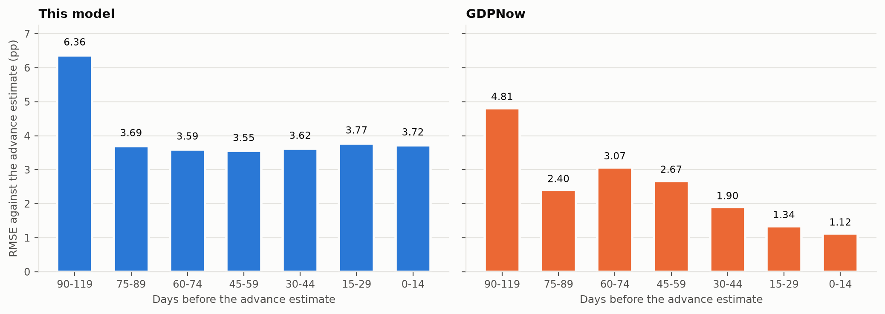
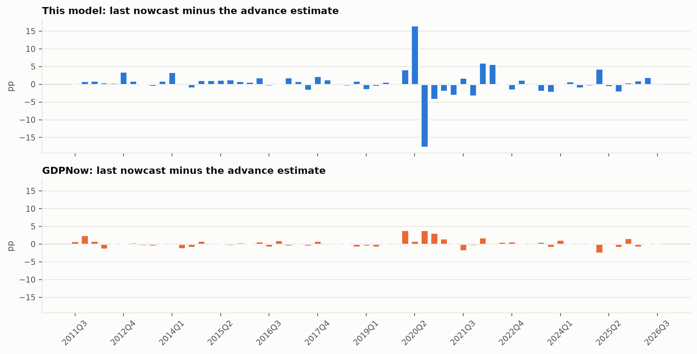
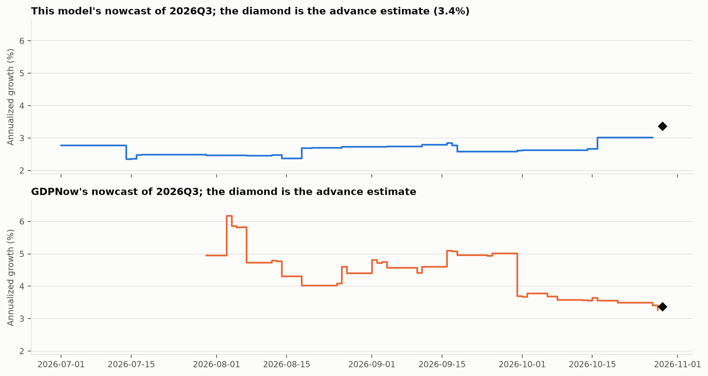
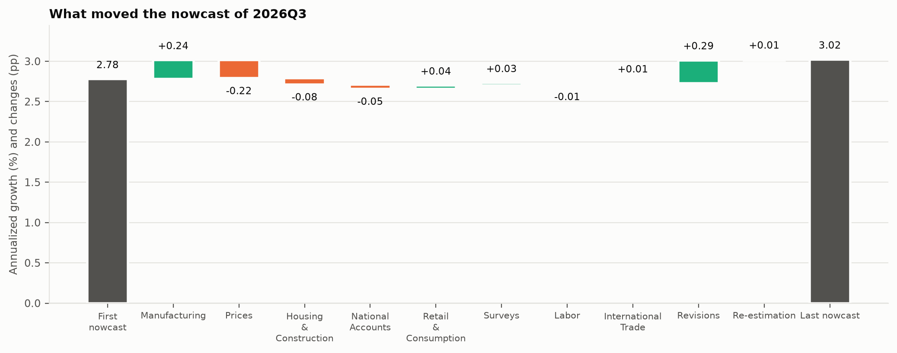
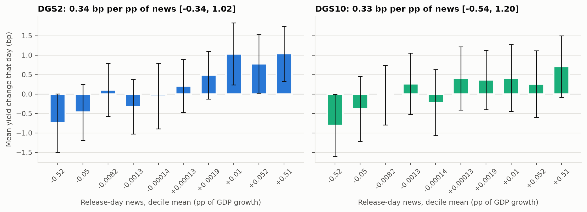

<% set e = r.estimates %>
<% set s = r.settings %>
<% set h = r.headline %>
<% set ev = e.evaluation %>
<% set fin = ev.final %>
<% set m = e.model %>
<% set mk = e.market %>
<% set y = mk[s.primary_yield] %>
<% set adv = e.data.advance_check %>
<% set words = {"better": "significantly lower than GDPNow's", "worse": "significantly higher than GDPNow's", "level": "not significantly different from GDPNow's"} %>
<% set abstract %>
<% if r.provenance != "official" %>Synthetic fixture run: the numbers test the pipeline and describe no real economy. <% endif %>A mixed-frequency dynamic factor model on the New York Fed staff nowcast's << s.n_series >> series is run through << ev.quarters >> quarters (<< ev.first_quarter >> to << ev.last_quarter >>) using only data as published on each day. On the last GDPNow publication day before each advance estimate its RMSE is << fin.all.model_rmse | num(2) >> percentage points against << fin.all.gdpnow_rmse | num(2) >> for GDPNow, << words[h.final_verdict_squared] >> by a Diebold-Mariano test at 5%; without << s.excluded_years | join_words >> they are << fin.ex_excluded.model_rmse | num(2) >> and << fin.ex_excluded.gdpnow_rmse | num(2) >>, << words[h.final_verdict_ex] >>. Every change in the nowcast is split exactly into revisions, the news in each release and re-estimation. On release days the << s.primary_yield >> yield moves << y.all.slope | num(2) >> basis points per percentage point of the model's news (t = << y.all.t | num(2) >>), and << y.ex_excluded.slope | num(2) >> without << s.excluded_years | join_words >> (t = << y.ex_excluded.t | num(2) >>).
<% endset %>
---
title: "<< r.title >>"
subtitle: "A mixed-frequency factor model run on data as published each day, and what its news does to Treasury yields"
author: "<< r.author >>"
date: "<< r.generated_at[:10] >>"
abstract: << abstract | trim | tojson >>
format:
  typst:
    papersize: a4
    margin:
      x: 2.2cm
      y: 2.4cm
    fontsize: 10pt
    section-numbering: "1.1"
  html:
    toc: true
    embed-resources: true
---

# Question

Can a dynamic factor model built only on data as they existed on each day match the Atlanta Fed's GDPNow, and do the model's surprises move Treasury yields on release days? Most macro forecasting code trains on today's revised data, which leaks information nobody had at the time. Here every input is rebuilt as it was published, and the score is kept against a public central-bank benchmark on the days that benchmark published.

# Data

ALFRED, the St. Louis Fed's archive of vintages, gives each value of each series with the days during which it was the published one. For day $d$ the panel holds, for every series and period, the value whose interval contains $d$; a value whose interval starts after $d$ cannot enter, and the build checks this on every panel it makes. The << s.n_series >> series are the published specification of the New York Fed staff nowcast (Bok et al. 2018): << s.n_monthly >> monthly and << s.n_quarterly >> quarterly, with that specification's transformations (level, change, percent change, annualized quarterly growth) and its blocks (<< s.blocks | join_words >>). Data start in << s.observation_start[:4] >>.

GDPNow nowcasts come from the Atlanta Fed's workbook, which archives every published nowcast of completed quarters from 2011:Q3. The advance estimate of each quarter is taken from ALFRED: the growth of real GDP in the vintage of the day it was first published. It matches the Atlanta Fed's own record within 0.05 points in << adv.within_005 >> of << adv.quarters >> quarters. Daily 2- and 10-year Treasury yields come from FRED.

# Method

## The model

Each monthly series $i$, standardized, is the sum of common factors and an idiosyncratic part,
$$
x_{i,t} = \Lambda_i f_t + e_{i,t}, \qquad e_{i,t} = \alpha_i e_{i,t-1} + \varepsilon_{i,t},
$$
with one AR(1) factor per block, $f_{b,t} = a_b f_{b,t-1} + u_{b,t}$, and every series loading on the global block and, where the specification assigns one, on its own block. A quarterly growth rate observed in the third month of a quarter is tied to the monthly factors by the Mariano and Murasawa (2003) approximation,
$$
y^{Q}_{t} = \Lambda^{Q} \left( f_t + 2 f_{t-1} + 3 f_{t-2} + 2 f_{t-3} + f_{t-4} \right) + e^{Q}_t ,
$$
imposed as linear restrictions on the loadings of the factor's lags. The state holds five lags of each factor, the monthly idiosyncratic parts and five lags of each quarterly one: << m.states >> states in all. Measurement error has variance << s.measurement_variance >> (Doz, Giannone and Reichlin 2012).

## Estimation

EM with the Kalman smoother (Banbura and Modugno 2014) handles every missing value, so the ragged edge needs no filling. Starting values come from principal components on a gap-filled panel. The implementation is a port of the New York Fed's MATLAB code, and on their example vintage it reproduces their published estimates to within 1e-12 in every matrix (1e-14 in the loadings, transition matrix and shock variances; 4e-13 in the initial state). EM stops when the log likelihood changes by less than << s.threshold >> in relative terms. Each run is accelerated by SQUAREM (Varadhan and Roland 2008): two EM steps are extrapolated along their own direction, and the extrapolated point is kept only when its likelihood is no lower, so the fixed point and the monotone path of EM are unchanged (plain EM is what is checked against the reference). << m.converged_count >> of << m.estimations >> estimations converged, the slowest in << m.max_iterations >> EM steps. Parameters are re-estimated on the first day of each month on that day's vintage, << m.estimations >> times, each starting from the previous month's estimates unless a series has entered, when EM starts again from principal components (median << m.median_iterations | num(0) >> iterations; the first estimation took << m.first_iterations >>), and held fixed in between. A block whose factor would rest on fewer than two monthly series is left out of that estimation.

Following Lenza and Primiceri (2022), the variance of every shock in the state equation is scaled by $s_t^2$, with $s_t$ free in << s.pandemic_free | join_words >> and $s_t = 1 + (s_{\text{last}} - 1)\rho^{t - \text{last}}$ after. Given the smoothed moments, the expected log likelihood in the scales is $\sum_t [-k \log s_t - d_t / (2 s_t^2)]$, with $k$ the number of shocks and $d_t$ the expected sum of squared standardized shocks; it is maximized over the free scales and $\rho$ as one more conditional step of EM, and the transition parameters are updated with each period weighted by $1/s_t^2$. Every scale is at least one, the support of their Pareto prior: a free month that is mostly unpublished (May 2020 on the first of June) otherwise has its scale driven to zero, where the likelihood has no maximum. Series are standardized with the means and standard deviations of the months before << s.pandemic_free[0] >>, not of the whole vintage as in the reference code<% if m.units %>: on the last vintage, << m.units.name >> in << m.units.largest_month >> was << m.units.largest_z | num(0) >> standard deviations of a month before the pandemic, and with the pandemic months in, its standard deviation would be << m.units.sd_ratio | num(1) >> times larger. Left in, those months set the units, squeeze every other month toward zero, and drive the idiosyncratic variances of the series they hit toward zero, where EM never settles<% endif %>. At the last estimation the scales were <% if m.pandemic_scales %><< m.pandemic_scales | map("round", 2) | join(", ") >> with $\rho$ = << m.pandemic_rho | num(2) >><% else %>not yet in the sample<% endif %>.

## News

Between two days with the same parameters, the change in the nowcast $\hat y$ of a quarter splits as
$$
\hat y_{\text{new}} - \hat y_{\text{old}} = \left(\hat y_{\text{rev}} - \hat y_{\text{old}}\right) + \sum_j w_j \left( x_j - \mathbb{E}\left[ x_j \mid \Omega_{\text{rev}} \right] \right),
$$
where $\Omega_{\text{rev}}$ is the new vintage with the new releases removed (Banbura and Modugno 2010). With the parameters and the pattern of missing data fixed, the smoothed nowcast is linear in the data, so $w_j$ is the exact derivative of $\hat y_{\text{new}}$ with respect to $x_j$, propagated through the stored Kalman and smoother gains. The identity is checked on every day of the run; the largest gap over << e.history.days >> days was << "%.0e" | format(e.history.identity_max) >>. On re-estimation days the effect of the new parameters is recorded separately.

## Evaluation

Every quarter is tracked from its first day to the day before its advance estimate. Each GDPNow publication is paired with the model's nowcast as of the same day. Pairs are grouped by days before the release (<% for lo in s.horizon_edges[:-1] %><< lo >>-<< s.horizon_edges[loop.index] - 1 >><< ", " if not loop.last >><% endfor %>); within a group each quarter contributes the pair closest to the release, so quarters are the independent observations of a Diebold and Mariano (1995) test with the Harvey, Leybourne and Newbold (1997) correction. Squared and absolute errors, on all quarters and without << s.excluded_years | join_words >>, are reported side by side.

For the market test, the news on a release day is the part of the day's change in the current-quarter nowcast that the releases explain. The daily change in each yield, in basis points, is regressed on it with HC3 standard errors.

# Results

## Accuracy

| Days to release | Quarters | Model RMSE | GDPNow RMSE | DM | p | Model MAE | GDPNow MAE | p (absolute) |
| --- | --- | --- | --- | --- | --- | --- | --- | --- |
<% for g in ev.groups %>
| << g.group >> | << g.all.n >> | << g.all.model_rmse | num(2) >> | << g.all.gdpnow_rmse | num(2) >> | << g.all.dm_squared | num(2) >> | << g.all.dm_squared_p | num(2) >> | << g.all.model_mae | num(2) >> | << g.all.gdpnow_mae | num(2) >> | << g.all.dm_absolute_p | num(2) >> |
<% endfor %>

: Errors against the advance estimate, percentage points of annualized growth. Negative DM statistics favour the model. {#tbl-accuracy}

On the last GDPNow day before each release the model's RMSE is << fin.all.model_rmse | num(2) >> and GDPNow's << fin.all.gdpnow_rmse | num(2) >> (@tbl-accuracy, @fig-rmse); without << s.excluded_years | join_words >> they are << fin.ex_excluded.model_rmse | num(2) >> and << fin.ex_excluded.gdpnow_rmse | num(2) >> (DM p = << fin.ex_excluded.dm_squared_p | num(2) >>). The model has the lower RMSE in << h.groups_model_lower | length >> of << h.groups_total >> horizon groups.

{#fig-rmse}

{#fig-errors}

## One quarter

@fig-path follows << e.example_quarter >> from its first day to the advance estimate of << e.example_advance | num(2) >>% on << e.example_release >>, and @fig-waterfall splits the model's path into the news of each release category, revisions and re-estimation.

{#fig-path}

{#fig-waterfall}

## Yields

| Yield | Days | Slope (bp per pp) | 95% interval | t | R² | Slope without << s.excluded_years | join_words >> |
| --- | --- | --- | --- | --- | --- | --- |
<% for name, t in mk.items() %>
| << name >> | << t.all.n >> | << t.all.slope | num(2) >> | << t.all.ci_low | num(2) >> to << t.all.ci_high | num(2) >> | << t.all.t | num(2) >> | << t.all.r2 | num(3) >> | << t.ex_excluded.slope | num(2) >> |
<% endfor %>

: Daily yield changes on release days regressed on the model's release news. {#tbl-yields}

{#fig-yields}

# Validation

- On the New York Fed's example vintage, EM reproduces their published estimates to within 1e-12 in every matrix; the comparison runs in CI against their files.
- A panel drawn from a factor model with known loadings, with holes where real releases leave them, is estimated and the factor recovered.
- Shock scales planted in a simulated pandemic are recovered by the Lenza and Primiceri step.
- News weights match finite differences of the nowcast, and the decomposition adds up on every day of every run.
- A test builds panels on many days and fails if any value used on day $d$ was published after $d$.
- The synthetic fixture writes ALFRED pages, the GDPNow workbook and FRED yields in their exact formats, with a planted yield response to release surprises that the end-to-end test recovers.

# Limitations

ALFRED's record of some series starts years after the series itself. Rather than carry today's history of such a series back to days when nobody had it, a series enters the model at the first re-estimation after ALFRED holds two years of its values<% if m.entered_later %> (<% for x in m.entered_later %><< x.name >> on << x.entered >><< "; " if not loop.last >><% endfor %>)<% endif %>, so the early nowcasts rest on fewer series than the New York Fed's list. The panel is the New York Fed's published list, not a search over series, and its parameters are re-estimated monthly rather than daily. The advance estimate is the target; later revisions of GDP would rank the models differently. GDPNow is read only on its publication days, so its nowcast between publications is not observed. The yield test measures association on release days: a significant slope says markets and the model react to the same surprises, not that the model moves markets.

# References

Banbura, M. and Modugno, M. (2010). Maximum likelihood estimation of factor models on data sets with arbitrary pattern of missing data. ECB Working Paper 1189.

Banbura, M. and Modugno, M. (2014). Maximum likelihood estimation of factor models on datasets with arbitrary pattern of missing data. *Journal of Applied Econometrics* 29(1), 133-160.

Bok, B., Caratelli, D., Giannone, D., Sbordone, A. M. and Tambalotti, A. (2018). Macroeconomic nowcasting and forecasting with big data. *Annual Review of Economics* 10, 615-643.

Diebold, F. X. and Mariano, R. S. (1995). Comparing predictive accuracy. *Journal of Business and Economic Statistics* 13(3), 253-263.

Doz, C., Giannone, D. and Reichlin, L. (2012). A quasi-maximum likelihood approach for large, approximate dynamic factor models. *Review of Economics and Statistics* 94(4), 1014-1024.

Harvey, D., Leybourne, S. and Newbold, P. (1997). Testing the equality of prediction mean squared errors. *International Journal of Forecasting* 13(2), 281-291.

Higgins, P. (2014). GDPNow: a model for GDP "nowcasting". Federal Reserve Bank of Atlanta Working Paper 2014-7.

Lenza, M. and Primiceri, G. E. (2022). How to estimate a vector autoregression after March 2020. *Journal of Applied Econometrics* 37(4), 688-699.

Mariano, R. S. and Murasawa, Y. (2003). A new coincident index of business cycles based on monthly and quarterly series. *Journal of Applied Econometrics* 18(4), 427-443.

Varadhan, R. and Roland, C. (2008). Simple and globally convergent methods for accelerating the convergence of any EM algorithm. *Scandinavian Journal of Statistics* 35(2), 335-353.
